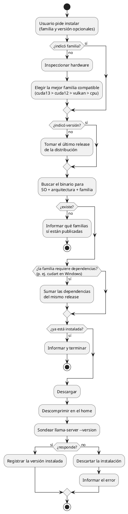
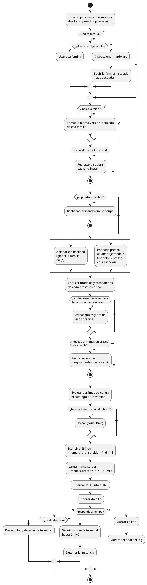
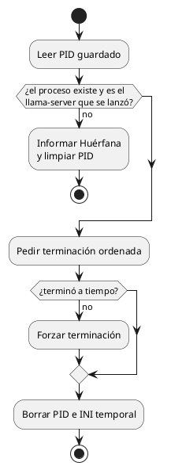
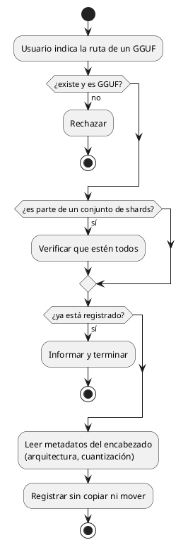
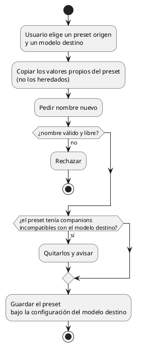

# Diagramas de actividades

## Instalar una versión de backend

## Iniciar una instancia

**Dónde vive el INI generado.** En el home de Coquena, no en la carpeta temporal del
sistema operativo: un limpiador podría borrarlo mientras `llama-server` sigue corriendo, y
Coquena no queda en ejecución para regenerarlo. Cada lanzamiento usa su propio archivo
(p. ej. `run/<servidor>/<id>.ini`) para que dos instancias no se pisen, y se borra al
detener la instancia.

## Detener una instancia

## Registrar un modelo externo

## Clonar un preset

