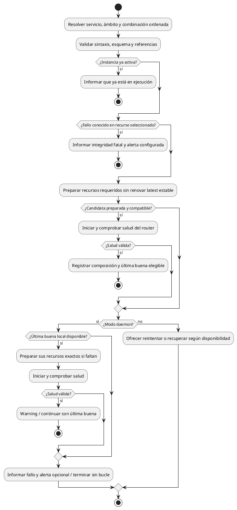
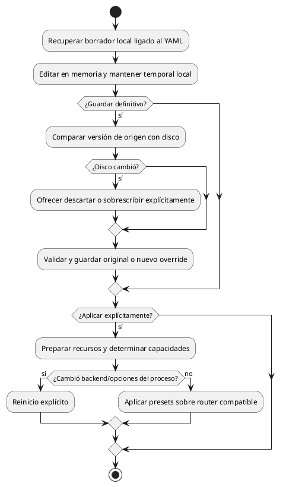

# Actividades complementarias

## Selección e instalación de backend

Seleccionar origen, versión y variante explícitos; resolver artefactos;
preparar/verificar sin sustituir recursos en uso. Diagnosticar incompatibilidad
sin cambiar la receta ni crear un bloqueo de integridad.

## Registrar un backend externo

Conservar rutas y propiedad ajenas. Identificar capacidades sin exigir parámetros
del oficial a todo ejecutable. Registrar no mueve ni adopta archivos.

## Iniciar una instancia

Integridad fatal no se elude por recuperación. Si hay proceso activo, verify
no lo detiene. El flujo de reinicio prepara antes de detenerlo.
No cargar cada modelo como condición para aceptar salud del router.

## Detener y consultar instancias

Service stop solicita cierre y conserva definición/recursos. Down retira sólo los presets del consumidor sin detener el servicio. Ps consulta identidad de
proceso y API y termina. Watch/TUI/Web observan mientras permanecen abiertos;
cerrarlos no detiene el backend. Reconectar observadores no reinicia servidores.

## Clonar un preset

Copiar valores/vínculos, dar identidad/nombre independientes, validar resultado.
No copiar archivos ni conservar herencia viva respecto del original.

## Referenciar un companion desde la configuración

Bind selecciona recurso por identidad y argumento destino.
Comprobar referencia y reglas del schema si existe; no certificar compatibilidad
de inferencia por el nombre del companion.

## Guardar y aplicar desde una interfaz

La aplicación experimental puede preceder al guardado. Por defecto no se convierte
en última buena de recuperación; esa elegibilidad requiere opción del proyecto.
Guardar un override lo selecciona para acciones siguientes, sin aplicarlo por sí solo.
