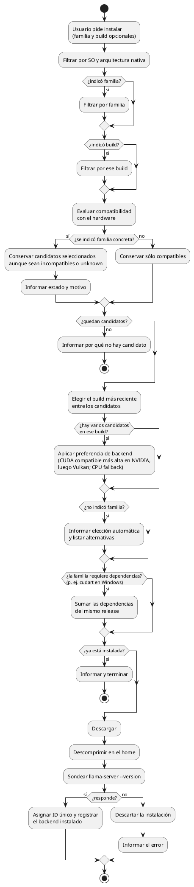
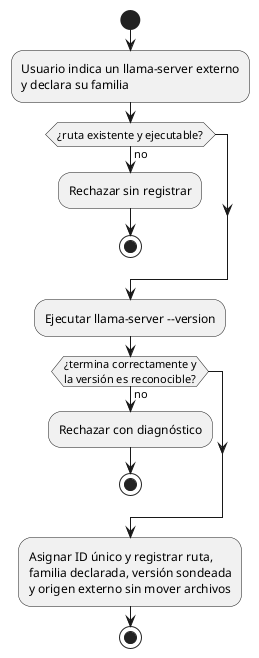
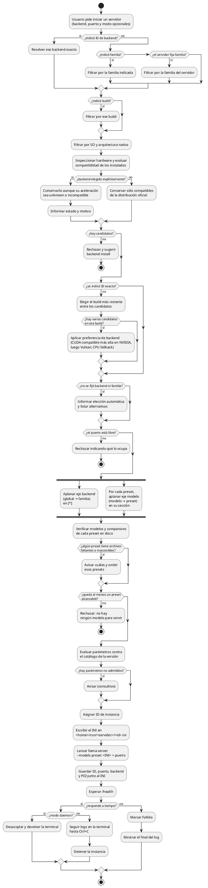
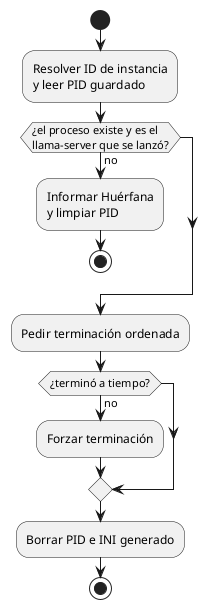
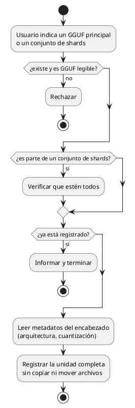
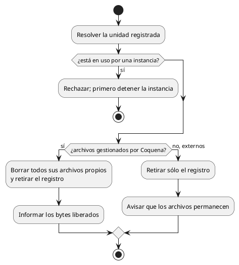
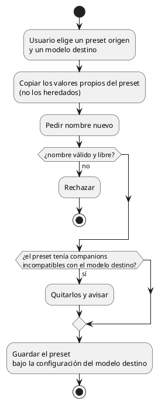
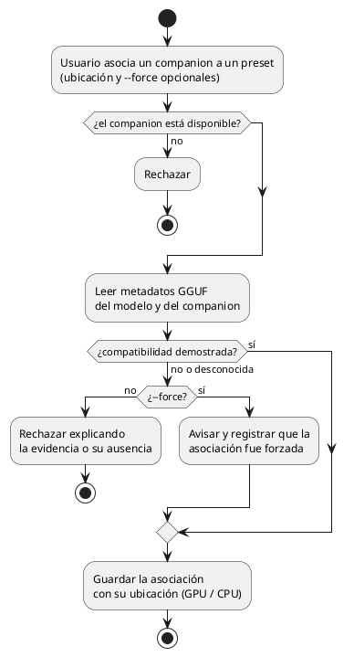

# Diagramas de actividades

## Instalar una versión de backend

**Sólo se descarga para instalar y usar.** Un binario de otro SO o arquitectura se
rechaza incluso si el usuario lo selecciona explícitamente. La elección explícita
permite continuar ante aceleración `unknown` o `incompatible` en la plataforma
correcta, pero la instalación aún exige que `llama-server --version` funcione
localmente. Coquena no ofrece descargas sin instalación.

## Registrar un backend externo

El sondeo valida el ejecutable, no demuestra compatibilidad con una GPU, no verifica
la familia declarada ni hace una prueba de inferencia. Coquena no infiere la familia
del nombre de la carpeta. Al retirarlo sólo se borra su registro.

## Iniciar una instancia

**Dónde vive el INI generado.** En el home de Coquena, no en la carpeta temporal del
sistema operativo: un limpiador podría borrarlo mientras `llama-server` sigue corriendo, y
Coquena no queda en ejecución para regenerarlo. Cada lanzamiento usa su propio archivo
(p. ej. `run/<servidor>/<id>.ini`) para que dos instancias no se pisen, y se borra al
detener la instancia.

## Detener una instancia

## Registrar un modelo externo

## Retirar un modelo o backend

La eliminación de un conjunto de shards no debe dejar una parte registrada como modelo
completo. Si otro registro comparte alguno de sus archivos, la regla de propiedad se
resolverá antes de implementar la eliminación gestionada.

## Clonar un preset

## Asociar un companion a un preset

Forzar permite **experimentar** con un companion de otra cuantización o de un
modelo derivado, sin declararlo compatible. La decisión y el diagnóstico quedan
visibles en el preset. La disponibilidad del archivo se comprueba aparte; `--force`
no convierte un archivo faltante en servible. Un mismo companion puede ser usado por
varios presets y su ubicación CPU/GPU se elige por asociación.
