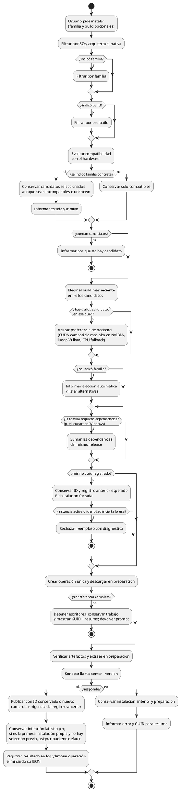
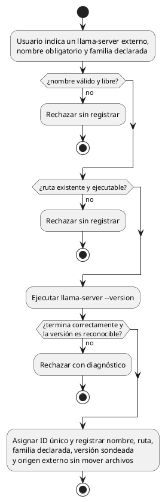
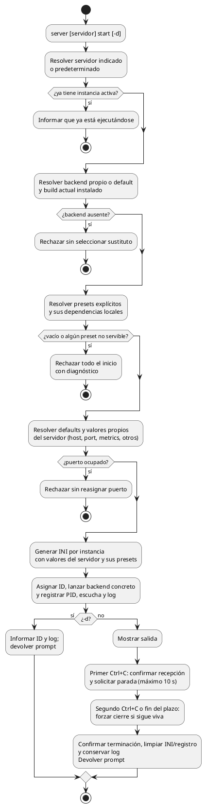
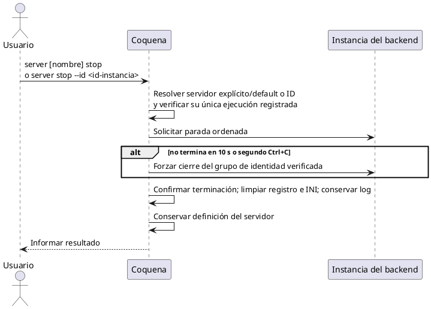
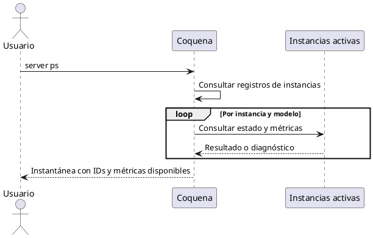
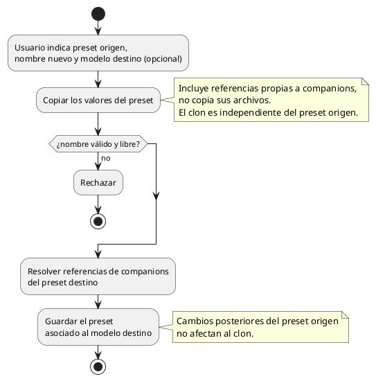
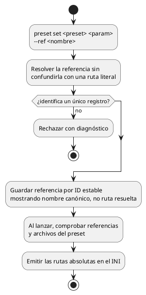

# Actividades complementarias

Los flujos de modelos y descargas se describen en [secuencias.md](secuencias.md).
Aquí sólo se conservan actividades complementarias; los pendientes de ejecución están en servidores.md.

## Selección e instalación de backend

**Sólo se descarga para instalar y usar.** Un binario de otro SO o arquitectura se
rechaza incluso si el usuario lo selecciona explícitamente. La elección explícita
permite continuar ante aceleración `unknown` o `incompatible` en la plataforma
correcta, pero la instalación aún exige que `llama-server --version` funcione
localmente. Coquena no ofrece descargas sin instalación.

## Registrar un backend externo

El sondeo valida el ejecutable, no demuestra compatibilidad con una GPU, no verifica
la familia declarada ni hace una prueba de inferencia. Coquena no infiere la familia
del nombre de la carpeta. Al retirarlo sólo se borra su registro.

## Iniciar una instancia

Reglas en [servidores.md](servidores.md); no se descargan actualizaciones al iniciar.

El INI generado vive en el home de Coquena, no en temporales del sistema.
Cada instancia tiene el suyo; se elimina al detenerla. Los tiempos de salud,
verificación del proceso requieren evidencia técnica. La política de terminación y las reglas funcionales
de recuperación están acordadas en servidores.md.

## Detener y consultar instancias

## Clonar un preset

## Referenciar un companion desde la configuración

Registrar mediante `model companion add` no configura ni activa una funcionalidad.
CPU/GPU y los ajustes de inferencia se expresan con parámetros normales del backend.
La compatibilidad funcional se delega al backend al cargar la combinación; no hay
validación ni modo forzado en Coquena para ella. Coquena conserva sus comprobaciones de
referencias y disponibilidad, sin garantizar funcionamiento. `--ref` distingue una
referencia por nombre canónico de un valor literal; no se infiere por el contenido del texto.
