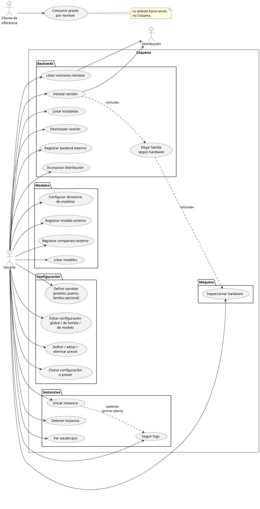

# Casos de uso

## Actores

- **Usuario:** una sola persona, en su propia PC. Opera Coquena por línea de comandos.
- **Cliente de inferencia** (secundario): OpenCode, Pi Code u otro harness. No habla con
  Coquena: consume el endpoint de `llama-server` y elige preset por nombre.
- **Distribución** (secundario): origen de releases de binarios; la oficial es
  `ggml-org/llama.cpp` en GitHub.

## Diagrama

## Notas por caso

**Instalar versión.** Por defecto Coquena detecta el hardware y propone la mejor familia
(p. ej. `cuda13` si el driver NVIDIA lo soporta, si no `cuda12`, si no `vulkan`, si no
`cpu`). El usuario siempre puede ser explícito y pedir otra, incluida `cpu` en una máquina
con GPU. En Windows, la familia CUDA requiere además el paquete `cudart` del mismo
release (arqueología de `legacy-go`, `internal/runtime/llamacpp/catalog.go`).

**Incorporar distribución.** Además de `ggml-org`, un desarrollador o laboratorio puede
publicar sus propios binarios compatibles; Coquena los gestiona como SDKMan gestiona el JDK
de Oracle junto a otros.

**Registrar backend externo.** El usuario puede incorporar un binario que compiló o
instaló por su cuenta. Coquena registra su ubicación para usarlo, pero no lo mueve ni
lo borra al retirarlo. En cambio, al desinstalar un backend descargado por Coquena se
borran sus archivos y se informan los bytes liberados. La sintaxis del comando de
registro todavía no está fijada.

**Varias familias a la vez.** En una máquina con GPU NVIDIA y AMD pueden correr dos
instancias simultáneas: una con `cuda13` y otra con `vulkan`, en puertos distintos.

**Registrar modelo externo.** Coquena guarda la ruta del GGUF sin copiarlo ni moverlo. El
directorio de modelos es sólo el destino de lo que Coquena descarga (iteración posterior).
Un modelo puede comprender varios shards; registrarlo y retirarlo se hace como unidad.
Retirar uno externo deja sus archivos intactos; retirar uno gestionado borra todos sus
archivos propios e informa el espacio liberado.

**Clonar configuración o preset.** Reutiliza un ajuste fino en otro modelo o familia.

**Iniciar instancia.** Sin backend explícito, Coquena elige la familia instalada más
adecuada al hardware y su última versión. Arranca aunque falten archivos de algún preset
(avisa y lo omite) mientras quede al menos uno alcanzable. Coquena genera el INI en ese
momento, dentro de su home. Como
`docker run`: en primer plano queda adjunto mostrando logs; en modo daemon se desacopla y
Coquena guarda el PID para gestionarla después.
