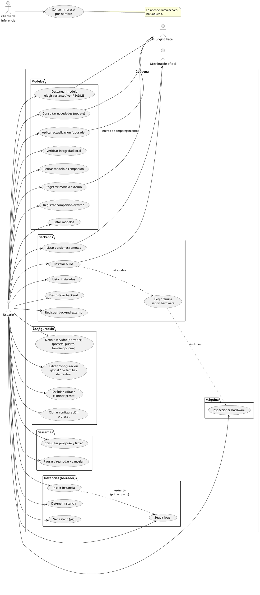

# Casos de uso

## Actores

- **Usuario:** una sola persona, en su propia PC. Opera Coquena por línea de comandos.
- **Cliente de inferencia** (secundario): OpenCode, Pi Code u otro harness. No habla con
  Coquena: consume el endpoint de `llama-server` y elige preset por nombre.
- **Distribución** (secundario): origen de releases de binarios; la oficial es
  `ggml-org/llama.cpp` en GitHub.

## Diagrama

## Lectura del mapa

- Backends: selección, compatibilidad y comandos en [comandos.md](comandos.md#convenciones).
- Modelos: registro, emparejamiento, actualización e integridad en
  [modelos-y-companions.md](modelos-y-companions.md).
- Descargas: progreso, control y recuperación en [descargas.md](descargas.md).
- Configuración y presets: herencia y referencias en [modelo-de-datos.md](modelo-de-datos.md#dos-ejes-de-herencia).
- Servidores e instancias: borradores; todavía no autorizan implementación.
- Elegir ubicaciones distintas para configuración y archivos pesados se difiere; no es
  un caso de uso del catálogo de modelos.

El cliente de inferencia consume llama-server, no una API de Coquena.
La verificación local no usa red; sólo los casos remotos se relacionan con Hugging Face.
