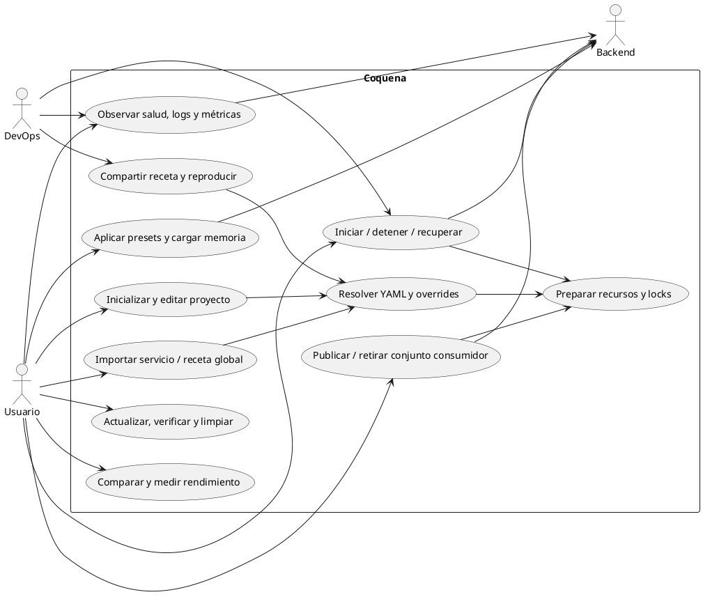

# Casos de uso

## Actores

- Usuario local o remoto por SSH: define, prueba y opera su proyecto.
- DevOps: reproduce una receta en hardware compatible, configura logs y alertas.
- Frontend CLI/TUI/Web: invoca operaciones comunes y observa APIs/procesos.
- Backend: sirve peticiones y ofrece las capacidades de su build.

## Diagrama

## Lectura del mapa

Editar, preparar y aplicar son efectos distintos. La interacción visual puede
crear borradores y experimentar antes de guardar, manteniendo explícita la
composición activa. Un router compatible puede recibir presets sin reinicio;
cambiar el backend requiere otro proceso.

La observación no inicia modelos ni deja un supervisor. El benchmarking tiene
su propio ciclo explícito y no debe interrumpir una instancia productiva sin
una operación acordada. Detalles en [interfaces](interfaces-visuales.md),
[observabilidad](observabilidad.md) y [benchmarking](benchmarking.md).
