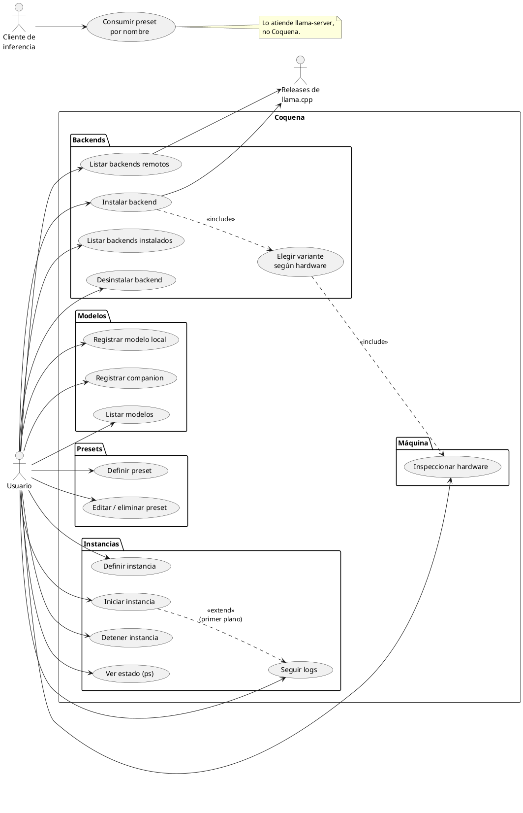

# Casos de uso

## Actores

- **Usuario:** una sola persona, en su propia PC. Opera Coquena por línea de comandos.
- **Cliente de inferencia** (secundario): OpenCode, Pi Code u otro harness. No habla con
  Coquena: consume el endpoint de `llama-server` y elige preset por nombre.
- **Repositorio de releases de llama.cpp** (secundario): GitHub, de donde salen los
  binarios.

## Diagrama

## Notas por caso

**Instalar backend.** Por defecto Coquena detecta el hardware y propone la mejor variante
(p. ej. `cuda@13` si el driver NVIDIA lo soporta, si no `cuda@12`, si no `vulkan`, si no
`cpu`). El usuario siempre puede ser explícito y pedir otra, incluida `cpu` en una máquina
con GPU. En Windows, la variante CUDA requiere además el paquete `cudart` del mismo
release (hallazgo de `legacy-go`, `internal/runtime/llamacpp/catalog.go`).

**Varios backends a la vez.** En una máquina con GPU NVIDIA y AMD pueden correr dos
instancias simultáneas: una con backend CUDA y otra con Vulkan/HIP, en puertos distintos.

**Iniciar instancia.** Como `docker run`: en primer plano queda adjunto mostrando logs;
con modo daemon se desacopla y Coquena guarda el PID para gestionarla después.
