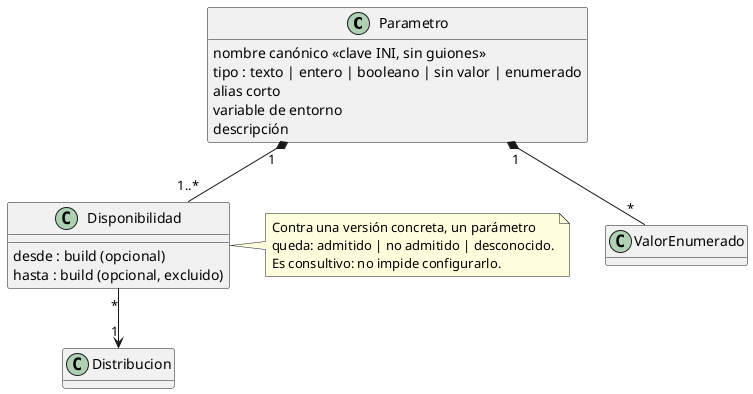
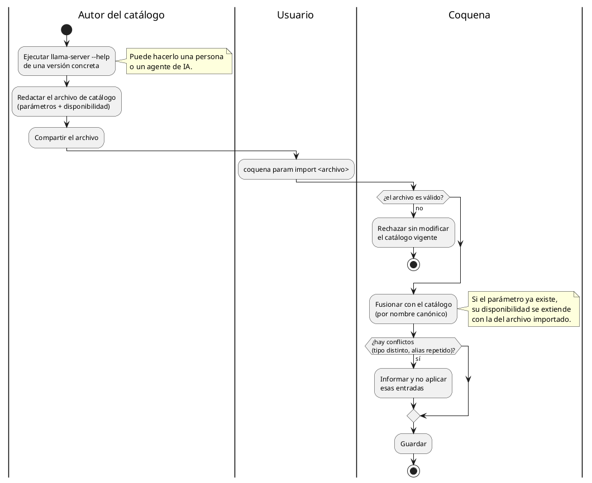

# Catálogo de parámetros de llama.cpp

Coquena conoce los parámetros (flags) de `llama-server` para validar lo que el usuario
configura y para saber en qué versión se puede usar cada uno.

## Los parámetros dependen de la versión, no de la familia

Un build para CPU y uno para CUDA del mismo release aceptan **los mismos argumentos**. Por
eso se puede, en un mismo lanzamiento, poner el modelo en GPU y el proyector multimodal en
CPU. Lo que cambia los parámetros es:

- **la versión:** un flag aparece en cierto build y puede desaparecer en otro;
- **la distribución:** un laboratorio que publica su propio llama.cpp puede sumar flags
  nuevos para sus funciones.

## Aclaraciones

- **Un solo nombre de identidad:** el nombre largo canónico, que es también la clave del
  INI. Los alias (`-c`, `LLAMA_ARG_CTX_SIZE`) se reconocen pero no son entradas aparte.
- **Consultivo:** un valor no admitido por la versión elegida se avisa al configurar y al
  lanzar; no se bloquea.
- **Consecuencia sobre la configuración de familia:** si los flags no varían por familia,
  la configuración por familia sirve para *valores* propios del hardware (dispositivo,
  capas en GPU), no para habilitar flags distintos.

## Arqueología (`legacy-go`)

`openspec/specs/llamacpp-field-catalog-persistence`: catálogo persistido en un documento
propio, nombre canónico + tipo inmutable, alias corto y de entorno, disponibilidad por
proveedor con rango `[desde, hasta)` de builds `b<dígitos>`, evaluación
`admitted | not-admitted | unknown`, y protección de parámetros referenciados por presets.

## Origen del catálogo

El catálogo **no se extrae automáticamente**: no hay heurística confiable ni forma de leer
el código de `llama-server`. Se distribuye a mano, como archivos que se comparten e
importan.

