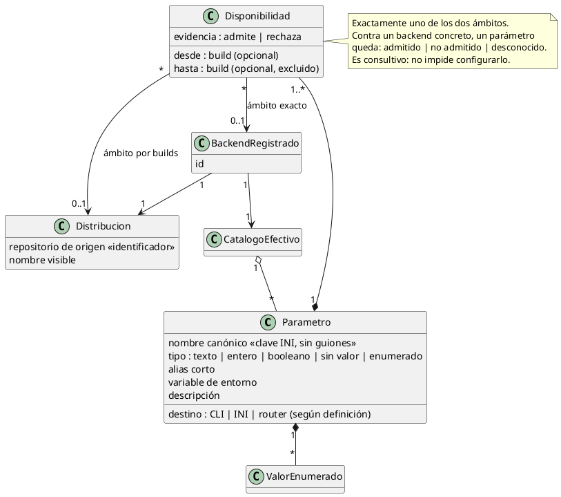
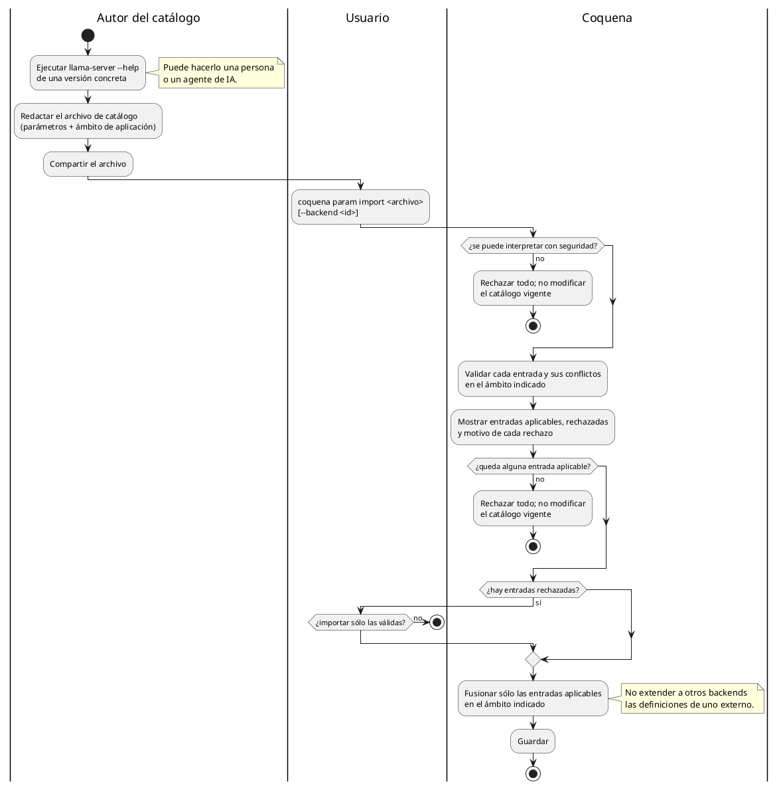

# Catálogo de parámetros de llama.cpp

Coquena registra los parámetros (flags) de `llama-server` para orientar la configuración.
Cada backend registrado tiene un catálogo efectivo asociado: el conocimiento oficial que
le corresponda y, si el usuario lo aporta, definiciones específicas de ese binario.

La asociación reutilizable es **origen de la distribución + release + parámetro**.
El origen omitido equivale a `oficial` (`https://github.com/ggml-org/llama.cpp`);
para un tercero se declara su repositorio de origen. Una etiqueta amigable no sustituye
ese identificador. Un mismo número de release en repositorios distintos no identifica
la misma disponibilidad.

## Disponibilidad por distribución y build

La familia de aceleración (CPU, CUDA, Vulkan) no identifica por sí sola el conjunto de
flags. Para los artefactos oficiales de un mismo release se espera un conjunto común,
pero Coquena no lo presume para compilados modificados. La disponibilidad puede
describirse por distribución y rango de builds o para un backend registrado concreto.
Depende de:

- **el build de llama.cpp:** un flag aparece en cierto build y puede desaparecer en otro;
- **la distribución:** un laboratorio puede añadir flags a su propio compilado de
  llama.cpp. La versión informada por `--version` no demuestra que los admita.



## Aclaraciones

- **Identidad del parámetro dentro de un catálogo:** el nombre largo canónico es la clave
  del INI. Los alias (`-c`, `LLAMA_ARG_CTX_SIZE`) se reconocen, pero no son entradas aparte.
  Un parámetro propio de un backend externo no pasa a ser automáticamente válido para
  otros backends, ni siquiera para el oficial.
- **Vinculación explícita:** al importar definiciones específicas para un backend externo,
  se declara el origen y el release al que corresponden. Al registrar el binario externo,
  el usuario declara ese mismo origen; `--version` no verifica su procedencia. Así se puede
  configurar, por ejemplo, un flag de decodificación especulativa sólo para el binario
  experimental que lo implementa. Si un release oficial lo adopta después, se declara
  por separado su disponibilidad oficial.
- **Compartir catálogos:** la exportación conserva origen y releases de aplicación;
  no depende del ID local del backend para asociarlos en otra instalación. La vinculación
  a un backend concreto sigue disponible para excepciones y requiere seleccionar el
  backend local al importar. Declarar un repositorio no autoriza descargas desde él ni
  lo convierte en una fuente de confianza.
- **Estados consultivos:** `admitido` significa que el catálogo asociado afirma que ese
  backend acepta el parámetro; `no admitido` requiere evidencia negativa explícita;
  `desconocido` significa que falta evidencia aplicable. La ausencia de una entrada no
  prueba que el backend la rechace. Los estados se informan al configurar y al lanzar,
  sin bloquear la elección explícita del usuario.
- **Precedencia:** una definición específica del backend prevalece sobre la de su
  distribución para ese backend. Coquena muestra el conflicto y la definición efectiva;
  no modifica el catálogo de la distribución ni el de otros backends. Los conflictos
  entre entradas del mismo ámbito se diagnostican durante la importación.
- **Configuración de familia:** sirve para *valores* propios del hardware (dispositivo,
  capas en GPU), no para inferir la disponibilidad de un flag.

## Consulta del catálogo local

`param list` y `param show <parámetro>` admiten dos selectores excluyentes:

- `--backend <id>` consulta el catálogo efectivo del binario registrado: su origen,
  versión y las excepciones específicas de ese backend.
- `--version <release> [--distribution <origen>]` consulta las definiciones de esa
  distribución y release, sin excepciones de un backend local. Omitir origen significa
  oficial. Declarar origen requiere versión en esta consulta.

No mezclar `--backend` con versión/distribución. Estas consultas leen los catálogos
locales; no acceden al repositorio ni descargan binarios. Sin selector no se afirma
disponibilidad para un backend concreto. Los releases externos no se fuerzan a bNNNN.

```text
coquena param list --backend <id-backend>
coquena param show ctx-size --backend <id-backend>
coquena param list --version b1002
coquena param show <parametro> --distribution <repositorio-origen> --version <release>
```

## Aplicación en Router Mode

El INI generado es la vía principal para configurar los modelos: `[*]` contiene valores
comunes y cada sección de preset sus valores específicos. Las claves corresponden a
argumentos sin los guiones iniciales; Coquena emite el nombre canónico.

No todo pertenece a esas secciones: el router controla opciones como host, puerto y
autenticación, que pueden eliminarse o sobrescribirse al cargar un modelo. También hay
opciones exclusivas del INI, como `load-on-startup` y `stop-timeout`, que no son flags CLI.
El catálogo debe distinguir estos casos según el origen y release.

La documentación actual establece la precedencia **CLI > sección del preset > `[*]`**.
Coquena debe evitar duplicar en CLI los valores que desea hacer configurables por preset.
Estas reglas se verifican para cada release soportado, no se deducen de `master` para
versiones anteriores o distribuciones modificadas.

Referencia: [Model presets de llama-server](https://github.com/ggml-org/llama.cpp/blob/master/tools/server/README.md#model-presets).

## Origen del catálogo

El catálogo **no se extrae automáticamente**: no hay heurística confiable para inferir
desde un ejecutable todos sus parámetros y rangos de disponibilidad. Se redacta a partir
de evidencia, por ejemplo `llama-server --help` de un build concreto, y se comparte e
importa como archivo.



Un archivo interpretable puede contener entradas inválidas (por ejemplo, tipo distinto
para un parámetro existente o alias duplicado dentro del mismo ámbito). La importación
parcial **nunca es silenciosa**: requiere la decisión explícita del usuario tras ver el
diagnóstico. Si no puede interpretarse con seguridad o no queda ninguna entrada
aplicable, se rechaza entero.
