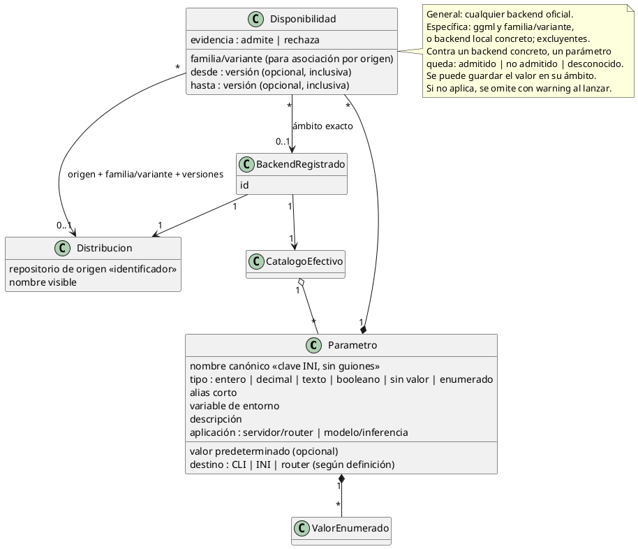
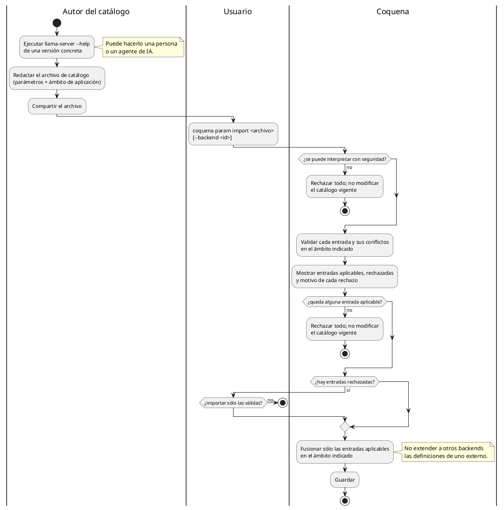

# Catálogo de parámetros de llama.cpp

Coquena registra los parámetros (flags) de `llama-server` para orientar la configuración.
El catálogo corresponde a la distribución oficial ggml-org/llama.cpp, sus builds
bNNNN y familias CPU, CUDA y Vulkan. Las asociaciones generales
cubren sólo backends oficiales, incluidas las excepciones por ID de instalación.

Cada backend oficial registrado tiene un catálogo efectivo asociado: el conocimiento oficial que
le corresponda y, si el usuario lo aporta, definiciones específicas de ese binario.

La asociación reutilizable es **origen de la distribución + release + parámetro**.
El origen omitido equivale a `ggml`, con alias `oficial` (`https://github.com/ggml-org/llama.cpp`).

## Gestión de parámetros personalizados

`param` crea, consulta, edita y elimina definiciones del catálogo. Coquena incluye
un catálogo inicial de parámetros oficiales; el usuario puede registrar nuevos parámetros
oficiales.

`param define` crea y `param edit` modifica: crear un nombre existente o editar uno
inexistente se rechaza sin cambios. La edición conserva los metadatos que no se
modifiquen explícitamente. La [CLI](comandos.md#param) distingue ambas operaciones.
Si el nombre o sus alias ya tienen asignaciones desconocidas, define comprueba su
compatibilidad con la nueva definición; las incompatibles o duplicadas se deben
corregir antes del alta, sin retirarlas implícitamente.

Las definiciones básicas suministradas por Coquena se pueden editar y eliminar con
las mismas reglas de impacto y confirmación que las creadas por el usuario. `host`,
`port` y `metrics` son la excepción: sus definiciones se protegen y mantienen. Esta
protección no impide ajustar sus valores en cada servidor.

El [restablecimiento de fábrica](#restablecimiento-de-fábrica) se realiza mediante
`config param-reset`, como operación de configuración del manager.

Una definición permite especificar y editar:

- Nombre canónico, descripción y alias.
- Tipo: entero, decimal, texto, booleano, sin valor o enumerado.
- Valores permitidos para un tipo enumerado y valor predeterminado compatible con el tipo.
- Ámbito de asignación (modelo o servidor) y destino de emisión (CLI o INI).
- Binarios/backends a los que corresponde y su aplicabilidad; las vinculaciones se
  pueden añadir, editar y retirar sin duplicar la definición.
- Versiones de soporte: límite inferior, límite superior, ambos o ninguno. Omitir el
  inferior deja abierto el rango hacia versiones anteriores; omitir el superior, hacia
  versiones futuras. Ambos límites son inclusivos: desde `b1000` hasta `b1200` significa
  `version >= b1000` y `version <= b1200`. Usar la misma versión en ambos extremos
  expresa soporte para esa versión exacta. Los límites se interpretan en el esquema
  de versiones del binario.

Cada definición admite varias asociaciones de soporte, identificadas por origen y
familia/variante del binario, cada una con su propio rango de versiones. `oficial` y
`ggml` identifican el mismo origen oficial. Una asociación a `ggml/vulkan` no declara
soporte para `ggml/cuda`. Los selectores siguen
la [identificación de backends](servidores.md#identificación-de-backends); también se
conserva la asociación a un backend oficial registrado concreto para excepciones locales.

Las asociaciones por origen y familia/variante se pueden definir aunque el binario
no esté instalado. Son reutilizables al importar o exportar el catálogo y no requieren
un ID de backend de la instalación de origen. Una asociación a un backend local concreto
exige que su ID esté registrado al crear o editar esa asociación; una referencia que
quede ausente posteriormente se diagnostica, sin reasignarla a otro backend por nombre.

Una asociación general, sin origen ni familia/variante, declara soporte para cualquier
backend oficial. Puede tener límites de build; se comparan numéricamente como bNNNN.
Límites de otro formato se rechazan. Sin límites, la asociación
general no restringe versiones. No crea valores compartidos entre presets o servidores.
`support remove` sin selector elimina únicamente esa asociación general, conservando
las asociaciones por origen/familia y las excepciones de backends locales.

Cuando coinciden asociaciones, prevalece la del backend local concreto, después la
de origen/familia y finalmente la general. Se evalúa el rango de la asociación más
específica existente para ese backend. Si la versión queda fuera, el parámetro se omite
con warning; no se recurre a una asociación menos específica que admita esa versión.
Dentro de CUDA, la variante con toolkit (por ejemplo cuda@13) prevalece sobre la
asociación de familia cuda. Las excepciones por ID siguen teniendo mayor precedencia.
El catálogo inicial conserva evidencia para b11482; fuera de ese build la disponibilidad
es desconocida. Declarar un rango mediante support set expresa soporte explícito y
permite diagnosticar sus versiones exteriores como no admitidas.

La familia/variante participa en la identificación del binario, no constituye un
ámbito compartido de valores. El soporte se declara por asociación; no se infiere
de que dos binarios usen la misma aceleración.

Cambiar una asociación o su rango no cambia el backend de un servidor ni
elimina valores de presets. La composición usa el backend efectivo y su versión:
si una definición personalizada declara que el parámetro no aplica a esa ejecución,
se omite con warning y se conserva su valor guardado. No se deduce aplicabilidad de CPU,
CUDA o Vulkan. Las referencias en uso se diagnostican al editar o eliminar una definición.

## Comparación de versiones

El catálogo oficial usa builds `bNNNN`: comparación numérica del número de build,
no alfabética. Los límites de una asociación deben tener ese formato. Un rango cuyo
límite inferior supera al superior se rechaza sin modificar el catálogo. Ambos
extremos son inclusivos; límites iguales expresan un build exacto y omitir ambos
deja el rango abierto.

## Tipos y evidencia del backend

El tipo de cada parámetro refleja lo que admite el binario, según su documentación,
ayuda y, cuando sea necesario, su implementación para la versión correspondiente.
No se deduce del aspecto de un valor aislado ni del formato INI.

La [documentación oficial de presets](https://github.com/ggml-org/llama.cpp/blob/master/docs/preset.md)
muestra enteros como `ctx-size` y `top-k`, fracciones como `temp` y `min-p`, y booleanos
representados mediante `1`. Los ejemplos ilustran la representación, pero no constituyen
un esquema de tipos. La [definición oficial de argumentos](https://github.com/ggml-org/llama.cpp/blob/master/common/arg.cpp)
confirma que `ctx-size` y `top-k` reciben enteros, mientras `temp`, `top-p` y `min-p`
se convierten a punto flotante.

Por eso el catálogo distingue entero y decimal; decimal designa un valor numérico
con parte fraccionaria, no exige usar el tipo `decimal` de C#. Valores y defaults se
validan conforme al tipo declarado. Las restricciones particulares se obtienen de la
evidencia del parámetro: no se impone positividad a todos los números ni se interpreta
todo `0` o `1` como booleano. Para definiciones personalizadas el usuario declara el tipo.

Estas referencias a `master` fundamentan la distinción, no certifican el soporte en
todos los releases. El catálogo conserva su aplicabilidad por binario y versión.

## Valores predeterminados para formularios

El valor predeterminado de una definición sirve para preasignar el campo al crear
un preset mediante un formulario de terminal o web. Al guardar el formulario, el valor
se copia como asignación propia del preset y queda independiente del catálogo.
Cambiar después el default de la definición no modifica los presets existentes.

El default no es una herencia ni se emite automáticamente al generar la configuración.
Quitar una asignación elimina ese parámetro del preset, sin restablecer el default
del catálogo. Esto no modifica los defaults propios del binario para opciones omitidas.

## Eliminación de definiciones

Al eliminar una definición editable en uso, Coquena muestra los presets y
servidores afectados y las asignaciones que se eliminarán. Advierte del borrado en
cascada y solicita confirmación antes de modificar el catálogo.

Confirmar elimina la definición y sus asignaciones en esos presets y servidores;
conserva las entidades y sus demás parámetros. Las referencias a modelos o companions
se retiran como asignaciones, sin eliminar los recursos referenciados ni sus archivos.
Un preset al que se retira model conserva su ID y queda sin modelo asignado; no puede
iniciarse hasta recuperar una definición compatible y asignar un modelo.
Cancelar o no poder obtener la confirmación deja el estado sin cambios. Se aplican las
[reglas de interacción de la CLI](comandos.md#mapa-por-comando).

La operación debe conservar la consistencia entre catálogo y asignaciones ante un fallo;
no puede dejar un borrado parcial. Las instancias en ejecución conservan su configuración;
la eliminación afecta a las siguientes composiciones. La protección de las definiciones
estáticas se mantiene según su ámbito de aplicación.

## Edición con asignaciones incompatibles

Al cambiar el tipo o las opciones de un enumerado, Coquena valida las asignaciones
existentes contra la nueva definición. Si alguna resulta incompatible, muestra los
presets y servidores afectados y los valores que se eliminarán, advierte de la cascada
y solicita confirmación.

Confirmar aplica la edición y elimina únicamente las asignaciones incompatibles;
las compatibles se conservan. Cancelar o no poder obtener la confirmación conserva
tanto la definición anterior como todas sus asignaciones. La edición y la cascada
forman una operación consistente ante fallos, con las mismas garantías de conservación
de entidades, recursos e instancias activas que la
[eliminación de definiciones](#eliminación-de-definiciones).

## Consulta del impacto

Las operaciones de edición y eliminación admiten `--dry-run`. Validan la operación
y calculan su impacto sobre el estado actual sin modificar definiciones, asignaciones
ni archivos de ejecución y sin solicitar confirmación. Se pueden consultar sin entrada
interactiva.

El informe muestra la definición y el cambio solicitado, los presets y servidores
afectados (nombre e ID), los parámetros y valores actuales que se eliminarían, y el
motivo de cada efecto. Incluye las referencias guardadas cuando el valor es una referencia,
para permitir revisar y reparar las asignaciones después. Al editar la aplicabilidad,
distingue las asignaciones conservadas cuyo parámetro dejaría de emitirse con un warning
en las ejecuciones afectadas de las asignaciones que se borrarían por incompatibilidad.
Si no hay asignaciones afectadas, lo indica expresamente.

El informe se emite como texto por la salida estándar, sin controles de terminal al
redirigirla, para que el usuario pueda guardarlo en un archivo. Usa el mismo análisis
de impacto que la operación real. Ejecutar después sin `--dry-run` recalcula el impacto
y solicita la confirmación que corresponda: el informe guardado describe el estado
consultado, no autoriza una modificación posterior.

## Restablecimiento de fábrica

`config param-reset` reemplaza el catálogo por las definiciones de fábrica suministradas
por la versión instalada de Coquena. Recupera las definiciones iniciales editadas o
eliminadas y retira las añadidas por el usuario. Mantiene las definiciones protegidas
`host`, `port` y `metrics`.

Antes de aplicar el cambio, muestra las definiciones que se restablecerán o retirarán
y el impacto sobre presets y servidores, y solicita confirmación. Conserva las
asignaciones válidas para el catálogo de fábrica; elimina en cascada las de parámetros
retirados y las incompatibles con las definiciones restablecidas. Un cambio de default
no modifica valores asignados. Los cambios de aplicabilidad conservan los valores y
se diagnostican según las reglas de emisión del catálogo.

Admite `--dry-run` con las [reglas del informe de impacto](#consulta-del-impacto),
sin escrituras ni confirmación. Cancelar o no poder obtener la confirmación deja todo
sin cambios. El restablecimiento y la cascada deben conservar la consistencia ante
fallos; preservan las entidades, archivos referenciados y configuración de instancias
activas según las garantías de [eliminación](#eliminación-de-definiciones).

## Ámbito de aplicación

Cada definición distingue servidor/router de modelo/inferencia, además de su destino
CLI/INI. Los parámetros del servidor se configuran en su definición, no en presets.
Host, port y metrics son definiciones estáticas no eliminables, independientes del
backend; los defaults y reglas están en [servidores.md](servidores.md#parámetros-del-servidor).
Unset elimina valores, no definiciones. Las demás definiciones conservan sus reglas
por distribución/release o binario exacto; no hay otro catálogo separado para servidores.

## Disponibilidad por distribución y build

La familia de aceleración (CPU, CUDA, Vulkan) no identifica por sí sola el conjunto de
flags. Para los artefactos oficiales de un mismo release se espera un conjunto común,
pero Coquena no lo presume para compilados modificados. La disponibilidad puede
describirse por distribución y rango de builds o para un backend registrado concreto.
Depende de:

- **el build de llama.cpp:** un flag aparece en cierto build y puede desaparecer en otro;
- **la distribución:** un laboratorio puede añadir flags a su propio compilado de
  llama.cpp. La versión informada por `--version` no demuestra que los admita.



## Aclaraciones

- **Identidad del parámetro dentro de un catálogo:** el nombre largo canónico es la clave
  del INI. Los alias (`-c`, `LLAMA_ARG_CTX_SIZE`) se reconocen, pero no son entradas aparte.
  Un parámetro propio de un backend externo no pasa a ser automáticamente válido para
  otros backends, ni siquiera para el oficial.
- **Vinculación explícita:** se declaran builds y variantes oficiales o una
  instalación oficial concreta. `--version` por sí solo no certifica procedencia ni parámetros.
- **Compartir catálogos:** la exportación conserva origen y releases de aplicación;
  no depende del ID local del backend para asociarlos en otra instalación. La vinculación
  a un backend concreto sigue disponible para excepciones y requiere seleccionar el
  backend local al importar. El intercambio JSON corresponde a M3; no habilita la
  gestión de repositorios de runtimes de terceros.
- **Disponibilidad y emisión:** la aplicabilidad se evalúa para el binario y versión
  que ejecutará el servidor. Guardar un valor no exige que el preset esté asociado a un
  servidor compatible. `Admitido` permite emitirlo; `no admitido` lo omite con warning,
  conservando la asignación. `Desconocido` informa falta de evidencia y conserva la
  elección explícita: ausencia de información no equivale a incompatibilidad declarada.
- **Precedencia:** las asociaciones siguen el orden backend local, origen/familia y
  general definido en la gestión del catálogo. Coquena muestra la asociación efectiva;
  no modifica otras asociaciones. Los conflictos entre entradas del mismo ámbito se
  diagnostican durante la importación.
- **Asignación por ámbito:** un parámetro de modelo se asigna en un preset; uno de
  proceso, en un servidor. La pertenencia a un binario determina su aplicabilidad, no
  dónde se guarda el valor. La familia de aceleración no es un ámbito de asignación.

## Consulta del catálogo local

`param list` y `param show <parámetro>` admiten dos selectores excluyentes:

- `--backend <id>` consulta el catálogo efectivo del binario oficial registrado: su origen,
  versión y las excepciones específicas de ese backend.
- `--version <release> [--distribution <origen>]` consulta las definiciones de esa
  distribución y release, sin excepciones de un backend local. Omitir origen significa
  oficial. Sólo se acepta el origen oficial; declararlo requiere versión en esta consulta.

No mezclar `--backend` con versión/distribución. Estas consultas leen los catálogos
locales; no acceden al repositorio ni descargan binarios. Sin selector no se afirma
disponibilidad para un backend concreto.

```text
coquena param list --backend <id-backend>
coquena param show ctx-size --backend <id-backend>
coquena param list --version b1002
coquena param show <parametro> --distribution ggml --version b11482
```

## Aplicación en Router Mode

Cada instancia de servidor tiene su propio INI, con una sección por preset que contiene
sus valores y la ruta del modelo. La sección `[*]` comparte valores únicamente dentro
de ese archivo: su alcance es la instancia, no todos los servidores de Coquena.
Los parámetros del servidor se emiten para esa ejecución según su destino CLI/INI.
Las claves usan el nombre canónico sin los guiones iniciales.

No todo pertenece a esas secciones: el router controla opciones como host, puerto y
autenticación, que pueden eliminarse o sobrescribirse al cargar un modelo. También hay
opciones exclusivas del INI, como `load-on-startup` y `stop-timeout`, que no son flags CLI.
El catálogo debe distinguir estos casos según el origen y release.

Coquena evita duplicar en CLI los valores que configura mediante las secciones de presets.
Un parámetro de modelo con destino CLI sólo puede emitirse una vez para el proceso:
todos los presets ofrecidos deben tener la misma asignación. Valores distintos, o
una asignación presente sólo en algunos presets, se rechazan antes del inicio porque
no representan las configuraciones independientes. Los parámetros de servidor con
destino INI se escriben en [*] del archivo de esa instancia.
Estas reglas se verifican para cada release soportado, no se deducen de `master` para
versiones anteriores o distribuciones modificadas.

Referencia: [Model presets de llama-server](https://github.com/ggml-org/llama.cpp/blob/master/tools/server/README.md#model-presets).

## Origen del catálogo

La importación/exportación de definiciones de parámetros usa JSON y corresponde
a [M3](milestones/M3-definiciones-declarativas.md). El YAML de ejecución puede
referenciar ese archivo opcional; véanse las [reglas declarativas](definiciones-declarativas.md).
El flujo siguiente es una propuesta de interacción; la fusión y los conflictos
requieren cerrar sus pendientes antes de implementar.

El catálogo **no se extrae automáticamente**: no hay heurística confiable para inferir
desde un ejecutable todos sus parámetros y rangos de disponibilidad. Se redacta a partir
de evidencia, por ejemplo `llama-server --help` de un build concreto, y se comparte e
importa como archivo.



Un archivo interpretable puede contener entradas inválidas (por ejemplo, tipo distinto
para un parámetro existente o alias duplicado dentro del mismo ámbito). La importación
parcial **nunca es silenciosa**: requiere la decisión explícita del usuario tras ver el
diagnóstico. Si no puede interpretarse con seguridad o no queda ninguna entrada
aplicable, se rechaza entero.

Antes de implementar la importación falta precisar cuándo una definición existente
constituye un conflicto rechazado y cuándo puede reemplazarse con el análisis de impacto
y confirmación de la edición. Esa decisión debe mantener las garantías del catálogo
y de sus asignaciones; no se resuelve implícitamente durante la fusión.
El formato JSON está acordado; su esquema exacto sigue pendiente.
