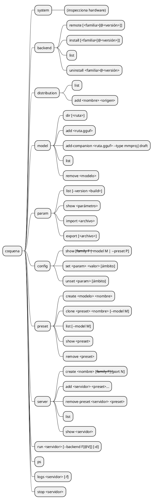
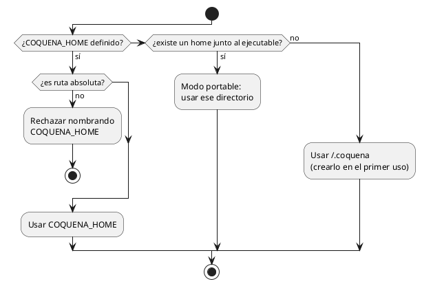

# Comandos de la CLI

Propuesta de superficie de comandos del núcleo, al estilo de SDKMan, FNM o UV para la
gestión y de Docker para la ejecución. Los nombres son borrador.

## Convenciones

- `<familia>` es `cpu`, `vulkan`, `cuda12`, `cuda13`, …; `<familia>@<versión>` fija un
  build (`cuda13@b6123`). Sin familia, Coquena elige la más adecuada al hardware; sin
  versión, la última.
- Los comandos que **leen** estado aceptan `--json`; los que **actúan** no, y rechazan la
  opción antes de hacer nada (convención heredada de `legacy-go`, `docs/model-commands.md`).

## Mapa

## Correspondencias

| Coquena | Análogo | Nota |
|---|---|---|
| `backend install` | `sdk install java 21-tem`, `fnm install --lts` | sin argumentos elige familia por hardware y último release |
| `backend list` / `remote` | `sdk list java`, `fnm ls-remote` | |
| `distribution add` | candidato/vendor de SDKMan | distribuciones de terceros |
| `model add` | `sdk install java x /ruta/local` | registra sin copiar |
| `config set` sin ámbito | configuración global | con `--family` o `--model`, el ámbito correspondiente |
| `run` / `run -d` | `docker run` / `docker run -d` | genera el INI y lanza `llama-server` |
| `ps`, `logs -f`, `stop` | `docker ps`, `docker logs -f`, `docker stop` | |

## Arqueología (`legacy-go`)

La CLI anterior (`cmd/coquena/runtime.go`) tenía `init`, `webui`, `system`,
`runtime remote|download|list|remove`, `model resolve|download|revision`,
`download list|status|pause|resume|cancel` y `field define|remove|list|show`. No tenía
ningún comando para lanzar `llama-server`.

## Home

No hay comando `init`. El home se resuelve así (`COQUENA_HOME` primero, porque es una
decisión explícita del usuario; se conserva de `legacy-go`):

## Reglas

- `run` siempre ejecuta un **servidor registrado** con un **backend instalado**; no existe
  un lanzamiento ad hoc de un preset suelto.
