# Comandos de la CLI

Propuesta de superficie de comandos del núcleo, al estilo de SDKMan, FNM o UV para la
gestión y de Docker para la ejecución. Los nombres son borrador.

## Convenciones

- `<familia>` es `cpu`, `vulkan`, `cuda@12`, `cuda@13`, … . En `cuda@12`, `12` es la
  versión mayor de las bibliotecas CUDA usadas para compilar el runtime, **no** el
  release de llama.cpp. Éste se expresa por separado como `<build>` (`b1002`).
  Cada backend registrado tiene además un **ID único y estable**. Un selector abreviado
  como familia + build sólo se acepta si identifica exactamente uno; `run` y
  `uninstall` admiten el ID para eliminar toda ambigüedad.
  Sin familia, Coquena elige automáticamente una compatible con el hardware; sin
  release, `latest` significa **el build más reciente que tenga un binario compatible
  dentro del filtro indicado**. Primero se compara el build y sólo entre candidatos
  del mismo build se prefiere, en NVIDIA, la familia CUDA con la versión de bibliotecas
  más alta que resulte compatible; después Vulkan. CPU es el fallback portable de la
  arquitectura nativa. Así, CPU `b10010` gana a CUDA `b10009` sin filtro, pero
  filtrar por CUDA con `latest` elige CUDA `b10009`. Coquena informa la elección por
  defecto y enumera las alternativas. La preferencia no garantiza rendimiento; el
  usuario siempre puede elegir explícitamente otra familia.
- La selección automática considera sólo candidatos `compatible`. En la plataforma
  correcta, un candidato con aceleración `incompatible` o `unknown` puede elegirse
  explícitamente; ambos quedan fuera de la elección automática, pero se muestran con
  diagnósticos distintos. La elección explícita no cambia su estado de compatibilidad.
  Un binario de otro SO o arquitectura se rechaza siempre: Coquena no descarga algo
  que no podrá instalar para uso local. Toda instalación o registro exige además un
  `llama-server --version` local válido.
- En el núcleo, la selección automática usa sólo la distribución oficial. Los
  backends externos son obtenidos y registrados por el usuario, y se eligen
  explícitamente para ejecutar. Repositorios de terceros como fuentes de descargas
  quedan para una iteración posterior. Al registrar uno externo, el usuario declara
  su familia; `--version` aporta la versión del ejecutable, no confirma esa familia.
  También se declara la distribución de origen para asociar su catálogo de parámetros:
  `--distribution oficial` (implícito) o el repositorio de un tercero. Esto no habilita
  descargas desde ese repositorio ni verifica la procedencia del binario externo.
- El núcleo inicial **no ofrece `--json`**. La salida JSON por comando se reconsiderará después de un milestone funcional. Si
  hiciera falta una interfaz programática, se prefiere evaluar un servidor HTTP.

## Mapa por comando

Todos los comandos se invocan con el prefijo `coquena`, omitido en los diagramas.

Las descargas y reanudaciones de modelos, companions y backends ocupan la terminal
en primer plano. Ctrl+C pausa sin borrar parciales y muestra el GUID de la operación
y `coquena download resume <guid>` antes de devolver el prompt. No equivale a
`download cancel`, que solicita limpiar los parciales.

### `system`

Inspecciona el hardware y la plataforma para informar las opciones de ejecución.

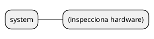

### `backend`

Consulta, instala y registra backends de llama.cpp; también permite retirarlos.

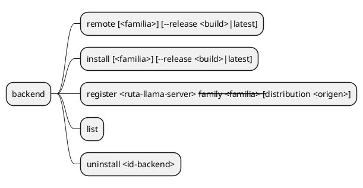

### `model`

Registra y descarga modelos y companions, y consulta su estado.

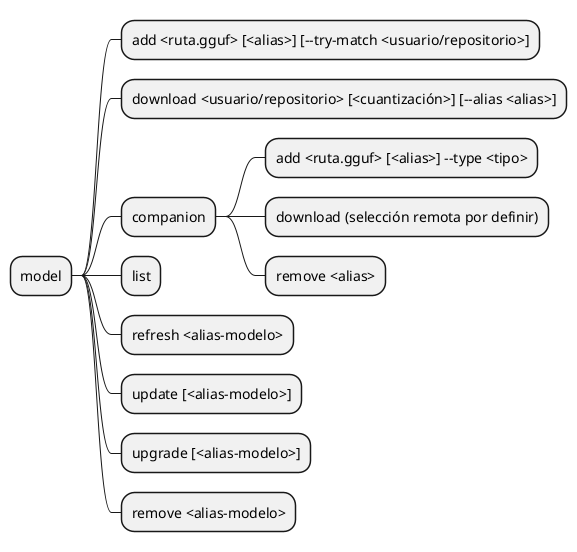

Modelos y companions se seleccionan por su alias en el catálogo local, no mediante
búsquedas por nombre de archivo. Si se omite el alias al registrar, el nombre del archivo
se usa como alias inicial; un alias ya ocupado se rechaza, sin sobrescribir otro registro.

`model companion add` registra el archivo sin asociarlo a un modelo o preset.
`--type` declara su papel (por ejemplo, `mmproj` o `draft`). `remove` retira el registro
por alias: borra archivos gestionados, pero conserva los externos.

El registro externo no copia pesos ni crea enlaces físicos. Intenta buscar equivalentes
en Hugging Face con metadatos locales y un repositorio opcional para orientar la búsqueda
(`--try-match usuario/repositorio`). Un fallo de red o la ausencia de
coincidencias no invalida el registro. Emparejar no habilita actualizaciones del externo.
`update` consulta metadatos y guarda novedades; `upgrade` aplica la revisión detectada
sólo a gestionados. Las reglas están en [modelos-y-companions.md](modelos-y-companions.md).
`model download` busca en Hugging Face la cuantización del repositorio indicado y
descarga sólo esa unidad, incluidos todos sus shards. La cuantización es opcional;
se propone `--alias` para evitar confundir alias y cuantización posicionales.
Antes de crear la operación presenta un único menú repetible:

- **Con cuantización:** descargar la selección indicada, mostrar README o cancelar.
- **Sin cuantización:** una opción «Descargar <variante>» por candidato, mostrar README
  o cancelar. Elegir una variante inicia la descarga, sin una segunda confirmación.
- Mostrar README consulta la documentación del repositorio en la revisión resuelta y
  vuelve al mismo menú. No descarga pesos; si falla o no existe, informa y vuelve.
- Cancelar en este menú no crea GUID, trabajo ni parciales; no es Ctrl+C de una descarga
  activa. Una cuantización inexistente se informa, sin sustituirla automáticamente.
- Si una etiqueta identifica varias variantes, mostrar sus diferencias para una selección
  explícita; no adivinar. Etiquetar cada opción de inicio como descarga, no como inspección.

El README se consulta sólo al solicitarlo. No se descarga por defecto con los pesos.
No encola companions. `model companion download` es otra invocación independiente,
incluso otro día; su búsqueda y argumentos quedan por definir. Descargarlo no lo asocia
automáticamente a un preset. La verificación y actualización de companions también
requieren completar su superficie de comandos.

### `download`

Consulta y controla operaciones por GUID. Estados, persistencia y recuperación se
definen en [descargas.md](descargas.md); no inicia selecciones nuevas.

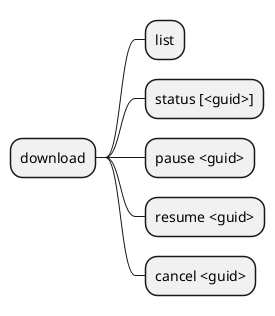

Las vistas filtradas por modelo/backend y las acciones sobre archivos individuales
siguen pendientes de gramática. No inventar variantes por analogía con otros comandos.

### `param`

Consulta, importa y exporta el catálogo de parámetros y su disponibilidad.

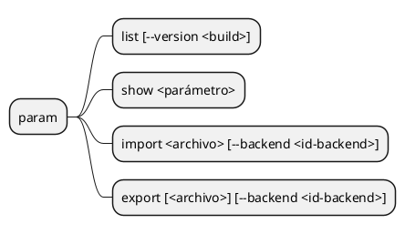

### `config`

Consulta y modifica valores de configuración globales o de un ámbito específico.

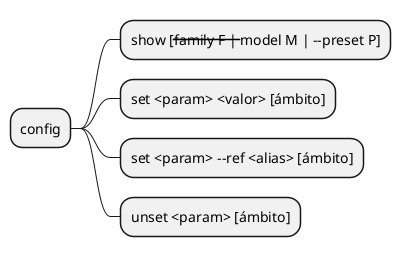

`unset` elimina el par clave-valor propio del ámbito indicado, como `delete` en
JavaScript. No bloquea la herencia: si hay un valor heredado, vuelve a regir; si no,
la clave deja de emitirse en la sección correspondiente del INI. No modifica el padre.

Los parámetros que cargan companions aceptan referencias por alias a su registro en vez
de una ruta literal. Coquena conserva la referencia y la resuelve a una ruta absoluta al generar
el INI; CPU/GPU y demás ajustes se configuran con los parámetros del backend.
`config set <param> --ref <alias> [ámbito]` guarda una referencia al catálogo.
El valor posicional y `--ref` son alternativas excluyentes: un valor normal es literal,
aunque coincida con un alias. No se usa un prefijo especial como `@`.

Por ejemplo:

```text
coquena config set mmproj --ref vision --preset conversacion
coquena config set temperature 0.7 --preset conversacion
```

Coquena no valida la compatibilidad funcional entre modelo y companion ni requiere
forzar su uso. El backend decide si puede cargar la combinación configurada.

### `preset`

Define configuraciones de ejecución de un modelo. Sus companions se eligen mediante
los parámetros de `config`, no con una lista de asociaciones separada.

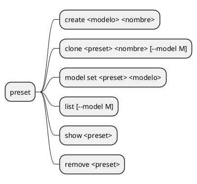

## Ejecución: borrador no aprobado

Las siguientes secciones requieren revisión al abordar servidores; no autorizan
implementación ni fijan políticas de omisión de presets, eliminación en uso o limpieza.

### `server`

Registra la composición de presets que ofrecerá un router y sus opciones de lanzamiento.

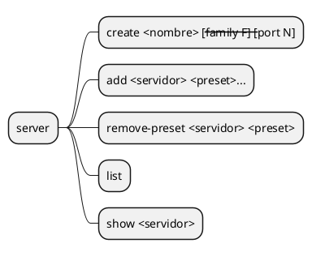

### `run`

Genera el INI e inicia una instancia de un servidor registrado.

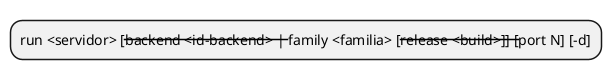

### `ps`

Lista las instancias registradas y sus IDs.

```plantuml
@startmindmap
* ps
@endmindmap
```

### `logs`

Consulta los logs de una instancia; con `-f`, sigue su salida.

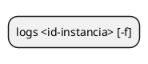

### `stop`

Detiene la instancia identificada por su ID.

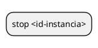

## Home

El objetivo es separar una ubicación de configuración de otra para los archivos pesados
gestionados (modelos, companions y backends). Configurar esas ubicaciones se abordará
en una iteración posterior, dentro de la configuración de Coquena, no del catálogo
de modelos ni de los parámetros de inferencia. No se define todavía su comando,
migración ni una disposición física obligatoria para la primera iteración.

No hay comando `init`. El home se resuelve así (`COQUENA_HOME` primero, porque es una
decisión explícita del usuario):

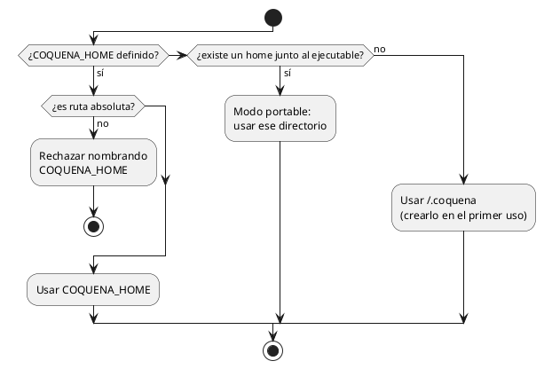

## Reglas de ejecución (borrador)

- `run` siempre ejecuta un **servidor registrado** con un **backend instalado**; no existe
  un lanzamiento ad hoc de un preset suelto.
- `run` devuelve un ID de instancia. `ps`, `logs` y `stop` se refieren a ese ID, no al
  nombre del servidor; varias instancias del mismo servidor pueden convivir sólo con
  puertos distintos. El puerto del servidor es el predeterminado y `--port` permite
  elegir otro para ese lanzamiento.
