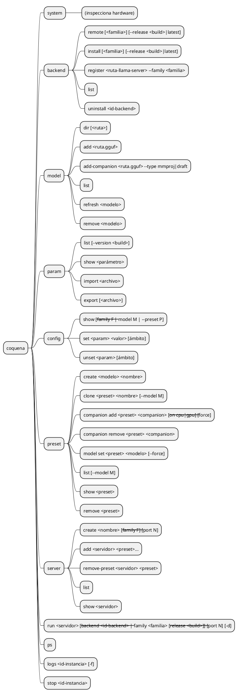
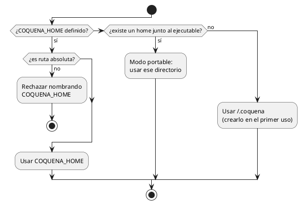

# Comandos de la CLI

Propuesta de superficie de comandos del núcleo, al estilo de SDKMan, FNM o UV para la
gestión y de Docker para la ejecución. Los nombres son borrador.

## Convenciones

- `<familia>` es `cpu`, `vulkan`, `cuda@12`, `cuda@13`, … . En `cuda@12`, `12` es la
  versión mayor de las bibliotecas CUDA usadas para compilar el runtime, **no** el
  release de llama.cpp. Éste se expresa por separado como `<build>` (`b1002`).
  Cada backend registrado tiene además un **ID único y estable**. Un selector abreviado
  como familia + build sólo se acepta si identifica exactamente uno; `run` y
  `uninstall` admiten el ID para eliminar toda ambigüedad.
  Sin familia, Coquena elige automáticamente una compatible con el hardware; sin
  release, `latest` significa **el build más reciente que tenga un binario compatible
  dentro del filtro indicado**. Primero se compara el build y sólo entre candidatos
  del mismo build se prefiere, en NVIDIA, la familia CUDA con la versión de bibliotecas
  más alta que resulte compatible; después Vulkan. CPU es el fallback portable de la
  arquitectura nativa. Así, CPU `b10010` gana a CUDA `b10009` sin filtro, pero
  filtrar por CUDA con `latest` elige CUDA `b10009`. Coquena informa la elección por
  defecto y enumera las alternativas. La preferencia no garantiza rendimiento; el
  usuario siempre puede elegir explícitamente otra familia.
- La selección automática considera sólo candidatos `compatible`. En la plataforma
  correcta, un candidato con aceleración `incompatible` o `unknown` puede elegirse
  explícitamente; ambos quedan fuera de la elección automática, pero se muestran con
  diagnósticos distintos. La elección explícita no cambia su estado de compatibilidad.
  Un binario de otro SO o arquitectura se rechaza siempre: Coquena no descarga algo
  que no podrá instalar para uso local. Toda instalación o registro exige además un
  `llama-server --version` local válido.
- En el núcleo, la selección automática usa sólo la distribución oficial. Los
  backends externos son obtenidos y registrados por el usuario, y se eligen
  explícitamente para ejecutar. Repositorios de terceros como fuentes de descargas
  quedan para una iteración posterior. Al registrar uno externo, el usuario declara
  su familia; `--version` aporta la versión del ejecutable, no confirma esa familia.
- El núcleo inicial **no ofrece `--json`**. Mantener salida JSON para cada comando fue
  una carga en `legacy-go`; se reconsiderará después de un milestone funcional. Si
  hiciera falta una interfaz programática, se prefiere evaluar un servidor HTTP.

## Mapa

## Correspondencias

| Coquena | Análogo | Nota |
|---|---|---|
| `backend install` | `sdk install java 21-tem`, `fnm install --lts` | sin argumentos elige familia por hardware y último release |
| `backend list` / `remote` | `sdk list java`, `fnm ls-remote` | |
| `model add` | `sdk install java x /ruta/local` | registra sin copiar |
| `config set` sin ámbito | configuración global | con `--family` o `--model`, el ámbito correspondiente |
| `run` / `run -d` | `docker run` / `docker run -d` | genera el INI y lanza `llama-server` |
| `ps`, `logs -f`, `stop` | `docker ps`, `docker logs -f`, `docker stop` | |

## Arqueología (`legacy-go`)

La CLI anterior (`cmd/coquena/runtime.go`) tenía `init`, `webui`, `system`,
`runtime remote|download|list|remove`, `model resolve|download|revision`,
`download list|status|pause|resume|cancel` y `field define|remove|list|show`. No tenía
ningún comando para lanzar `llama-server`.

## Home

No hay comando `init`. El home se resuelve así (`COQUENA_HOME` primero, porque es una
decisión explícita del usuario; se conserva de `legacy-go`):

## Reglas

- `run` siempre ejecuta un **servidor registrado** con un **backend instalado**; no existe
  un lanzamiento ad hoc de un preset suelto.
- `run` devuelve un ID de instancia. `ps`, `logs` y `stop` se refieren a ese ID, no al
  nombre del servidor; varias instancias del mismo servidor pueden convivir sólo con
  puertos distintos. El puerto del servidor es el predeterminado y `--port` permite
  elegir otro para ese lanzamiento.
- `model remove` y `backend uninstall` borran los archivos **gestionados por Coquena**
  junto con su registro e informan los bytes liberados. Si el registro es externo,
  quitan sólo el registro y avisan que los archivos permanecen en disco. La misma regla
  deberá aplicarse al comando de quitar companions cuando se defina su superficie.
