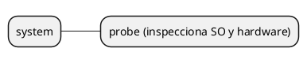
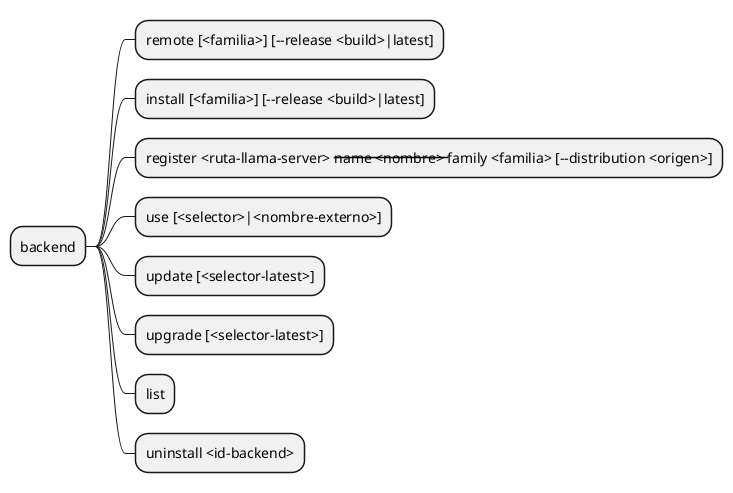
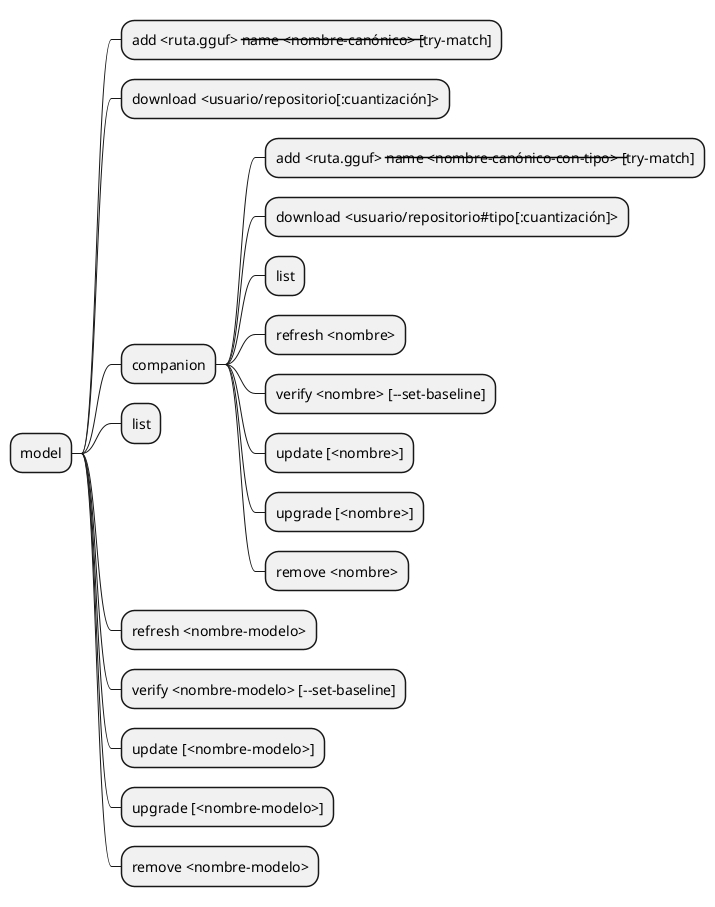
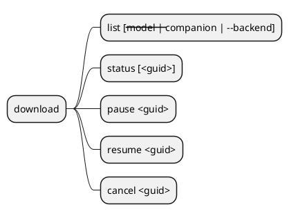
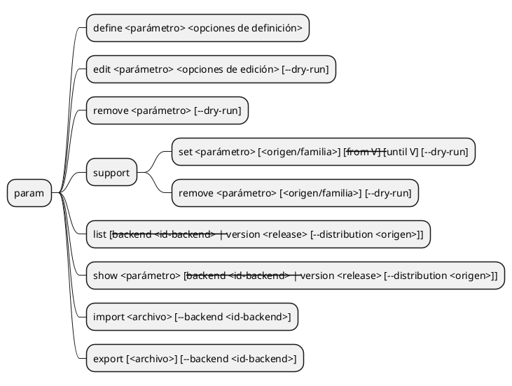
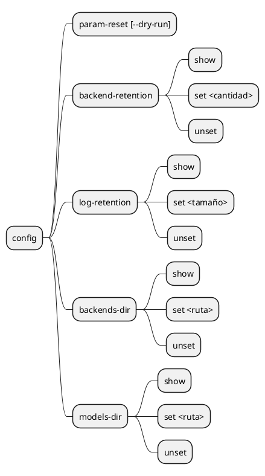
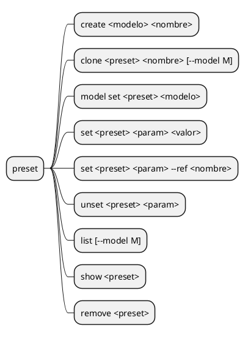
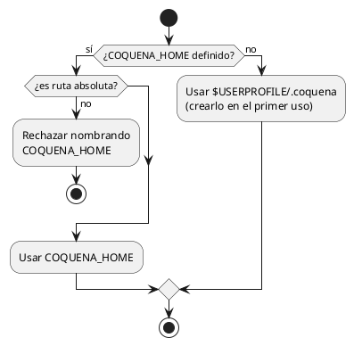

# Comandos de la CLI

Las rutas de evidencia están parametrizadas. Para reproducir comandos de este documento, definir `$TestRoot` y `$CoquenaHome` con directorios de prueba propios; las ubicaciones originales no se publican.

```powershell
$TestRoot = Join-Path $env:TEMP "coquena-validation"
$CoquenaHome = Join-Path $TestRoot "home"
$TestRootUpper = $TestRoot.ToUpperInvariant()
$CoquenaHomeLower = $CoquenaHome.ToLowerInvariant()
New-Item -ItemType Directory -Force $TestRoot | Out-Null
```

Superficie acordada del núcleo, al estilo de SDKMan, FNM o UV para la gestión y de
Docker para la ejecución. El alcance aplazado y las excepciones por resolver se
identifican en la lista central; no son requisitos implícitos.

## Convenciones

- `<familia>` es `cpu`, `vulkan`, `cuda@12`, `cuda@13`, … . En `cuda@12`, `12` es la
  versión mayor de las bibliotecas CUDA usadas para compilar el runtime, **no** el
  release de llama.cpp. Éste se expresa por separado como `<build>` (`b1002`).
  Cada backend registrado tiene además un **ID único y estable**. Un selector abreviado
  como familia + build sólo se acepta si identifica exactamente uno. Servidores seleccionan
  por origen/variante:release o nombre externo; `uninstall` conserva la selección por ID.
  Sin familia, Coquena elige automáticamente una compatible con el hardware; sin
  release, `latest` significa **el build más reciente que tenga un binario compatible
  dentro del filtro indicado**. Primero se compara el build y sólo entre candidatos
  del mismo build se prefiere, en NVIDIA, la familia CUDA con la versión de bibliotecas
  más alta que resulte compatible; después Vulkan. CPU es el fallback portable de la
  arquitectura nativa. Así, CPU `b10010` gana a CUDA `b10009` sin filtro, pero
  filtrar por CUDA con `latest` elige CUDA `b10009`. Coquena informa la elección por
  defecto y enumera las alternativas. La preferencia no garantiza rendimiento; el
  usuario siempre puede elegir explícitamente otra familia.
- La selección automática considera sólo candidatos `compatible`. En la plataforma
  correcta, un candidato con aceleración `incompatible` o `unknown` puede elegirse
  explícitamente; ambos quedan fuera de la elección automática, pero se muestran con
  diagnósticos distintos. La elección explícita no cambia su estado de compatibilidad.
  Un binario de otro SO o arquitectura se rechaza siempre: Coquena no descarga algo
  que no podrá instalar para uso local. Toda instalación o registro exige además un
  `llama-server --version` local válido.
- En el núcleo, la selección automática usa sólo la distribución oficial. Los
  backends externos son obtenidos y registrados por el usuario, y se eligen
  explícitamente para ejecutar. Repositorios de terceros como fuentes de descargas
  quedan para una iteración posterior. Al registrar uno externo, el usuario declara
  su familia; `--version` aporta la versión del ejecutable, no confirma esa familia.
  También se declara la distribución de origen para asociar su catálogo de parámetros:
  `--distribution oficial` (implícito) o el repositorio de un tercero. Esto no habilita
  descargas desde ese repositorio ni verifica la procedencia del binario externo.
- El núcleo inicial **no ofrece `--json`**. La salida JSON por comando se reconsiderará después de un milestone funcional. Si
  hiciera falta una interfaz programática, se prefiere evaluar un servidor HTTP.

## Mapa por comando

Todos los comandos se invocan con el prefijo `coquena`, omitido en los diagramas.

Los flujos de selección y confirmación son **interactivos**. No se incorpora un modo
automático para omitir sus menús. Si no hay entrada interactiva y el flujo necesita
una respuesta, informar el requisito y terminar sin decidir por el usuario ni ejecutar
la acción pendiente. Un registro local ya concretado antes de un emparejamiento se
conserva; la falta de interacción no revierte esa alta.

Las descargas y reanudaciones de modelos, companions y backends ocupan la terminal
en primer plano. Ctrl+C pausa sin borrar parciales y muestra el GUID de la operación
y `coquena download resume <guid>` antes de devolver el prompt. No equivale a
`download cancel`, que solicita limpiar los parciales.

### Responsabilidades de los comandos

| Grupo | Responsabilidad |
|---|---|
| config | Configuración de Coquena |
| system | Sistema operativo y hardware |
| param | Catálogo de parámetros: tipos, defaults, opciones y metadatos |
| preset | Catálogo de presets por modelo y valores del catálogo de parámetros |
| model | Catálogo de modelos |
| server | Catálogo de servidores por runtime/backend y presets asociados |

### `system`

Inspecciona el hardware y la plataforma para informar las opciones de ejecución.



### `backend`

Consulta, instala y registra backends de llama.cpp; también permite retirarlos.



Repetir install fuerza descarga y reinstalación; intención latest/pin y publicación
siguen [servidores.md](servidores.md) y [descargas.md](descargas.md).

Register sondea el ejecutable local con `--version` y guarda su ruta absoluta sin copiar
archivos ni cambiar el backend predeterminado. Requiere un nombre único sin `/` ni `:`;
`default` está reservado. Use selecciona ese nombre sin distinguir mayúsculas.
La familia y distribución se declaran, no se certifican por el sondeo. Las familias
externas no amplían las familias disponibles para descarga oficial.

Update y upgrade sin selector operan sobre todos los seguimientos latest registrados;
con selector (por ejemplo ggml/cuda@12:latest), sólo sobre ese seguimiento. Releases
fijados y externos quedan excluidos. Update consulta y guarda novedades; upgrade aplica
el build detectado, sin seleccionar silenciosamente uno nuevo. El recorrido es por
unidad: un fallo no impide tratar las demás. No se deduce el alcance del servidor default.

### `model`

Registra y descarga modelos y companions, y consulta su estado.



La sintaxis del nombre es `usuario/repositorio[#tipo]:cuantización`; `#tipo` sólo
aparece en companions. No hay aliases ni `--type`. Las reglas de identidad están en
[modelos-y-companions.md](modelos-y-companions.md#identificación-en-el-catálogo-local).
`--name` es obligatorio para externos; no certifica procedencia.
`--try-match` es opcional, sin valor. Sin él no se consulta la red; si falla, el alta
local permanece. Emparejar no habilita actualizaciones del externo.
Si hay candidatos, un menú muestra opciones y razones y permite elegir o cancelar
el empate. Cancelar conserva el registro local; elegir guarda sólo equivalencia informativa.
`update` guarda novedades y `upgrade` aplica la revisión detectada sólo a gestionados.

`model download usuario/repositorio[:cuantización]` selecciona una unidad completa.
Omitir cuantización conserva el menú acordado; al elegirla se determina el nombre
canónico. No se descargan companions como efecto secundario.
Si ese nombre está ocupado por un externo, ofrecer su transición explícita a gestionado;
publicar sólo tras verificar la descarga, conservando ID y referencias y sin tocar los
archivos externos. Cancelar o fallar mantiene el externo. Otras colisiones se rechazan.
Antes de crear la operación presenta un único menú repetible:

- **Con cuantización:** descargar la selección indicada, mostrar README o cancelar.
- **Sin cuantización:** una opción «Descargar <variante>» por candidato, mostrar README
  o cancelar. Elegir una variante inicia la descarga, sin una segunda confirmación.
- Mostrar README consulta la documentación del repositorio en la revisión resuelta y
  vuelve al mismo menú. No descarga pesos; si falla o no existe, informa y vuelve.
- Cancelar en este menú no crea GUID, trabajo ni parciales; no es Ctrl+C de una descarga
  activa. Una cuantización inexistente se informa, sin sustituirla automáticamente.
- Si una etiqueta identifica varias variantes, mostrar sus diferencias para una selección
  explícita; no adivinar. Etiquetar cada opción de inicio como descarga, no como inspección.

El README se consulta sólo al solicitarlo. No se descarga por defecto con los pesos.
Cada opción muestra rutas, etiqueta/fuente y tamaño en GB decimal y GiB. La actividad
de inspección de metadatos se informa separadamente de la descarga instalable, sin GUID
ni parciales. Los nombres no convencionales se evalúan por cabecera; las
[reglas de selección](modelos-y-companions.md) distinguen candidatos, conflictos e
incertidumbre. Elegir completa la validación acotada antes de iniciar; si falla, explica
la causa y vuelve al menú sin crear una operación vacía.
Si el repositorio existe pero no ofrece GGUF seleccionables para la unidad solicitada,
mostrar sólo «Mostrar README» y «Cancelar», explicando la ausencia de candidatos.
No ofrecer descarga ni crear GUID, operación o parciales. La misma regla aplica a
companions cuando no hay candidatos del tipo indicado.
No encola companions. `model companion download` es otra invocación independiente,
incluso otro día. Usa `usuario/repositorio#tipo[:cuantización]` y el mismo menú de
selección, README y cancelación, limitado al tipo auxiliar indicado. Descargarlo no
descarga el principal ni lo asocia automáticamente a un preset. `list`, `refresh`,
`update`, `upgrade` y `remove` aplican las mismas reglas que en modelos, sobre companions.
Sin nombre, `model update` revisa todos los gestionados del catálogo, incluidos companions,
y `model upgrade` aplica sus planes resueltos; los subcomandos de `companion` limitan
el alcance a companions. Externos no reciben seguimiento ni actualización. Los problemas
de una unidad se informan sin impedir tratar las demás; no hay publicación global atómica.
`model verify <nombre>` y `model companion verify <nombre>` leen todos los archivos
de la unidad y comparan SHA-256 completos con las referencias registradas, sin red.
No reparan ni reemplazan referencias. Sin referencia, informan que no pueden verificar;
no establecen una base automáticamente. Reglas en
[integridad local](modelos-y-companions.md#integridad-local).

En externos, `verify <nombre> --set-baseline` calcula y registra SHA-256 de los bytes
actuales como base local. Advierte que no certifica procedencia ni corrección original.
Es una acción explícita distinta de comparar; sin el flag nunca reemplaza la referencia.
El flag no se aplica a gestionados, cuya referencia se establece durante la descarga.

### `download`

Consulta y controla operaciones por GUID. Estados, persistencia y recuperación se
definen en [descargas.md](descargas.md); no inicia selecciones nuevas.



`download list` muestra todas las operaciones y admite filtros excluyentes `--model`,
`--companion` o `--backend`: principales, companions o backends respectivamente.
El detalle conserva progreso por archivo. Pause, resume y cancel requieren el GUID
del conjunto; no hay control individual de archivos en el alcance inicial.
Operaciones terminadas y limpiadas desaparecen de estas vistas; su resultado queda en el log.

### `param`

Administra el catálogo de parámetros personalizados: creación y edición de definiciones,
tipos, defaults, enumeraciones, binarios aplicables y rangos de versiones. También permite
consultar, retirar, importar y exportar definiciones. Define, edit, remove, support
y las consultas operan sobre la distribución oficial de llama.cpp, sus builds
bNNNN y familias CPU, CUDA y Vulkan.

Import y export corresponden a [M3](milestones/M3-definiciones-declarativas.md).
El formato de intercambio será JSON; su sintaxis y resolución de conflictos
se concretarán según [las reglas declarativas](definiciones-declarativas.md).

Las reglas están en el [catálogo de parámetros](catalogo-de-parametros.md).
`define` crea una definición y rechaza un nombre existente; `edit` modifica una
definición existente y rechaza un nombre inexistente. Las opciones omitidas en edit
conservan su valor actual.

Define y edit comparten estas opciones:

| Opción | Metadato |
|---|---|
| `--type integer\|decimal\|string\|boolean\|flag\|enum` | Tipo; flag no recibe valor |
| `--description <texto>` | Descripción |
| `--default <valor>` | Valor inicial para formularios |
| `--alias <alias>` | Alias del parámetro; opción repetible |
| `--values <valor>` | Valor permitido del enumerado; opción repetible |
| `--scope model\|server` | Ámbito de asignación |
| `--target cli\|ini` | Destino de emisión |

Define requiere type, scope y target; los demás metadatos son opcionales. Edit valida
la definición completa resultante antes de aplicar el cambio.

Las asociaciones se gestionan mediante support. Cada repetición de alias o values
aporta un elemento de su lista. En edit, indicar la opción reemplaza la lista anterior
por todos los elementos proporcionados; omitirla conserva la lista actual. Los alias
que comienzan con guiones se pasan mediante `--alias=<alias>` para distinguirlos de
opciones del comando:

```text
coquena param edit ctx-size --alias=-c --alias=--context-size
coquena param edit device --values cpu --values cuda --values vulkan
```

Edit admite `--clear-default`, `--clear-description` y `--clear-aliases` para retirar
esos metadatos. Cada opción de limpieza es excluyente con la opción que asigna el
mismo metadato en esa invocación. Un enumerado debe conservar al menos un valor
permitido: para retirar su enumeración hay que cambiar el tipo. El default, si existe,
debe seguir siendo válido para la definición resultante.



`support set` crea o actualiza una asociación de soporte oficial; `support remove` la retira.
Omitir origen/familia en set declara soporte para cualquier backend oficial, sujeto
a los límites de build indicados. Los rangos se comparan numéricamente como bNNNN;
otros formatos se rechazan.
`support remove` sin origen/familia retira sólo la asociación general; conserva
las asociaciones específicas del parámetro.
Para una excepción local oficial, set y remove aceptan `--backend <id>` en lugar del selector
origen/familia; ambos selectores son excluyentes. Set reemplaza el rango de la asociación
seleccionada: omitir from o until deja abierto ese extremo. Los selectores de origen
admitidos son ggml y su alias oficial.
List/show conservan --distribution para el origen oficial únicamente.

La [consulta del impacto](catalogo-de-parametros.md#consulta-del-impacto) permite guardar
el informe mediante redirección de salida:

```text
coquena param remove <parámetro> --dry-run > impacto.txt
```

### `config`

Configura Coquena.



La [política de retención](servidores.md#consulta-de-logs) define el límite global,
las excepciones por servidor y cuándo se aplica una modificación.

`config backend-retention` consulta, ajusta o restablece el número de builds conservados;
sus reglas están en [actualizaciones y retención de backends](servidores.md#definición-persistida).

```text
coquena config backend-retention show
coquena config backend-retention set 5
coquena config backend-retention unset
```

```text
coquena config log-retention show
coquena config log-retention set 200MiB
coquena config log-retention unset
```

`backends-dir` y `models-dir` consultan y ajustan los directorios de backends y modelos.
Show consulta la ubicación efectiva; set guarda una ubicación propia; unset elimina
ese ajuste y recupera la ubicación predeterminada. Set y unset ofrecen trasladar los
archivos existentes con las mismas reglas. Las rutas con espacios se pasan entre comillas.
Las rutas relativas se guardan como relativas y se resuelven desde el home de Coquena.
Sus reglas están en
[Directorios gestionados](servidores.md#directorios-gestionados).

```text
coquena config backends-dir show
coquena config backends-dir set "${CoquenaHome}/Backends"
coquena config backends-dir unset
coquena config models-dir show
coquena config models-dir set "${TestRoot}/external/Modelos"
coquena config models-dir set "../Modelos"
coquena config models-dir unset
```

`config param-reset` restablece el catálogo de parámetros de fábrica. Sus reglas están
en el [restablecimiento del catálogo](catalogo-de-parametros.md#restablecimiento-de-fábrica).

```text
coquena config param-reset --dry-run > impacto-reset.txt
coquena config param-reset
```

### `preset`

Administra presets asociados a un modelo y sus valores. Las reglas de asignación,
referencias y clonación están en [Presets](modelos-y-companions.md#presets).



`set` asigna el valor, `unset` lo retira y `show` consulta el preset y sus parámetros.
El valor posicional y `--ref` son alternativas excluyentes; no se usa un prefijo `@`.

```text
coquena preset set conversacion temperature 0.7
coquena preset set conversacion mmproj --ref ggml-org/Qwen3.8-27B-GGUF#mmproj:BF16
```

## Servidores e instancias

Reglas confirmadas y pendientes en [servidores.md](servidores.md).

### Sintaxis confirmada

~~~text
coquena backend use [<selector>|<nombre-externo>]

coquena server create <nombre> [--port <puerto>]
coquena server default [<nombre>]
coquena server [<nombre>] use default|<selector>|<nombre-externo>
coquena server [<nombre>] set <parámetro> <valor>
coquena server [<nombre>] unset <parámetro>
coquena server [<nombre>] preset add <preset>...
coquena server [<nombre>] preset remove <preset>...
coquena server [<nombre>] preset list
coquena server [<nombre>] start [-d]
coquena server [<nombre>] restart
coquena server [<nombre>] stop
coquena server [<nombre>] show
coquena server [<nombre>] remove
coquena server [<nombre>] logs [-f]
coquena server [<nombre>] log-retention show
coquena server [<nombre>] log-retention set <tamaño>
coquena server [<nombre>] log-retention unset
coquena server list
coquena server ps
coquena server stop --id <id-instancia>
~~~

Backend use configura el backend predeterminado de Coquena; sin selector lo muestra.
No descarga ni inicia: la selección debe resolver a una instalación registrada.
Server default designa un servidor existente; sin nombre muestra el predeterminado.
Coquena parte de un servidor default predeterminado. El primer backend instalado
correctamente mediante descarga propia se autoasigna como backend predeterminado,
sin sustituir una selección previa del usuario. Los presets siguen asignándose explícitamente.

Palabras reservadas tras server: create, default, list, ps, stop, use, set, unset,
preset, show, remove, logs, log-retention, start y restart. Para preset, las acciones son
add, remove y list. Para log-retention, son show, set y unset. Un token no reservado tras server identifica un servidor existente y su acción.
Los nombres de servidores no pueden coincidir con las reservadas, salvo default,
que también puede crearse explícitamente. Los argumentos se interpretan según su posición:
server create default crea ese servidor si el nombre está libre; server default default
lo designa como predeterminado si existe. No se interpretan esos argumentos como subcomandos.
La excepción de acción explícita se resuelve por el siguiente token:

- server default sin argumentos muestra la designación predeterminada.
- server default <nombre> designa un servidor existente (incluido default).
- server default seguido de use, set, unset, preset, show, remove, logs, log-retention, start, stop o restart
  actúa sobre el servidor llamado default, aunque otro sea el predeterminado.
- Un subcomando global como create, list o ps no es una acción válida después
  del nombre default; no se reinterpreta como nombre de servidor para adivinar la intención.

Por ejemplo, server default start inicia el llamado default; server default lts designa
lts como predeterminado. Se interpreta la gramática antes de consultar entidades;
si el servidor default fue retirado, su acción informa que no existe y no lo recrea.
Omitir el nombre en use, set,
unset, preset, show, remove, logs, log-retention, start, stop o restart dirige la acción al servidor predeterminado. Create, default, list
y ps tienen su significado propio; no operan implícitamente sobre ese servidor.

Server use default elimina la selección propia y recupera la herencia del backend
predeterminado de Coquena. Los selectores mantienen la distinción entre release fijado
y seguimiento latest. El selector admite origen/variante:release (o latest), con origen
oficial implícito si se omite. Un externo se selecciona por nombre, sin --backend.
Los selectores de gestionados no incluyen externos, aunque éstos declaren igual origen,
familia y release. Backend update/upgrade no siguen ni actualizan registros externos.
Las identidades y alcance de terceros están en [servidores.md](servidores.md#identificación-de-backends).

Start utiliza la definición guardada, sin overrides temporales de backend o parámetros;
-d sólo selecciona el modo. Start sin -d permanece en primer plano. Ps muestra instancias activas y métricas como
instantánea. Stop detiene la única instancia del servidor indicado o predeterminado;
`server stop --id <id-instancia>` selecciona una ejecución concreta sin requerir default.
No se combina nombre con --id ni se acepta el ID posicional. Un servidor existente
ya detenido informa que no tiene instancia activa y termina correctamente. Un servidor
o ID ausente, un default no designado o una identidad incierta se diagnostican.
Stop no crea ni designa un default. No hay comando de guardar.
El control de Ctrl+C y la espera de parada se describen en
[servidores.md](servidores.md#inicio-y-detención); la ayuda muestra ambos controles.
Restart aplica la configuración guardada y, si la selección sigue latest, el build actual
instalado por backend upgrade. No descarga al reiniciar. Hay una sola instancia activa
por servidor; un segundo start no crea otra. Restart inicia también un servidor detenido
y devuelve el prompt sin seguir logs; la nueva instancia queda en segundo plano.
Los antiguos comandos raíz run, ps y stop no son la superficie acordada.

Log-retention consulta o cambia la política del servidor seleccionado. Show muestra el
límite efectivo y su origen; set guarda un límite propio y unset recupera el global.
La [política de retención](servidores.md#consulta-de-logs) define unidades y aplicación.

Preset add asocia presets existentes; remove retira sólo las asociaciones, sin eliminar
los presets del catálogo. List muestra los asociados al servidor seleccionado. Los cambios
afectan al próximo inicio, no a instancias activas.

Show muestra la definición completa: selección de backend propia o heredada, build
instalado resuelto, parámetros efectivos y presets asociados. No inicia procesos ni
consulta actualizaciones remotas. Si falta una referencia/default, muestra el diagnóstico
sin inventar una selección.

Logs muestra salida reciente; -f sigue la salida. Ctrl+C termina únicamente el
seguimiento, sin detener el servidor. Se consulta la ejecución actual o, si está
detenido, la última ejecución. La retención se limita por tamaño configurable;
no confundir logs -f con start en primer plano.

Remove retira sólo la definición de un servidor detenido. Si era el predeterminado,
limpia la designación sin seleccionar otro ni recrear default. No elimina recursos asociados.

## Home

El home contiene configuración, catálogos y estado de ejecución con la
[estructura acordada](implementacion-catalogo-modelos.md#almacenamiento-local-acordado).
Las ubicaciones de archivos pesados se ajustan mediante
[config](#config); sus reglas de resolución y traslado están en
[directorios gestionados](servidores.md#directorios-gestionados).

No hay comando `init` ni autodetección de directorios junto al ejecutable. Si no se
define `COQUENA_HOME`, se utiliza `$USERPROFILE\.coquena` en Windows.
La variable puede redefinirse con una ruta absoluta para testing o uso portable;
por ejemplo, `$env:COQUENA_HOME = Join-Path $PWD '.coquena'` estando en el
directorio del ejecutable. La configuración es del proceso: Coquena no modifica
variables de entorno persistentes. El directorio se crea en el primer uso de almacenamiento.


