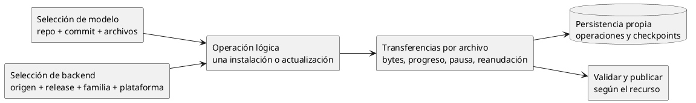
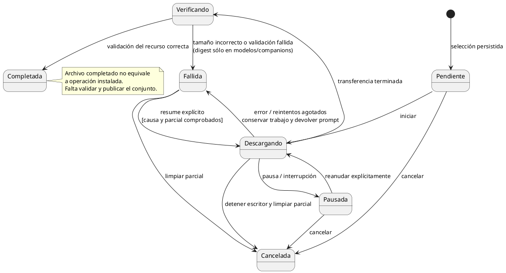

# Administrador de descargas

## Propósito y alcance

Implementación nueva en C#. Gestiona transferencias de modelos y backends con una vista
común, progreso por archivo y estado persistente. La selección del recurso y su
instalación tienen reglas específicas; el motor de transferencia no decide identidades,
compatibilidad de hardware ni qué modelo sustituye a otro.

Este documento define comportamiento y pruebas sin depender de otro repositorio.
Los mecanismos marcados como propuesta requieren aprobación antes de implementarse.
No establece una base de datos ni un daemon. La concurrencia inicial se define abajo.

## Responsabilidades



- **Selección:** produce un conjunto concreto antes de crear transferencias.
- **Operación:** reúne los archivos necesarios para un resultado instalable.
- **Transferencia:** descarga un archivo y expone su progreso y diagnóstico.
- **Publicación:** sólo activa un resultado completo y validado.
- **Catálogo de descargas:** consulta operaciones y archivos, globalmente o por tipo.

Los shards pertenecen a una misma unidad. Un companion es otra unidad opcional.
Modelo y companion se solicitan en invocaciones separadas: descargar el modelo no
encola el companion. Una sola operación puede transferir múltiples shards del modelo;
eso no equivale a combinar dos unidades en un comando.
Un backend puede requerir varios archivos, como un ejecutable empaquetado y bibliotecas
distribuidas por separado. Terminar un archivo no completa necesariamente la instalación.

## Identificación y persistencia

### Concurrencia

La CLI permite operaciones distintas desde terminales distintas. Un GUID sólo tiene
un ejecutor activo; otro intento de ejecutarlo se rechaza con diagnóstico. No hay
paralelismo automático de descargas en una invocación inicialmente.

La publicación sobre el mismo registro o destino se serializa y vuelve a comprobar
colisiones y vigencia antes de activar; ninguna operación sobrescribe a otra.
La reinstalación explícita de backend reemplaza sólo su registro esperado, tras
validar una preparación nueva; conserva el anterior ante un fallo. Las
escrituras de un mismo catálogo JSON también deben excluirse para evitar perder cambios
de operaciones distintas. No mantener ese bloqueo durante toda la transferencia.
El mecanismo técnico de exclusión queda para la implementación.

### Datos de la operación

Después del milestone ejecutable con las funcionalidades iniciales, una TUI podrá
coordinar múltiples descargas simultáneas. El motor mantiene operaciones independientes
y progreso por archivo, sin asumir una única descarga global ni depender de una terminal
concreta. No se implementa ahora la TUI ni un scheduler paralelo: esto preserva su futura
integración, no amplía el alcance inicial.

Cada operación de descarga tiene un GUID estable, persistido antes de transferir y
mostrado al usuario. Sus transferencias se identifican dentro de esa operación.
El nombre canónico del modelo o la identidad del
backend sirven para presentación, no sustituyen el ID del trabajo.

| Información persistente | Finalidad |
|---|---|
| ID, tipo de recurso y operación padre | Localizar y agrupar transferencias |
| Selección fijada | Reanudar el mismo contenido, no resolver otra versión silenciosamente |
| Archivos esperados y destino | Saber qué falta antes de publicar |
| Ruta del parcial y bytes confirmados | Recuperación y reanudación |
| Tamaño esperado, si se conoce | Progreso y validación |
| Identidad de contenido y validadores HTTP separados | Verificación y continuidad del transporte |
| Estado, fase, fechas y diagnóstico | Explicar resultados y recuperación |
| Identificación del ejecutor activo | Evitar recuperar como interrumpido un trabajo aún vivo |

Para modelos, guardar repositorio, referencia solicitada, commit resuelto y rutas elegidas.
Para backends, origen, release, familia, plataforma, artefactos y tamaños disponibles.
No calcular, almacenar ni verificar SHA-256 para backends en el alcance inicial.
No persistir credenciales ni usar URLs firmadas caducables como identidad. Renovar una
ubicación de descarga no autoriza a cambiar el contenido seleccionado.

La persistencia pertenece a Coquena, nunca se escribe junto a modelos externos.
Debe poder restaurarse y diagnosticar documentos dañados sin omitirlos silenciosamente.
Catálogo instalado y trabajo en curso son independientes.

### Área de preparación acordada

Cada operación guarda sus archivos en `downloads`, no en la carpeta instalada:

```text
<home>/downloads/<guid>/
  operation.json
  files/
    <archivo>.part
    <otro-archivo>.part
```

`operation.json` describe el origen, revisión o release fijado, archivos esperados,
rutas de preparación y destinos finales, progreso, verificadores de contenido,
estado y diagnóstico. Es un documento por operación, no un sidecar por shard.
Guardar JSON mediante archivo nuevo y reemplazo seguro; el índice instalado es
independiente. Versión de esquema y mecanismo de exclusión se concretan al implementar.

Descargar y conservar parciales en esta área; verificar el conjunto completo y luego
moverlo al destino, publicando mediante un protocolo recuperable. Para backends,
extracción y validación también ocurren en preparación antes de publicar.
Una pausa conserva la preparación. Cancelar elimina sólo preparación propia, nunca
archivos instalados o externos. Al terminar y completar su limpieza, se elimina toda
la carpeta de operación, incluido operation.json. No se conservan objetos terminales
ni un catálogo histórico de descargas. El resultado se registra en un log de transacciones
local en JSONL, con retención limitada y sin credenciales ni URLs firmadas. No sustituye
los JSON de estado ni requiere reproducción de eventos. Pausadas y fallos recuperables conservan su
operación; una limpieza pendiente no se presenta como terminada.

La preparación permanece bajo el home y la instalación utiliza el destino fijado en
la operación, aunque cambie después la configuración del directorio. Un movimiento
no vuelve atómica la publicación con el índice. Si preparación y destino están en
volúmenes distintos, se copia y verifica el conjunto completo antes de publicarlo;
la preparación sólo se elimina después de publicar el índice. Una interrupción
conserva el estado para reanudar o cancelar sin retirar la instalación anterior.

## Estados y fases

El diagrama muestra el estado de cada transferencia de archivo, no la disponibilidad
del modelo ni el resultado final de la instalación. Los estados terminales se muestran
durante la ejecución; no obligan a conservar objetos después de completar la operación.



Un fallo de transferencia conserva selección, parciales y GUID para reanudación
explícita. Tras detener escritores y guardar el diagnóstico, devuelve el prompt e
informa `coquena download resume <guid>`. Resume comprueba de nuevo la seguridad del
parcial; que sea recuperable no autoriza a reutilizar bytes corruptos ni cambiar contenido.

La operación informa también las fases de verificación, extracción cuando corresponda,
publicación y limpieza pendiente. No anuncia instalación disponible al llegar al 100 %
de bytes. Una nueva tentativa desde fallo requiere validar su causa y la seguridad del
parcial; se realiza mediante resume, no mediante reintento infinito.

Al publicar un directorio de backend en Windows, una denegación de renombrado admite
una espera breve y acotada dentro de la misma operación, sin volver a descargar.
La espera libera la exclusión global del home; antes de otro intento se comprueban
otra vez la selección, el catálogo, la propiedad y la versión preparada. La pausa o
cancelación interrumpe la espera. Si la denegación persiste, se conserva la preparación
y se informa la etapa de movimiento y el código de sistema, sin rutas sensibles ni
texto de excepciones. Otros errores de E/S no reciben reintentos genéricos.

## Comportamiento por acción

### Iniciar y consultar

Selección y menú viven en [comandos.md](comandos.md#model): cancelar antes de iniciar
no crea operación. Upgrade y resume usan selecciones fijadas, sin repetir el menú;
la selección de backend sigue sus reglas propias.

Descargar y reanudar se ejecutan **en primer plano**: ocupan la terminal, muestran
progreso y no devuelven el prompt mientras la operación continúa. No hay descarga
desacoplada implícita. Esta regla aplica a modelos, companions y backends.

**Ctrl+C interrumpe de forma conservadora:** detiene la transferencia, conserva los
archivos parciales y marca la operación como pausada. Antes de devolver el prompt,
muestra su GUID y `coquena download resume <guid>`. No ejecuta la cancelación destructiva.
El GUID no es un hash del modelo ni cambia al reanudar. En operaciones de varios archivos,
se conserva el progreso de todos ellos; reanudar no vuelve a descargar los ya completos
y comprobados.

Persistir selección y destinos antes de transferir. Escribir sólo en preparación;
no sobrescribir una instalación activa. Una selección inválida no crea trabajo.

Mostrar ID, tipo, nombre, estado/fase, bytes transferidos, total conocido y destino.
Con total desconocido mostrar bytes y ausencia de total, nunca un porcentaje inventado.
Para un conjunto, sumar bytes; sólo calcular porcentaje agregado si todos los totales
son conocidos. Mantener detalle por archivo, no sólo una barra global.

Listar no inicia descargas, no pausa trabajos vivos y no verifica íntegramente los
modelos. Consulta local sin peticiones al proveedor.

### Pausar

Solicitar detención, esperar al escritor y persistir un checkpoint coherente antes de
confirmar pausa. Conservar parcial y selección. Ctrl+C usa este mismo procedimiento;
la CLI sólo devuelve el prompt tras detener al escritor e informar el estado persistido
o un fallo explícito de persistencia. No anunciar pausa guardada si la escritura falló.

### Reanudar

1. Comprobar que no hay otro escritor activo y recuperar la selección persistida.
2. Contrastar tamaño real del parcial con el checkpoint.
3. Si el parcial es menor, informar inconsistencia; no continuar desde un offset falso.
4. Si está adelantado, reconciliar el checkpoint sólo tras validar que pertenece al trabajo.
5. Solicitar el resto mediante Range y un validador apropiado cuando esté disponible.
6. Validar código, inicio de Content-Range, límites y continuidad de identidad antes de añadir bytes.
7. Validar según el recurso: modelos y companions calculan SHA-256 del archivo completo,
   incluido el prefijo anterior; backends aplican tamaño/extracción/sondeo, sin SHA-256.

Nunca añadir una respuesta completa HTTP 200 al parcial ni mezclar contenido de versiones.
Si el servidor no permite continuar o cambia la identidad, conservar un diagnóstico seguro.
Si Range no permite continuar, conservar el parcial y preguntar si se desea reiniciar
ese archivo desde cero. Sólo tras aceptación explícita se descarta su parcial y se
reinicia bajo el mismo GUID y selección fijada. Rechazar conserva el trabajo recuperable.
No repetir archivos completos y verificados ni presentar el reinicio como reanudación
exitosa. Si cambió la identidad o la revisión fijada no es accesible, informar el fallo:
reiniciar no autoriza descargar otra versión. Sin respuesta interactiva no reiniciar.

### Cancelar

Detener y esperar al escritor antes de eliminar sus parciales. No permitir que un
callback tardío recree el registro o continúe escribiendo. No eliminar archivos publicados
ni externos. Sólo confirmar limpieza cuando termine; si falla, conservar un registro
recuperable que indique lo pendiente. Tras completar la cancelación y limpieza, registrar
el resultado en el log y eliminar la carpeta de operación, incluido su JSON.

No se permite cancelar archivos individuales en el alcance inicial: el control por
GUID actúa sobre todo el conjunto.

### Recuperar después de un cierre

Al iniciar, distinguir trabajos ejecutados por otro proceso de los verdaderamente
interrumpidos. Un PID por sí solo no demuestra propiedad del trabajo.

Los interrumpidos pasan a pausados o a fallo diagnosticado según la coherencia de sus
datos; no reanudar red automáticamente. Reconciliar índice, checkpoint y parciales sin
declarar instalación completa a partir de su mera existencia.

Durante publicación, no dejar mezclas de archivos declaradas como instalación completa
ni anunciar éxito antes de coordinar destino e índice.
Detectar inconsistencias entre disco y catálogo, sin borrar o sobrescribir por adivinación.
El mecanismo se prueba al implementar, sin imponer un archivo transaccional adicional.
La limpieza posterior fallida se informa separadamente de la validez de la instalación activa.

## Validación específica por recurso

### Modelos

Aplicar [modelos-y-companions.md](modelos-y-companions.md):
commit fijo, sólo archivos seleccionados, correspondencia explícita del conjunto,
companions opcionales y externos fuera de descarga/actualización.

Verificar tamaños conocidos, integridad y legibilidad GGUF. Un conjunto incompleto no
se activa. Una descarga fallida no altera la instalación anterior ni el hash de referencia.
La generación del INI resuelve referencias locales: no depende de consultar descargas.

### Backends

Aplicar las [convenciones de selección](comandos.md#convenciones):
origen de software, release, familia de aceleración y plataforma son dimensiones
distintas. `latest` y las reglas compatible/unknown/incompatible se resuelven antes
de transferir. Descarga desde origen oficial; terceros se registran externamente.

Resolver todos los artefactos y dependencias requeridos por esa distribución.
Comprobar tamaño cuando se conozca. Se omite SHA-256 completamente para backends,
incluidos artefactos y dependencias; no es requisito de instalación ni referencia local.
No anunciar integridad o autenticidad verificada contra el origen.
Extraer en preparación con límites de bytes/entradas y protección contra rutas que
escapen del destino. Localizar y ejecutar `llama-server --version`; sólo publicar
si la validación termina correctamente. El sondeo no demuestra compatibilidad funcional
de cualquier configuración de inferencia.

## Errores y seguridad del motor

- Separar tiempos de espera de metadatos y transferencias largas.
- Reintentos acotados sólo para fallos transitorios; respetar espera indicada por servidor.
- Agotados los reintentos, persistir fallo recuperable, conservar parciales y selección,
  mostrar GUID y comando resume y devolver el control al usuario tras detener escritores.
  Se detiene la operación de la unidad completa, sin continuar otros archivos de ese
  conjunto. En update/upgrade global, el fallo no impide tratar otras unidades
  independientes; el prompt vuelve al finalizar el recorrido global.
- No ignorar fallos al persistir, leer el parcial, calcular hash, sincronizar o publicar.
- Memoria acotada: flujo de bytes, no cargar modelos completos en RAM.
- Validar rutas, colisiones y propiedad antes de escribir o eliminar.
- No reenviar credenciales indiscriminadamente entre hosts tras redirecciones.
- No confundir reanudación con actualización diferencial por bloques; esta última no
  forma parte del alcance inicial.
- Progreso emitido y persistencia deben tener frecuencia acotada; fijar valores al
  implementar, sin reescribir todo el catálogo por cada bloque de red.

## Superficie de comandos

La gramática común está en [comandos.md](comandos.md#download). `download list` muestra
todas las operaciones y admite filtros excluyentes `--model`, `--companion` o `--backend`.
Modelo selecciona principales, no companions. Controlar requiere GUID y actúa sobre
el conjunto; no hay control individual por archivo inicialmente. El detalle por archivo
se conserva. La persistencia JSON interna no implica salida JSON pública.
## Pruebas de aceptación para implementar desde cero

| Escenario | Resultado exigido |
|---|---|
| Modelo y backend pendientes | Vista global contiene ambos; filtros no mezclan tipos |
| Archivo sin tamaño remoto | Progreso en bytes, sin porcentaje falso |
| Varios shards, uno pendiente | Detalle individual; modelo no disponible como instalación nueva |
| Companion no elegido | No se crea su transferencia |
| Pausa y reinicio del programa | Mismo ID, parcial conservado, sin red hasta reanudar |
| Ctrl+C en descarga o reanudación de modelo/backend | Escritor detenido, parciales conservados, GUID y comando para retomar; vuelve el prompt |
| Descarga activa en terminal | No devuelve el prompt ni continúa en segundo plano implícitamente |
| Otro proceso sigue descargando | Listar no lo convierte en pausado |
| Parcial adelantado o menor al checkpoint | Reconciliación segura o error; nunca offset inventado |
| Range ignorado, rango incorrecto o recurso cambiado | No añade bytes incompatibles ni publica |
| Hash de modelo o companion reanudado | Incluye prefijo y sufijo; detecta corrupción del parcial |
| Cancelación con escritor activo | Espera su terminación; no reaparece trabajo ni borra instalación |
| JSON ilegible o fallo de escritura | Diagnóstico visible, sin desaparición silenciosa del trabajo |
| Disco lleno o transferencia cortada | No publica; conserva resultado anterior y estado recuperable |
| Archivo comprimido malicioso | No escribe fuera de preparación |
| Tamaño incorrecto, extracción inválida o --version fallido | Backend no instalado |
| Interrupción antes/después de activar conjunto | Recuperación coherente; ninguna mezcla de revisiones |

Usar transporte simulado, archivos pequeños y fallos inyectados. Integración con proveedores
real es opt-in, con tráfico acotado. No se consideran pruebas ejecutadas hasta que exista
la implementación y se informe su resultado.

## Implementación y pendientes

Las entregas y las decisiones abiertas se mantienen en
[la guía técnica](implementacion-catalogo-modelos.md#9-decisiones-que-no-deben-quedar-ocultas-en-el-código).
Este documento define el comportamiento común y sus pruebas, no otro plan de trabajo.
