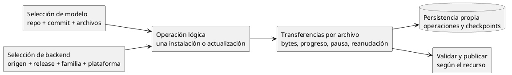
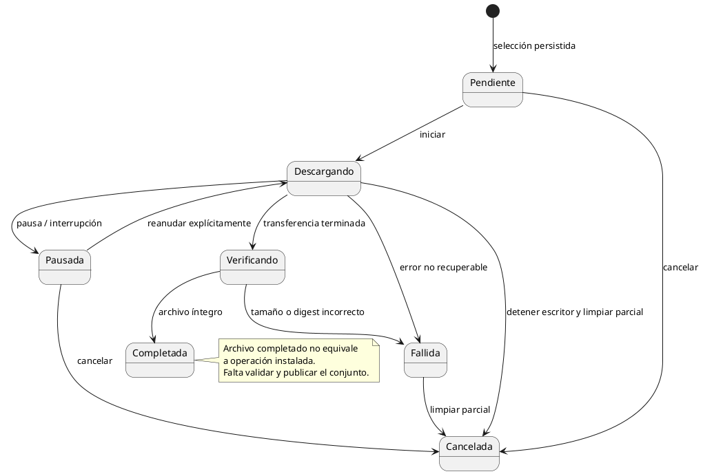

# Administrador de descargas

## Propósito y alcance

Implementación nueva en C#. Gestiona transferencias de modelos y backends con una vista
común, progreso por archivo y estado persistente. La selección del recurso y su
instalación tienen reglas específicas; el motor de transferencia no decide identidades,
compatibilidad de hardware ni qué modelo sustituye a otro.

Este documento define comportamiento y pruebas sin depender de otro repositorio.
Los mecanismos marcados como propuesta requieren aprobación antes de implementarse.
No establece una base de datos, un daemon ni una política de concurrencia todavía.

## Responsabilidades

- **Selección:** produce un conjunto concreto antes de crear transferencias.
- **Operación:** reúne los archivos necesarios para un resultado instalable.
- **Transferencia:** descarga un archivo y expone su progreso y diagnóstico.
- **Publicación:** sólo activa un resultado completo y validado.
- **Catálogo de descargas:** consulta operaciones y archivos, globalmente o por tipo.

Los shards pertenecen a una misma unidad. Un companion es otra unidad opcional.
Un backend puede requerir varios archivos, como un ejecutable empaquetado y bibliotecas
distribuidas por separado. Terminar un archivo no completa necesariamente la instalación.

## Identificación y persistencia

Cada operación y transferencia tiene ID estable. El alias de modelo o la identidad del
backend sirven para presentación, no sustituyen el ID del trabajo.

| Información persistente | Finalidad |
|---|---|
| ID, tipo de recurso y operación padre | Localizar y agrupar transferencias |
| Selección fijada | Reanudar el mismo contenido, no resolver otra versión silenciosamente |
| Archivos esperados y destino | Saber qué falta antes de publicar |
| Ruta del parcial y bytes confirmados | Recuperación y reanudación |
| Tamaño esperado, si se conoce | Progreso y validación |
| Identidad de contenido y validadores HTTP separados | Verificación y continuidad del transporte |
| Estado, fase, fechas y diagnóstico | Explicar resultados y recuperación |
| Identificación del ejecutor activo | Evitar recuperar como interrumpido un trabajo aún vivo |

Para modelos, guardar repositorio, referencia solicitada, commit resuelto y rutas elegidas.
Para backends, origen, release, familia, plataforma y artefactos con sus digests disponibles.
No persistir credenciales ni usar URLs firmadas caducables como identidad. Renovar una
ubicación de descarga no autoriza a cambiar el contenido seleccionado.

La persistencia pertenece a Coquena, nunca se escribe junto a modelos externos.
Debe poder restaurarse y diagnosticar documentos dañados sin omitirlos silenciosamente.
Catálogo instalado y trabajo en curso son independientes.

**Propuesta:** archivos JSON versionados, un documento por operación con sus archivos,
escritos mediante temporal y reemplazo seguro. Índices de instalación separados. Elegir
ubicaciones, respaldo, exclusión de escritores y recuperación antes de codificar.
No se exige un documento por shard ni un único JSON gigante.

## Estados y fases

La operación informa también las fases de verificación, extracción cuando corresponda,
publicación y limpieza pendiente. No anuncia instalación disponible al llegar al 100 %
de bytes. Una nueva tentativa desde fallo requiere validar su causa y la seguridad del
parcial; la UX concreta queda pendiente, no implica reintento infinito.

## Comportamiento por acción

### Iniciar y consultar

Persistir selección y destinos antes de transferir. Escribir sólo en preparación;
no sobrescribir una instalación activa. Una selección inválida no crea trabajo.

Mostrar ID, tipo, nombre, estado/fase, bytes transferidos, total conocido y destino.
Con total desconocido mostrar bytes y ausencia de total, nunca un porcentaje inventado.
Para un conjunto, sumar bytes; sólo calcular porcentaje agregado si todos los totales
son conocidos. Mantener detalle por archivo, no sólo una barra global.

Listar no inicia descargas, no pausa trabajos vivos y no verifica íntegramente los
modelos. Consulta local sin peticiones al proveedor.

### Pausar

Solicitar detención, esperar al escritor y persistir un checkpoint coherente antes de
confirmar pausa. Conservar parcial y selección. Una interrupción de consola debe dejar
un trabajo recuperable cuando sea posible, mostrando el ID y cómo continuarlo.

### Reanudar

1. Comprobar que no hay otro escritor activo y recuperar la selección persistida.
2. Contrastar tamaño real del parcial con el checkpoint.
3. Si el parcial es menor, informar inconsistencia; no continuar desde un offset falso.
4. Si está adelantado, reconciliar el checkpoint sólo tras validar que pertenece al trabajo.
5. Solicitar el resto mediante Range y un validador apropiado cuando esté disponible.
6. Validar código, inicio de Content-Range, límites y continuidad de identidad antes de añadir bytes.
7. Verificar el archivo completo: el hash incluye el prefijo anterior a la reanudación.

Nunca añadir una respuesta completa HTTP 200 al parcial ni mezclar contenido de versiones.
Si el servidor no permite continuar o cambia la identidad, conservar un diagnóstico seguro.
**Pendiente de UX:** ofrecer reinicio desde cero o exigir otra acción explícita; nunca
presentar ese reinicio como continuación exitosa ni cambiar de revisión por conveniencia.

### Cancelar

Detener y esperar al escritor antes de eliminar sus parciales. No permitir que un
callback tardío recree el registro o continúe escribiendo. No eliminar archivos publicados
ni externos. Sólo confirmar limpieza cuando termine; si falla, conservar un registro
recuperable que indique lo pendiente. La retención de historial terminal queda por definir.

La política de cancelar un archivo dentro de una operación compuesta queda pendiente:
en ningún caso puede publicarse como completa una unidad a la que le falta ese archivo.

### Recuperar después de un cierre

Al iniciar, distinguir trabajos ejecutados por otro proceso de los verdaderamente
interrumpidos. Un PID por sí solo no demuestra propiedad del trabajo.

Los interrumpidos pasan a pausados o a fallo diagnosticado según la coherencia de sus
datos; no reanudar red automáticamente. Reconciliar índice, checkpoint y parciales sin
declarar instalación completa a partir de su mera existencia.

Las interrupciones durante publicación siguen el protocolo recuperable de instalación:
conservar la anterior hasta activar la nueva completa. La limpieza posterior fallida se
informa separadamente de la validez de la instalación activa.

## Validación específica por recurso

### Modelos

Aplicar [modelos-y-companions.md](modelos-y-companions.md):
commit fijo, sólo archivos seleccionados, correspondencia explícita del conjunto,
companions opcionales y externos fuera de descarga/actualización.

Verificar tamaños conocidos, integridad y legibilidad GGUF. Un conjunto incompleto no
se activa. Una descarga fallida no altera la instalación anterior ni el hash de referencia.
La generación del INI resuelve referencias locales: no depende de consultar descargas.

### Backends

Aplicar las [convenciones de selección](comandos.md#convenciones):
origen de software, release, familia de aceleración y plataforma son dimensiones
distintas. `latest` y las reglas compatible/unknown/incompatible se resuelven antes
de transferir. Descarga desde origen oficial; terceros se registran externamente.

Resolver todos los artefactos y dependencias requeridos por esa distribución.
Comprobar tamaño y digest disponible antes de extraer; definir explícitamente la política
si falta evidencia de integridad, sin anunciar una verificación inexistente.
Extraer en preparación con límites de bytes/entradas y protección contra rutas que
escapen del destino. Localizar y ejecutar `llama-server --version`; sólo publicar
si la validación termina correctamente. El sondeo no demuestra compatibilidad funcional
de cualquier configuración de inferencia.

## Errores y seguridad del motor

- Separar tiempos de espera de metadatos y transferencias largas.
- Reintentos acotados sólo para fallos transitorios; respetar espera indicada por servidor.
- No ignorar fallos al persistir, leer el parcial, calcular hash, sincronizar o publicar.
- Memoria acotada: flujo de bytes, no cargar modelos completos en RAM.
- Validar rutas, colisiones y propiedad antes de escribir o eliminar.
- No reenviar credenciales indiscriminadamente entre hosts tras redirecciones.
- No confundir reanudación con actualización diferencial por bloques; esta última no
  forma parte del alcance inicial.
- Progreso emitido y persistencia deben tener frecuencia acotada; fijar valores al
  implementar, sin reescribir todo el catálogo por cada bloque de red.

## Superficie de comandos

La gestión común dispone de `download list|status|pause|resume|cancel`.
`list` y `status` sin ID muestran el conjunto; `status <id>` muestra el detalle.
Las acciones de control requieren ID. Las vistas por recurso filtran modelos o backends
y rechazan un ID de otro tipo en vez de operar silenciosamente sobre él.

La gramática exacta de filtros y acciones sobre operación/archivo se cerrará con el mapa
de comandos. No hay `--json`. La persistencia JSON interna no implica salida JSON pública.

## Pruebas de aceptación para implementar desde cero

| Escenario | Resultado exigido |
|---|---|
| Modelo y backend pendientes | Vista global contiene ambos; filtros no mezclan tipos |
| Archivo sin tamaño remoto | Progreso en bytes, sin porcentaje falso |
| Varios shards, uno pendiente | Detalle individual; modelo no disponible como instalación nueva |
| Companion no elegido | No se crea su transferencia |
| Pausa y reinicio del programa | Mismo ID, parcial conservado, sin red hasta reanudar |
| Otro proceso sigue descargando | Listar no lo convierte en pausado |
| Parcial adelantado o menor al checkpoint | Reconciliación segura o error; nunca offset inventado |
| Range ignorado, rango incorrecto o recurso cambiado | No añade bytes incompatibles ni publica |
| Hash de archivo reanudado | Incluye prefijo y sufijo; detecta corrupción del parcial |
| Cancelación con escritor activo | Espera su terminación; no reaparece trabajo ni borra instalación |
| JSON ilegible o fallo de escritura | Diagnóstico visible, sin desaparición silenciosa del trabajo |
| Disco lleno o transferencia cortada | No publica; conserva resultado anterior y estado recuperable |
| Archivo comprimido malicioso | No escribe fuera de preparación |
| Digest incorrecto o --version fallido | Backend no instalado |
| Interrupción antes/después de activar conjunto | Recuperación coherente; ninguna mezcla de revisiones |

Usar transporte simulado, archivos pequeños y fallos inyectados. Integración con proveedores
real es opt-in, con tráfico acotado. No se consideran pruebas ejecutadas hasta que exista
la implementación y se informe su resultado.

## Entregas y decisiones pendientes

1. Cerrar esquema de operación/archivo, acciones de conjunto y persistencia restaurable.
2. Implementar estados y almacenamiento con pruebas de errores y recuperación.
3. Implementar transferencia HTTP y pruebas de reanudación/cancelación.
4. Integrar validadores y publicación específica de cada recurso.
5. Integrar comandos, progreso y filtros con pruebas de extremo a extremo.

Resolver además límites concretos, coordinación entre procesos, concurrencia de archivos,
historial terminal y reinicio de parciales no reanudables. Los agentes no deben deducir
estas políticas de una librería o de una implementación ajena.
