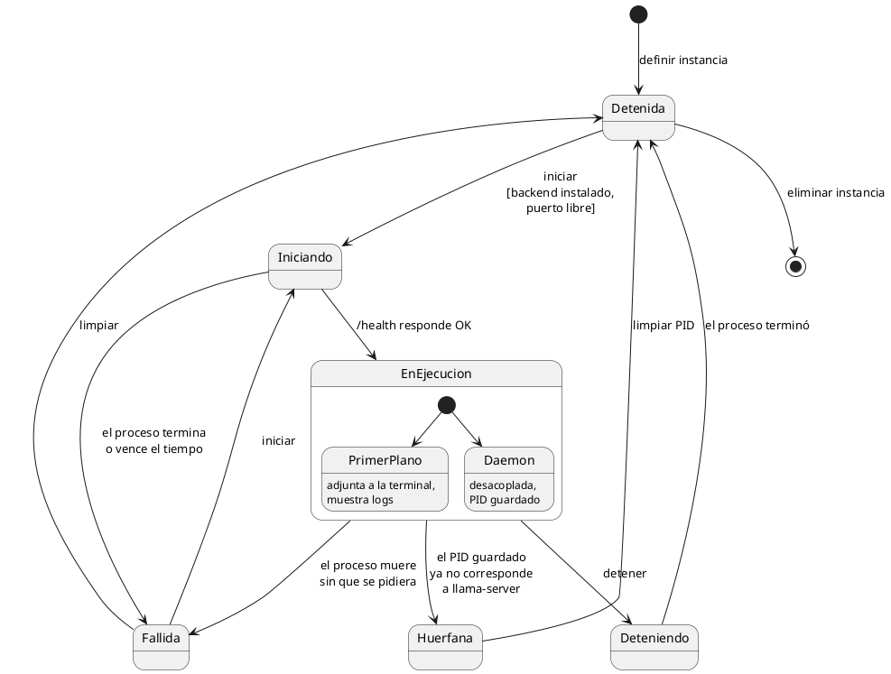
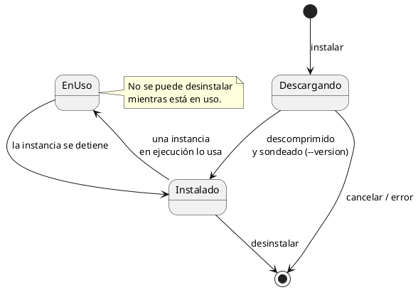

# Diagramas de estado

## Instancia

El estado se **deriva** de la configuración, el PID guardado y lo que responde el
sistema operativo y el endpoint de salud de `llama-server`.

- **Huérfana:** el PID guardado apunta a un proceso que ya no existe o que el sistema
  reutilizó para otro programa. Coquena debe verificar que el PID pertenece al
  `llama-server` que lanzó antes de actuar sobre él.

## Backend

