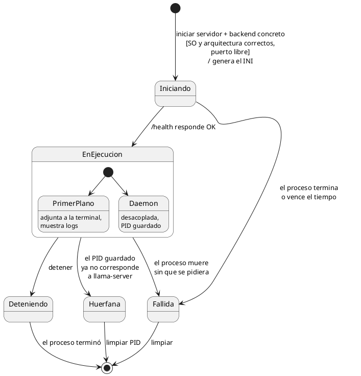
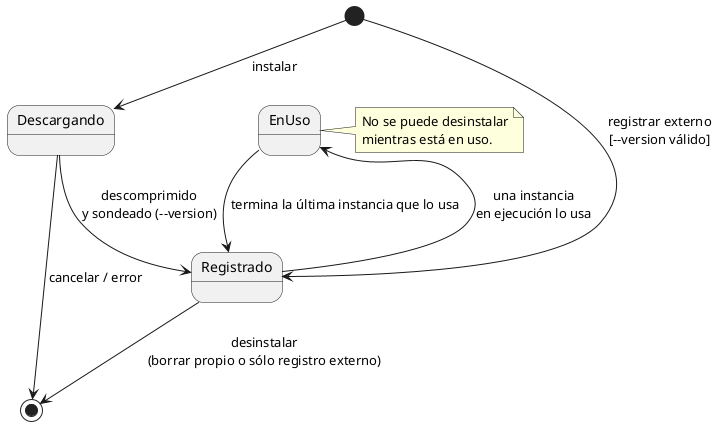
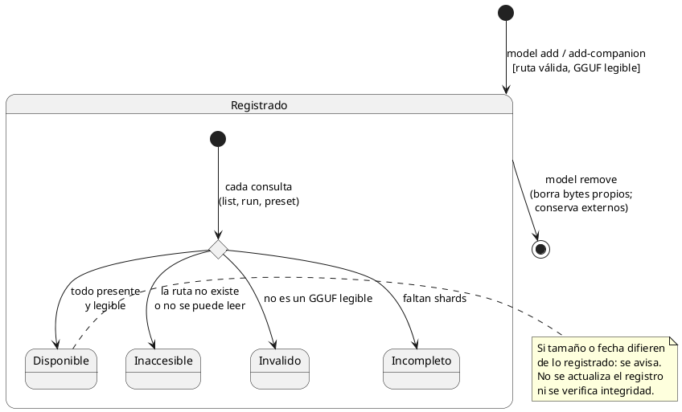
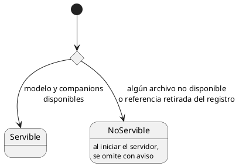

# Diagramas de estado

## Instancia

Una instancia es un `llama-server` vivo: existe desde que se inicia hasta que termina. El
estado se **deriva** del PID guardado, de lo que responde el sistema operativo y del
endpoint de salud de `llama-server`.

- **Huérfana:** el PID guardado apunta a un proceso que ya no existe o que el sistema
  reutilizó para otro programa. Coquena debe verificar que el PID pertenece al
  `llama-server` que lanzó antes de actuar sobre él.

## Backend registrado

## Modelo y companion (núcleo)

Un solo eje: **disponibilidad**. Se deriva en cada consulta, sin hashear y sin persistir.
Por qué un solo eje, y qué quedó afuera: [modelos-y-companions.md](modelos-y-companions.md).

- **Origen** (gestionado o externo) es un atributo del registro, no un estado.
- Un companion no depende de su modelo principal para estar disponible.

## Preset

Derivado de la disponibilidad de su modelo y sus companions.

