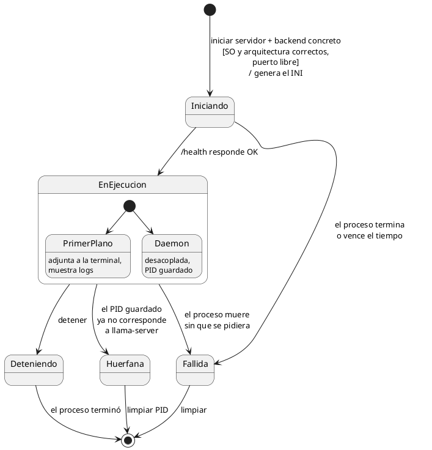
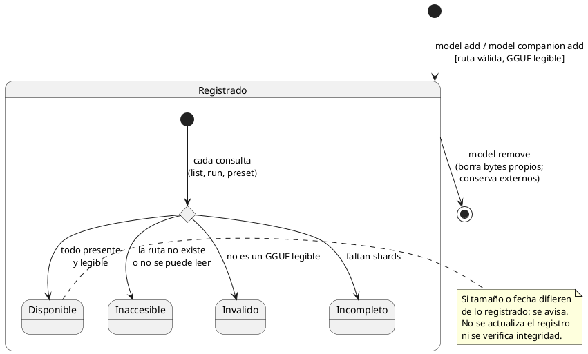
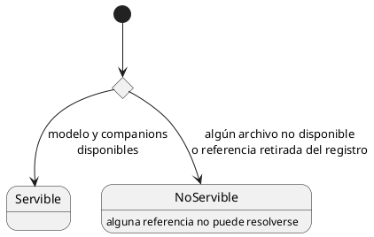

# Diagramas de estado

## Instancia (borrador)

Una instancia es un `llama-server` vivo: existe desde que se inicia hasta que termina. El
estado se **deriva** del PID guardado, de lo que responde el sistema operativo y del
endpoint de salud de `llama-server`.

- **Huérfana:** el PID guardado apunta a un proceso que ya no existe o que el sistema
  reutilizó para otro programa. Coquena debe verificar que el PID pertenece al
  `llama-server` que lanzó antes de actuar sobre él.

## Backend registrado

La transferencia y sus estados pertenecen a [descargas.md](descargas.md).
El backend aparece como registrado sólo tras validar y publicar la instalación, o tras
registrar un externo con sondeo válido. Un trabajo pausado o fallido no es un backend
instalado y permanece recuperable en el administrador de descargas.

La política de retirar backends en uso se resolverá con servidores; no se establece aquí.

## Modelo y companion (núcleo)

Este diagrama representa sólo **disponibilidad**, derivada en cada consulta sin hash
completo y sin persistir. Seguimiento remoto e integridad son ejes independientes,
definidos en [modelos-y-companions.md](modelos-y-companions.md): perder el seguimiento
no cambia por sí solo la disponibilidad; en externos el seguimiento no aplica.

- **Origen** (gestionado o externo) es un atributo del registro, no un estado.
- Un companion no depende de su modelo principal para estar disponible.

## Preset: disponibilidad de referencias

Derivado de la disponibilidad de su modelo y sus companions.

