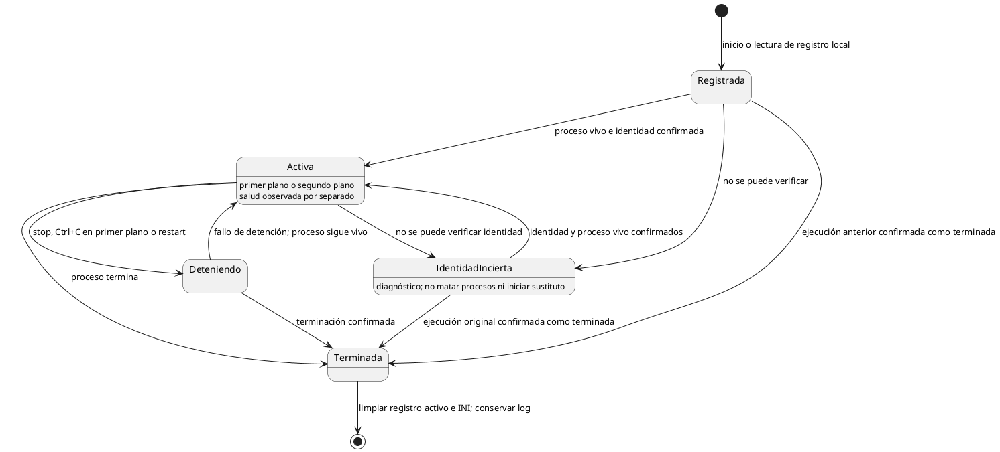
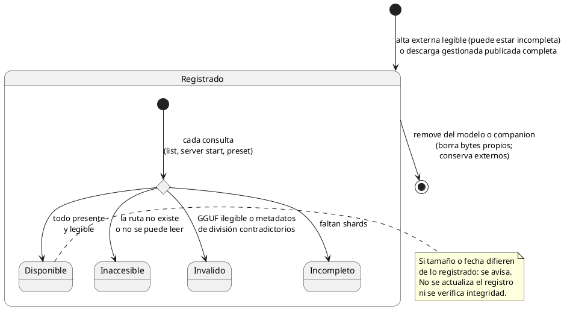
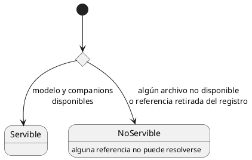

# Diagramas de estado

## Instancia y registro de ejecución

El estado se deriva de la existencia e identidad del proceso. Salud y modo de ejecución
son observaciones distintas: no responder a /health no demuestra que el proceso terminó.
Los tiempos y mecanismos concretos se definen al implementar.

Un PID reutilizado no autoriza a actuar sobre el proceso ajeno. Si se confirma que la
ejecución original terminó, se limpia su registro, no se mata el proceso que reutilizó
el PID. Si hay incertidumbre, se conserva evidencia y se informa. No hay reinicio automático.
La definición de servidor con backend ausente es una referencia rota, no un proceso huérfano.

## Backend registrado

La transferencia y sus estados pertenecen a [descargas.md](descargas.md).
El backend aparece como registrado sólo tras validar y publicar la instalación, o tras
registrar un externo con sondeo válido. Un trabajo pausado o fallido no es un backend
instalado y permanece recuperable en el administrador de descargas.

Retirar un backend se rechaza mientras una instancia activa lo utiliza. Si sólo lo
referencian definiciones de servidores detenidos, se permite retirarlo y se conservan
esas definiciones con backend ausente. Véase [servidores.md](servidores.md#backend-seleccionado-ausente).

## Modelo y companion (núcleo)

Este diagrama representa sólo **disponibilidad**, derivada en cada consulta sin hash
completo y sin persistir. Seguimiento remoto e integridad son ejes independientes,
definidos en [modelos-y-companions.md](modelos-y-companions.md): perder el seguimiento
no cambia por sí solo la disponibilidad; en externos el seguimiento no aplica.

- **Origen** (gestionado o externo) es un atributo del registro, no un estado.
- Un companion no depende de su modelo principal para estar disponible.

## Preset: disponibilidad de referencias

Derivado de la disponibilidad de su modelo y sus companions.

