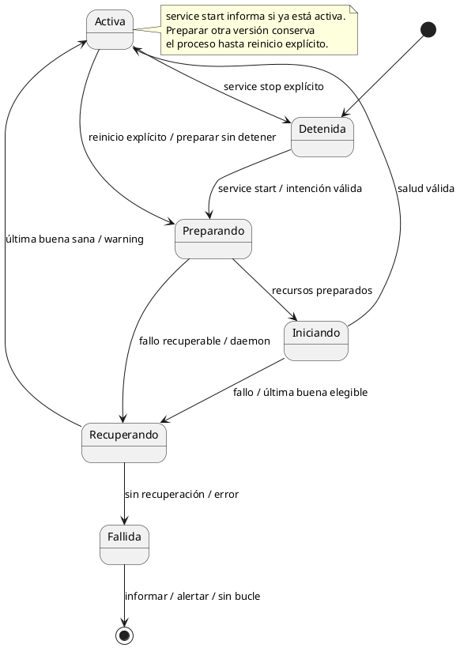
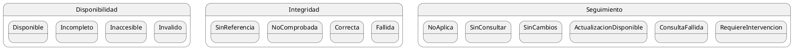
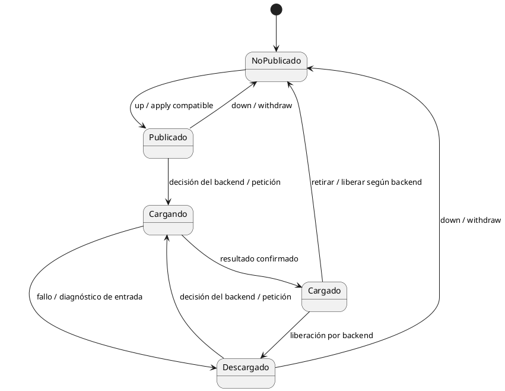

# Diagramas de estado

Los ejes son independientes. Estar disponible, íntegro, actualizado, publicado
en el router y cargado en memoria son afirmaciones diferentes.

## Instancia y registro de ejecución

Un fallo de integridad conocido no toma la transición de recuperación.
La política interactiva ofrece opciones; el diagrama representa el ciclo
desacoplado. Una pérdida del observador no es una transición del servidor.

## Backend registrado

Backend puede ser externo o gestionado. Registro, preparación, compatibilidad
de hardware, salud y uso activo se conservan por separado. Una revisión nueva
preparada no vuelve obsoleta físicamente la revisión que sigue usando el proceso.

## Modelo y companion (núcleo)

La comprobación completa de integridad no se repite al arrancar.
Un fallo registrado bloquea selecciones que usan ese recurso; excluirlo no lo repara.
Una retirada parcial conserva inventario/propiedad y no se considera servible.

## Preset publicado y estado observado del backend

Servible requiere recursos seleccionados disponibles y sin fallo de integridad
conocido. No garantiza que la carga real funcione.

Las transiciones de residencia son observaciones del backend, no comandos de Coquena.
Descargado aquí significa fuera de memoria, no borrado de disco.
No confundir servidor sano con todos los presets cargados correctamente.
