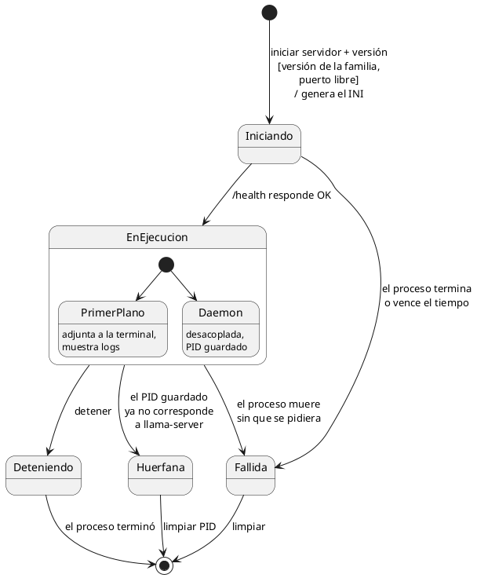
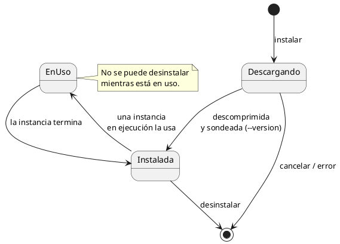

# Diagramas de estado

## Instancia

Una instancia es un `llama-server` vivo: existe desde que se inicia hasta que termina. El
estado se **deriva** del PID guardado, de lo que responde el sistema operativo y del
endpoint de salud de `llama-server`.

- **Huérfana:** el PID guardado apunta a un proceso que ya no existe o que el sistema
  reutilizó para otro programa. Coquena debe verificar que el PID pertenece al
  `llama-server` que lanzó antes de actuar sobre él.

## Versión de backend

