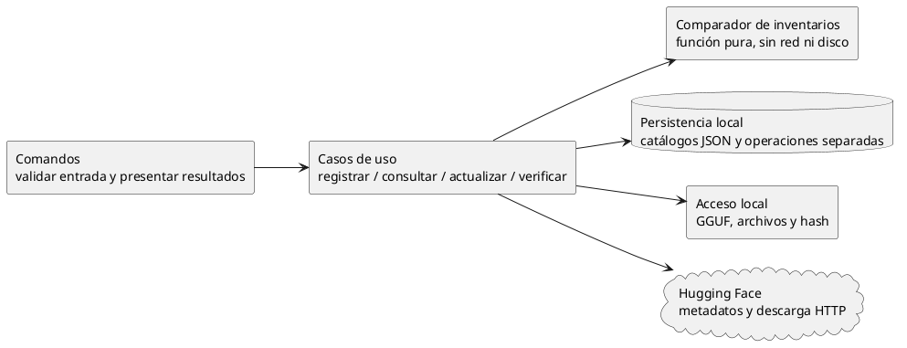
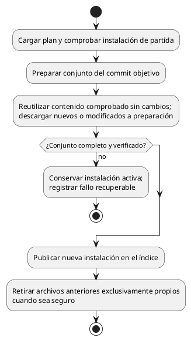

# Implementación del catálogo de modelos

## Contrato de trabajo para agentes

Esta guía permite implementar en C# por entregas pequeñas sin reconstruir la conversación.
No crea el proyecto ni autoriza a implementar ahora. Leer primero
[las reglas funcionales](modelos-y-companions.md) y luego la entrega asignada aquí.

- **Acordado:** comportamiento de modelos-y-companions.md; ningún agente lo reinterpreta.
- **Diseño propuesto:** mecanismos concretos de esta guía, pendientes de revisión antes
  de implementarlos. La estructura JSON de la sección 2 sí está acordada; librerías y
  mecanismos no aprobados siguen siendo propuestas.
- **Pendiente:** decisiones enumeradas al final. Un agente no las resuelve por omisión.
- Implementar desde cero a partir de estos contratos; ninguna tarea requiere consultar otro repositorio.
- Implementar sólo la entrega asignada. No crear framework de proveedores, daemon,
  frontend, servidor HTTP, soporte MLX ni motor propio de Xet para resolver este catálogo.
- No incorporar paquetes ni cambiar contratos compartidos sin explicar su necesidad y
  obtener la decisión correspondiente. No hacer commits sin autorización explícita.
- Si aparece una contradicción, señalar las dos reglas y detener sólo el trabajo afectado.
  No ampliar silenciosamente el alcance para resolverla.

## 1. Separación mínima de responsabilidades

Son responsabilidades de código, no una obligación de crear proyectos, interfaces o
capas por cada caja. Mantener una aplicación C# comprensible.



El acceso HTTP traduce respuestas a datos propios; no introduce objetos del proveedor
en presets ni en el comparador. La resolución de referencias para generar INI es local:
no consulta Hugging Face ni exige que el seguimiento esté al día.

## 2. Datos mínimos y significado

### Almacenamiento local acordado

Configuración, catálogos y registros de operaciones conservan JSON indentado con el
estado actual, para facilitar lectura y edición manual. JSONL se utiliza para el log
local de transacciones: un evento JSON por línea, agregado secuencialmente y con retención
limitada. No es la fuente del estado ni exige reproducir eventos para reconstruir catálogos.
Los logs originales de llama-server pueden conservarse como texto.

No utilizar JSONL como historial de modificaciones de los catálogos: actualizar o retirar
un registro exigiría reescribir el archivo o introducir reproducción y compactación.
JSONL no aporta atomicidad; se mantiene la exclusión de escritores. Los documentos de
estado se guardan en un archivo nuevo y se reemplazan de forma segura. El nombre/ruta,
límite y rotación del log de transacciones se concretan al implementar, sin registrar
credenciales ni URLs firmadas. No conservar indefinidamente eventos ni operaciones terminadas.

```text
<home>/
  config.json
  catalogs/
    models.json       # modelos principales y companions
    backends.json
    parameters.json
    presets.json
    servers.json      # definiciones persistidas de servidores
  run/<servidor>/     # registro JSON de instancia e INI por lanzamiento
  logs/<servidor>/    # salida de llama-server como texto, con retención limitada
  downloads/<guid>/
    operation.json
    files/
  models/<usuario>/<repositorio>/<ruta-remota>
  backends/           # disposición interna pendiente
```

Un JSON por catálogo, no un archivo por registro ni por shard; configuración separada.
Config.json conserva las selecciones de servidor/backend predeterminados y las políticas
de retención. Servers.json guarda presets referenciados, selección propia de backend
o herencia y parámetros propios; no duplica valores efectivos heredados. El registro
de instancia bajo run conserva ID, PID, backend/build concretos, escucha efectiva y
ubicación del log. La definición guarda intención; la instancia registra lo ejecutado.
Detener elimina el registro activo y su INI, no el último log. La consulta de ese log
no exige mantener una instancia detenida como activa; la referencia al último log
se diseña al implementar; la estructura mínima de servidores está acordada en
[servidores.md](servidores.md#estructura-mínima-de-json-acordada).
Los registros tienen nombre canónico visible e ID estable. Las referencias conservan
el ID para sobrevivir a renombres y muestran el nombre para lectura humana; un nombre
reutilizado no reconecta referencias al registro retirado. El esquema concreto sigue
pendiente para los otros catálogos; no se exige duplicar nombre e ID en cada referencia.

Los pesos conservan las rutas relativas remotas bajo usuario/repositorio; no se agrega
una carpeta propia por cuantización. Los renombres confirmados se reflejan físicamente
según las reglas funcionales. Validar las rutas antes de escribir: ninguna ruta remota
puede escapar del área gestionada. La publicación entre archivos e índice requiere
un protocolo recuperable; JSON por sí solo no lo garantiza.

Nombres conceptuales: no son todavía clases públicas ni esquema de persistencia.

| Registro | Contenido |
|---|---|
| Entrada | Identificador estable, nombre canónico, modelo o companion, tipo de companion, propiedad, instalación activa |
| Instalación | Archivos esperados y rutas locales; externo puede estar incompleto; commit de descarga si es gestionada |
| Archivo instalado | Ruta local, ruta remota si aplica, tamaño observado, fecha local observada, identidad remota tipada, referencia de integridad opcional |
| Origen seguido | Repositorio, referencia solicitada, selección remota y correspondencias actuales de sus archivos |
| Consulta remota | Fecha, commit consultado, resultado, diferencias y candidatos; separada de la instalación |
| Plan de actualización | Instalación de partida, commit objetivo, conjunto objetivo completo y acciones por archivo |
| Verificación | Archivo y referencia comprobados, resultado y fecha; error de lectura distinto de discrepancia |

Un hash se representa con **tipo/algoritmo, dominio y valor completo**. Un commit no es
un hash de archivo. No comparar un hash de puntero Git con un SHA-256 de los pesos.
ETag es evidencia del transporte que debe interpretarse según su contrato, no por su
longitud. La ausencia de identidad comparable produce incertidumbre, no igualdad.

SHA-256 completo es la referencia de integridad local acordada, calculada durante la
escritura de la descarga sin una segunda lectura obligatoria. Contrastar con el digest
remoto sólo si representa esos mismos bytes y algoritmo. Xet no obliga a implementar
su algoritmo interno para usar una descarga convencional.

Las referencias de configuración deben sobrevivir a la actualización de archivos.
Se resuelven mediante el identificador estable, no mediante rutas físicas.
El nombre canónico es case insensitive, sin aliases. Los renombres físicos siguen la
regla funcional; esquema de ID y recuperación se concretan al implementar.

## 3. Registro externo y comprobaciones locales

1. Validar nombre canónico, rutas y encabezados con lecturas acotadas; aplicar la
   agrupación estándar desde el primer shard. Conservar partes esperadas y faltantes:
   un externo incompleto puede registrarse con diagnóstico, pero no usarse.
2. Registrar todas las rutas de la unidad como externas, sin copiar ni crear enlaces.
3. No exigir hash completo. Tras persistir, intentar emparejamiento sólo si se indicó `--try-match`,
   usando `--name` y metadatos locales. Un fallo remoto no revierte el alta.
4. Resolver luego esas rutas para el INI. No certificar compatibilidad con el backend.

Listar deriva disponibilidad mediante acceso local y muestra avisos de tamaño/fecha.
No reescribe hashes, procedencia ni referencias remotas. `refresh` sólo relee los
metadatos locales previstos por la regla funcional.

La verificación explícita recorre los archivos con memoria acotada y compara contra
su referencia. Si falta referencia, informa que no puede verificar: establecer una
base para un externo es otra acción explícita. Si tamaño/fecha cambian durante la
lectura, no publicar un éxito concluyente; esos indicadores tampoco detectan por sí
solos todas las modificaciones concurrentes.

No escribir junto a archivos externos. Retirarlos elimina sólo su registro. Un enlace
hacia fuera del área gestionada no transforma su destino en propiedad de Coquena.

## 4. Adaptador de Hugging Face: sólo la información necesaria

Operaciones requeridas, independientemente de la librería elegida:

| Operación | Resultado requerido |
|---|---|
| Resolver referencia | Commit concreto del repositorio |
| Consultar inventario en ese commit | Rutas, tamaños e identidades de contenido tipadas, con paginación completa |
| Consultar metadatos de archivo | Identidad y ubicación de descarga, cuando el inventario no alcance |
| Descargar selección fijada | Flujo de bytes de cada archivo elegido en ese commit |

No clonar Git, descargar tensores para consultar novedades ni inspeccionar todos los
GGUF del Hub. Empezar por las rutas seleccionadas; ampliar al inventario del repositorio
si hace falta localizar una reubicación. La paginación incompleta no prueba ausencia.

Autenticación, red, límites de peticiones, repositorio inaccesible y revisión inexistente
se informan como fallos de consulta, no como actualización ni borrado remoto confirmado.
Respetar las indicaciones de espera del servidor y usar reintentos acotados; no sondear
en bucle ni efectuar búsquedas históricas exhaustivas. Nunca registrar credenciales o
URLs firmadas como identidad duradera. No reenviar credenciales a cualquier host al
seguir redirecciones.

Antes de elegir endpoints/librería, comprobar estas capacidades con fixtures pequeños
y documentación oficial. No hacer experimentos descargando modelos de gigabytes.
La sintaxis de la API Python citada como referencia no exige introducir Python en C#.

## 5. Comparación determinista y update

Implementar las [reglas de correspondencia](modelos-y-companions.md#reglas-de-correspondencia)
como función pura: entrada = instalación, correspondencias seguidas e inventario remoto;
salida = diferencias explicadas y, sólo si hay resolución suficiente, conjunto objetivo.
No hay E/S ni selección opaca por semejanza.

Identidad ausente o incomparable produce un resultado no concluyente. No sustituir
esa evidencia por commit, tamaño o fecha. Para localizar una reubicación se necesita
inventario suficientemente completo; para comparar rutas conocidas no hace falta
recorrer todo el repositorio.

Resultados propuestos: sin consultar, sin cambios, actualización disponible,
requiere intervención y consulta fallida; externo usa no aplica.
Conservar último intento y último éxito con sus fechas.
Una elección manual resuelve correspondencia, no prueba retrospectivamente procedencia.
## 6. Descarga inicial y `upgrade`: publicación recuperable

La adquisición inicial usa el menú definido en comandos.md y secuencias.md: cuantización
opcional, README a pedido y cancelación antes de crear trabajo. Upgrade aplica el plan
fijado sin repetir esa selección. Ambos transfieren en primer plano; Ctrl+C conserva
parciales y muestra el GUID para reanudar sin volver a buscar ni elegir cuantización.

El [administrador de descargas](descargas.md) define los contratos de transferencia, pausa, reanudación, cancelación, progreso y vistas global/filtrada. Implementarlos en C# con las pruebas de aceptación allí especificadas.

La preparación acordada es `downloads/<guid>/operation.json` y `files/`, según
[descargas.md](descargas.md#área-de-preparación-acordada). Está separada del destino
instalado y en el mismo volumen en la primera iteración. La disposición del catálogo
instalado está acordada en la sección 2; el protocolo recuperable sigue pendiente.
No exigir symlinks.



- Descargar siempre desde el commit fijado. Si deja de estar accesible, fallar sin
  sustituirlo por `main` ni por otra revisión.
- Antes de aplicar, comprobar que el plan sigue ligado a la instalación actual. Otro
  proceso no puede aplicar después un plan obsoleto sin detectarlo.
- Reutilización exige evidencia local suficiente; no confiar únicamente en que el
  índice recuerde un digest. Si hace falta, verificar los bytes antes de reutilizarlos.
- No reemplazar shards activos durante la transferencia. Verificar el conjunto antes
  de publicar. Guardar cada JSON nuevo y reemplazar el original de forma segura, con
  exclusión de escritores y comprobación de vigencia. Esto no vuelve atómicos los
  movimientos físicos: detectar inconsistencias sin reparación destructiva automática.
  No se impone un archivo transaccional adicional.
- Mantener la instalación anterior durante preparación; después de una publicación
  confirmada, la nueva debe estar completa. Una interrupción entre movimiento e índice
  puede requerir recuperación antes de usar la unidad. No declarar éxito o inventar
  rutas para ocultarlo. Probar el mecanismo con fallos; una limpieza pendiente no revierte
  una publicación válida.
- Cancelación, falta de espacio o hash incorrecto no publican archivos parciales.
  Validar rutas remotas para impedir escapes, rutas absolutas y colisiones locales.
- La política de archivos compartidos y de modelos en uso es un prerrequisito de la
  activación y limpieza definitivas, no algo que el agente de descargas deba inventar.
- Reanudar una transferencia incompleta no es actualizar por bloques un archivo viejo.
  Ninguna de esas optimizaciones forma parte del comparador.

## 7. Emparejamiento

El intento es opcional mediante `--try-match`; el nombre se declara con `--name`.
El flujo está en [secuencias.md](secuencias.md#1-registrar-un-externo-e-intentar-emparejarlo).
Implementar consultas acotadas a partir de pistas locales. Tras concretar el registro
local, mostrar candidatos y razones en un menú con selección explícita o cancelación.
Guardar la equivalencia elegida como información, no como identidad certificada ni
habilitación de seguimiento. Cancelar deja el alta local intacta y sin emparejamiento.

Si el nombre está ocupado por un externo, ofrecer la transición explícita definida
en modelos-y-companions.md: publicar sólo tras completar/verificar la descarga,
conservando ID y referencias, sin tocar los archivos externos. La operación conserva
el registro de partida para comprobar vigencia antes de publicar.
## 8. Entregas delegables y evidencia de aceptación

Cada entrega recibe este documento, las reglas funcionales, sus decisiones pendientes
resueltas y el contrato de su predecesora. No comenzar todas en paralelo: primero
estabilizar los datos compartidos. Sólo después podrán delegarse piezas independientes.

| Entrega | Depende de | Resultado y pruebas mínimas |
|---|---|---|
| M0: contratos y fixtures | Decisiones de identidad local y agrupación | Datos de ejemplo monofichero, shards y companion; revisión humana, sin aplicación todavía |
| M1: comparador puro | M0 | Tabla de correspondencia completa; mismas entradas producen mismo resultado; ninguna E/S |
| M2: índice y registro externo | M0, M3, persistencia elegida | Registro local independiente del éxito remoto; listado/retiro sin red; cero escrituras externas; colisión sin pérdida |
| M3: inspección e integridad | M0 | GGUF inválido, shards ausentes, lectura fallida, hash correcto/incorrecto; nunca rebasar referencia tras discrepancia |
| M4: metadatos HF y update | M1, M2, contrato HTTP verificado | Paginación, error de acceso/red, identidad ausente, reubicación; cero descarga de pesos |
| M5: descarga y upgrade | M2–M4, publicación/propiedad resueltas | Commit fijo, conjunto verificado, plan obsoleto, fallo y recuperación antes/después de activación |
| M6: búsqueda asistida | M2–M4, UX definida | Intento opcional en el alta; candidatos no certificados; fallo remoto no invalida registro; descarga no altera externo |

Pruebas de regresión obligatorias: cambio sólo de README; cambio de pesos con igual
nombre; renombre exacto único y ambiguo; eliminación más alta con distinto contenido;
shard faltante; companion no elegido; externo modificado por otra herramienta; error
de consulta con último éxito previo; fallo de descarga conservando versión instalada.

Usar archivos pequeños y transporte simulado para pruebas deterministas. Las pruebas
de integración remota son opt-in y acotadas; no dependen de modelos enormes ni se ejecutan
en cada listado. No declarar una entrega terminada sólo porque compila.

Cada agente entrega: alcance realizado, archivos modificados, pruebas ejecutadas y
resultado, limitaciones, decisiones pendientes y siguiente dependencia. Distinguir
claramente propuesta, implementación y comportamiento efectivamente verificado.

## 9. Decisiones que no deben quedar ocultas en el código

Esta es la lista central de pendientes. No reabre nombres canónicos, shards estándar,
JSON por catálogo, comandos de companions, SHA-256, alcance global de update/upgrade
ni controles de descargas ya acordados.

### Decisiones funcionales pendientes

- Autenticación y repositorios privados/restringidos: decisión aplazada; no requisito
  confirmado de la primera versión.

### Detalles técnicos al implementar

- Esquemas JSON y versiones; representación de IDs; exclusión de escritores y
  comprobación de ejecutores vivos; recuperación entre cambios de disco e índice.
- Reutilización física dentro de la misma unidad, sin deduplicación entre repositorios;
  representación de eliminaciones parciales; tratamiento de identificadores remotos
  no comparables sin convertirlos en evidencia falsa de igualdad.
- Límites de consultas, metadatos, tiempos, reintentos y extracción; frecuencia de
  checkpoints y formato del log. Reintentos limitados y trabajo recuperable ya están acordados.
- Detención y diagnóstico tras fallar un archivo del conjunto, sin confundirlo con
  el recorrido global: un fallo de unidad no impide tratar otras unidades.
- Disposición interna de backends; cálculo de espacio liberado y pruebas de fallos.

Estos detalles requieren evidencia y pruebas en su entrega, no nuevas rondas de
decisiones funcionales salvo que aparezca un impacto visible o una contradicción.
Las reglas de recursos en uso y retención de backends están en [servidores.md](servidores.md).
Upgrade de pesos en uso se rechaza; el mecanismo de exclusión y recuperación requiere pruebas. La TUI, separación configurable de ubicaciones y transferencia diferencial
por bloques quedan para iteraciones posteriores.

## Referencias

Las referencias verificadas durante el análisis están en
[modelos-y-companions.md](modelos-y-companions.md#referencias-técnicas). Antes de integrar
el proveedor, verificar su contrato vigente y guardar fixtures sin credenciales. No
convertir un comportamiento observado en una garantía universal de todos los orígenes.
