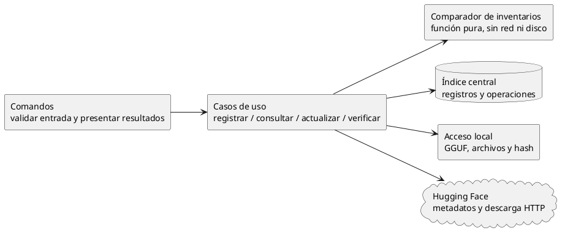
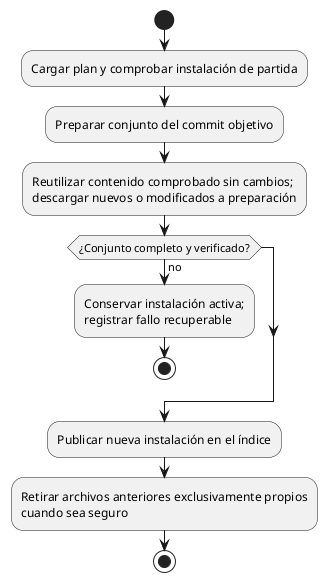

# Implementación del catálogo de modelos

## Contrato de trabajo para agentes

Esta guía permite implementar en C# por entregas pequeñas sin reconstruir la conversación.
No crea el proyecto ni autoriza a implementar ahora. Leer primero
[las reglas funcionales](modelos-y-companions.md) y luego la entrega asignada aquí.

- **Acordado:** comportamiento de modelos-y-companions.md; ningún agente lo reinterpreta.
- **Diseño propuesto:** mecanismos concretos de esta guía, pendientes de revisión antes
  de implementarlos. No equivalen a decisiones ya aceptadas sobre persistencia o librerías.
- **Pendiente:** decisiones enumeradas al final. Un agente no las resuelve por omisión.
- Implementar desde cero a partir de estos contratos; ninguna tarea requiere consultar otro repositorio.
- Implementar sólo la entrega asignada. No crear framework de proveedores, daemon,
  frontend, servidor HTTP, soporte MLX ni motor propio de Xet para resolver este catálogo.
- No incorporar paquetes ni cambiar contratos compartidos sin explicar su necesidad y
  obtener la decisión correspondiente. No hacer commits sin autorización explícita.
- Si aparece una contradicción, señalar las dos reglas y detener sólo el trabajo afectado.
  No ampliar silenciosamente el alcance para resolverla.

## 1. Separación mínima de responsabilidades

Son responsabilidades de código, no una obligación de crear proyectos, interfaces o
capas por cada caja. Mantener una aplicación C# comprensible.

El acceso HTTP traduce respuestas a datos propios; no introduce objetos del proveedor
en presets ni en el comparador. La resolución de referencias para generar INI es local:
no consulta Hugging Face ni exige que el seguimiento esté al día.

## 2. Datos mínimos y significado

Nombres conceptuales: no son todavía clases públicas ni esquema de persistencia.

| Registro | Contenido |
|---|---|
| Entrada | Identificador estable propuesto, alias, modelo o companion, tipo de companion, propiedad, instalación activa |
| Instalación | Conjunto completo de archivos locales; commit de descarga si es gestionada |
| Archivo instalado | Ruta local, ruta remota si aplica, tamaño observado, fecha local observada, identidad remota tipada, referencia de integridad opcional |
| Origen seguido | Repositorio, referencia solicitada, selección remota y correspondencias actuales de sus archivos |
| Consulta remota | Fecha, commit consultado, resultado, diferencias y candidatos; separada de la instalación |
| Plan de actualización | Instalación de partida, commit objetivo, conjunto objetivo completo y acciones por archivo |
| Verificación | Archivo y referencia comprobados, resultado y fecha; error de lectura distinto de discrepancia |

Un hash se representa con **tipo/algoritmo, dominio y valor completo**. Un commit no es
un hash de archivo. No comparar un hash de puntero Git con un SHA-256 de los pesos.
ETag es evidencia del transporte que debe interpretarse según su contrato, no por su
longitud. La ausencia de identidad comparable produce incertidumbre, no igualdad.

Propuesta: SHA-256 completo como referencia de integridad local, calculado durante la
escritura de la descarga sin una segunda lectura obligatoria. Contrastar con el digest
remoto sólo si representa esos mismos bytes y algoritmo. Xet no obliga a implementar
su algoritmo interno para usar una descarga convencional.

Las referencias de configuración deben sobrevivir a la actualización de archivos.
Se propone resolverlas mediante un identificador estable, no mediante rutas físicas.
El espacio de aliases y su posible renombrado se deciden antes de cerrar ese contrato.

## 3. Registro externo y comprobaciones locales

1. Validar alias, rutas y encabezados con lecturas acotadas; reunir los shards requeridos.
2. Registrar todas las rutas de la unidad como externas, sin copiar ni crear enlaces.
3. No ejecutar búsqueda remota ni hash completo como efecto secundario.
4. Resolver luego esas rutas para el INI. No certificar compatibilidad con el backend.

Listar deriva disponibilidad mediante acceso local y muestra avisos de tamaño/fecha.
No reescribe hashes, procedencia ni referencias remotas. `refresh` sólo relee los
metadatos locales previstos por la regla funcional.

La verificación explícita recorre los archivos con memoria acotada y compara contra
su referencia. Si falta referencia, informa que no puede verificar: establecer una
base para un externo es otra acción explícita. Si tamaño/fecha cambian durante la
lectura, no publicar un éxito concluyente; esos indicadores tampoco detectan por sí
solos todas las modificaciones concurrentes.

No escribir junto a archivos externos. Retirarlos elimina sólo su registro. Un enlace
hacia fuera del área gestionada no transforma su destino en propiedad de Coquena.

## 4. Adaptador de Hugging Face: sólo la información necesaria

Operaciones requeridas, independientemente de la librería elegida:

| Operación | Resultado requerido |
|---|---|
| Resolver referencia | Commit concreto del repositorio |
| Consultar inventario en ese commit | Rutas, tamaños e identidades de contenido tipadas, con paginación completa |
| Consultar metadatos de archivo | Identidad y ubicación de descarga, cuando el inventario no alcance |
| Descargar selección fijada | Flujo de bytes de cada archivo elegido en ese commit |

No clonar Git, descargar tensores para consultar novedades ni inspeccionar todos los
GGUF del Hub. Empezar por las rutas seleccionadas; ampliar al inventario del repositorio
si hace falta localizar una reubicación. La paginación incompleta no prueba ausencia.

Autenticación, red, límites de peticiones, repositorio inaccesible y revisión inexistente
se informan como fallos de consulta, no como actualización ni borrado remoto confirmado.
Respetar las indicaciones de espera del servidor y usar reintentos acotados; no sondear
en bucle ni efectuar búsquedas históricas exhaustivas. Nunca registrar credenciales o
URLs firmadas como identidad duradera. No reenviar credenciales a cualquier host al
seguir redirecciones.

Antes de elegir endpoints/librería, comprobar estas capacidades con fixtures pequeños
y documentación oficial. No hacer experimentos descargando modelos de gigabytes.
La sintaxis de la API Python citada como referencia no exige introducir Python en C#.

## 5. Comparación determinista y `update`

Entrada del comparador: inventario instalado, correspondencias seguidas e inventario
remoto completo en un commit. Salida: diferencias explicadas y, sólo si hay resolución
suficiente, un conjunto objetivo. No escribe archivos, no decide por semejanza opaca.

1. Misma ruta e identidad comparable igual: conservar contenido.
2. Misma ruta e identidad comparable distinta: contenido modificado.
3. Ruta ausente: buscar coincidencia exacta de contenido en el inventario remoto.
   Una sola permite seguir la reubicación; varias requieren elección.
4. Sin coincidencia exacta: candidatos por pistas, nunca sustitución automática.
5. Identidad ausente o incomparable: resultado no concluyente; no usar sólo commit,
   tamaño o fecha para afirmar identidad o actualización de pesos.
6. Validar la correspondencia del conjunto completo de shards. Cambios en su composición
   requieren una regla explícita de agrupación; hasta resolverla, pedir intervención.

`update` fija un commit, obtiene metadatos, compara y guarda la observación. No actualiza
el commit de descarga ni las rutas físicas instaladas. Un commit distinto con idénticos
archivos seleccionados significa que no hay pesos que descargar.

Propuesta de resultados internos: sin consultar, sin cambios, actualización disponible,
requiere intervención, consulta fallida; externo usa no aplica. Conservar fecha y último
éxito separadamente del último intento para no mostrar información vieja como actual.

Una elección del usuario resuelve una correspondencia, no demuestra retrospectivamente
que los bytes anteriores procedían de esa revisión. Persistir la selección explícita
sin fabricar esa evidencia.

## 6. Descarga inicial y `upgrade`: publicación recuperable

El [administrador de descargas](descargas.md) define los contratos de transferencia, pausa, reanudación, cancelación, progreso y vistas global/filtrada. Implementarlos en C# con las pruebas de aceptación allí especificadas.

Propuesta de almacenamiento: índice central y directorios propios por instalación,
con área de preparación dentro del mismo volumen. Los nombres exactos y el motor del
índice siguen pendientes. No copiar la estructura de LM Studio ni exigir symlinks.

- Descargar siempre desde el commit fijado. Si deja de estar accesible, fallar sin
  sustituirlo por `main` ni por otra revisión.
- Antes de aplicar, comprobar que el plan sigue ligado a la instalación actual. Otro
  proceso no puede aplicar después un plan obsoleto sin detectarlo.
- Reutilización exige evidencia local suficiente; no confiar únicamente en que el
  índice recuerde un digest. Si hace falta, verificar los bytes antes de reutilizarlos.
- No reemplazar shards activos uno a uno. Propuesta: preparar la instalación, registrar
  durablemente la operación y cambiar su referencia activa mediante una escritura
  transaccional del índice. Una transacción de base de datos no vuelve atómicas las
  operaciones del sistema de archivos.
- Recuperación tras interrupción: antes del cambio activo sigue vigente la instalación
  anterior; después, la nueva completa. La limpieza pendiente no revierte una publicación
  válida. El mecanismo exacto depende del índice elegido y debe probarse con fallos.
- Cancelación, falta de espacio o hash incorrecto no publican archivos parciales.
  Validar rutas remotas para impedir escapes, rutas absolutas y colisiones locales.
- La política de archivos compartidos y de modelos en uso es un prerrequisito de la
  activación y limpieza definitivas, no algo que el agente de descargas deba inventar.
- Reanudar una transferencia incompleta no es actualizar por bloques un archivo viejo.
  Ninguna de esas optimizaciones forma parte del comparador.

## 7. Búsqueda asistida: fuera del camino obligatorio

Una acción explícita puede leer nombre y metadatos locales y proponer candidatos
remotos mediante consultas acotadas. Registrar y usar el externo funciona aunque esa
búsqueda no exista, falle o no encuentre nada. No reconstruir revisiones históricas.

Elegir descargar un candidato crea una instalación gestionada; no modifica ni convierte
automáticamente el externo. Reasignar un alias o los presets entre ambos requiere un
flujo explícito aún pendiente. No eliminar el externo al terminar la descarga.

## 8. Entregas delegables y evidencia de aceptación

Cada entrega recibe este documento, las reglas funcionales, sus decisiones pendientes
resueltas y el contrato de su predecesora. No comenzar todas en paralelo: primero
estabilizar los datos compartidos. Sólo después podrán delegarse piezas independientes.

| Entrega | Depende de | Resultado y pruebas mínimas |
|---|---|---|
| M0: contratos y fixtures | Decisiones de identidad local y agrupación | Datos de ejemplo monofichero, shards y companion; revisión humana, sin aplicación todavía |
| M1: comparador puro | M0 | Tabla de correspondencia completa; mismas entradas producen mismo resultado; ninguna E/S |
| M2: índice y registro externo | M0, persistencia elegida | Registro/listado/retiro sin red; cero escrituras externas; colisión de alias sin pérdida |
| M3: inspección e integridad | M0 | GGUF inválido, shards ausentes, lectura fallida, hash correcto/incorrecto; nunca rebasar referencia tras discrepancia |
| M4: metadatos HF y update | M1, M2, contrato HTTP verificado | Paginación, error de acceso/red, identidad ausente, reubicación; cero descarga de pesos |
| M5: descarga y upgrade | M2–M4, publicación/propiedad resueltas | Commit fijo, conjunto verificado, plan obsoleto, fallo y recuperación antes/después de activación |
| M6: búsqueda asistida | M2–M4, UX definida | Candidatos no certificados; externo utilizable sin búsqueda; descarga no altera externo |

Pruebas de regresión obligatorias: cambio sólo de README; cambio de pesos con igual
nombre; renombre exacto único y ambiguo; eliminación más alta con distinto contenido;
shard faltante; companion no elegido; externo modificado por otra herramienta; error
de consulta con último éxito previo; fallo de descarga conservando versión instalada.

Usar archivos pequeños y transporte simulado para pruebas deterministas. Las pruebas
de integración remota son opt-in y acotadas; no dependen de modelos enormes ni se ejecutan
en cada listado. No declarar una entrega terminada sólo porque compila.

Cada agente entrega: alcance realizado, archivos modificados, pruebas ejecutadas y
resultado, limitaciones, decisiones pendientes y siguiente dependencia. Distinguir
claramente propuesta, implementación y comportamiento efectivamente verificado.

## 9. Decisiones que no deben quedar ocultas en el código

Antes de la entrega afectada, resolver con el usuario:

1. Identificador local estable, namespace/case de aliases y renombrado.
2. Detección de shards, selección de variante y archivo de entrada para llama.cpp.
3. Ubicación y formato del índice, versión de esquema, exclusión de escritores,
   publicación recuperable y almacenamiento de archivos sin cambios entre instalaciones.
4. Compartición de archivos, eliminación parcial y cálculo real de espacio liberado.
5. Confirmar SHA-256 local y tratamiento de identidades remotas no comparables.
6. Comandos de descarga/verificación/búsqueda y alcance de update/upgrade sin alias;
   actualización de companions y resolución manual de sucesores.
7. Autenticación y alcance inicial para repositorios privados o con acceso restringido;
   límites concretos de consultas, tamaño de metadatos, tiempos y reintentos.
8. Modelos en uso durante activación/eliminación, al abordar servidores; política de
   conservación de instalaciones anteriores y adaptación de las operaciones de descarga
   existentes a conjuntos de archivos (véase descargas.md).

Estas decisiones no reabren lo descartado: reconciliación obligatoria, sidecars por
shard, actualización de externos, descarga automática de companions, estado único que
mezcla disponibilidad con seguimiento, ni búsqueda exhaustiva de procedencia.

## Referencias

Las referencias verificadas durante el análisis están en
[modelos-y-companions.md](modelos-y-companions.md#referencias-técnicas). Antes de integrar
el proveedor, verificar su contrato vigente y guardar fixtures sin credenciales. No
convertir un comportamiento observado en una garantía universal de todos los orígenes.
