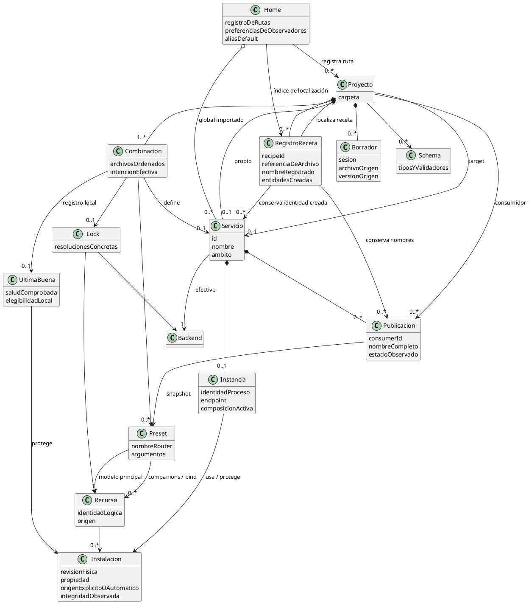

# Modelo de datos

Relaciones conceptuales, sin fijar clases ni layout. Las reglas pertenecen a
[proyectos](definiciones-declarativas.md), [servidores](servidores.md),
[modelos](modelos-y-companions.md) y [parámetros](catalogo-de-parametros.md).

Un servicio admite una instancia, no una por consumidor ni por combinación.
Los consumidores comparten proceso y conservan publicaciones independientes.
Compartir pesos por referencia dentro del proyecto no exige deduplicación global.
Instancias de otras carpetas deben respetar colisiones de recursos.

Los locks son transportables; inventario físico, PID, última buena y borradores son
locales. Los archivos INI/runtime se generan a partir del estado seleccionado;
no sustituyen el YAML ni se guardan en el temporal genérico del sistema.
