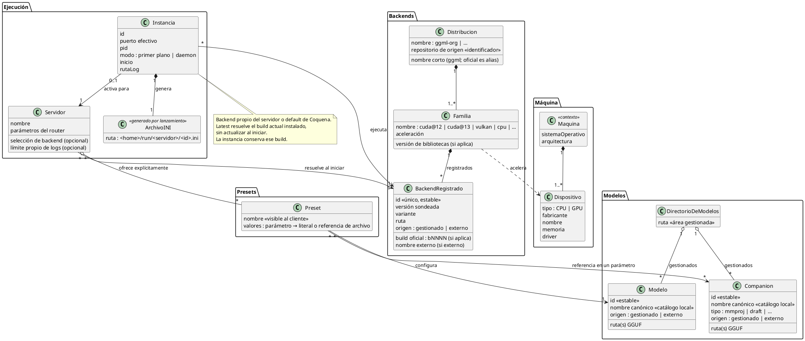
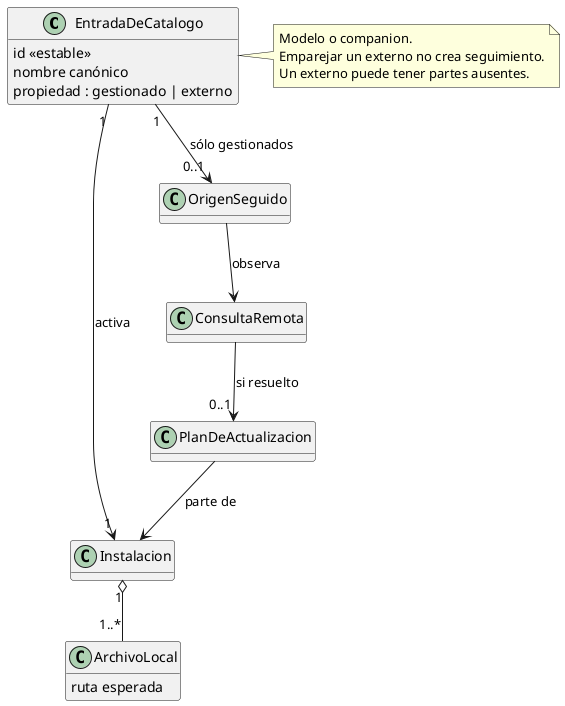
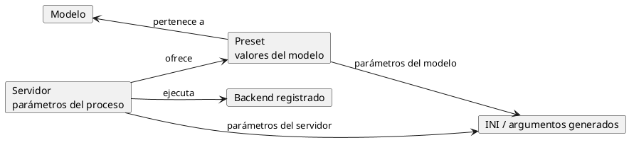

# Modelo de datos

Relaciones del dominio, sin fijar persistencia ni clases C#. Reglas de ejecución en [servidores.md](servidores.md); detalles pendientes allí.

Coquena tiene **su propio modelo interno**. Los archivos INI de `llama-server` no son
parte de él: se **generan** en cada lanzamiento, a partir de ese modelo, y duran lo que
dura la instancia — como los archivos que IntelliJ IDEA arma en su propia carpeta al
lanzar una aplicación para depurarla. Se guardan en el home de Coquena, nunca en la
carpeta temporal del sistema operativo.

Las reglas de pertenencia y asignación están en
[Presets](modelos-y-companions.md#presets).

## Catálogo y seguimiento: estructura conceptual propuesta

Los campos y significados se definen una sola vez en
[la guía técnica](implementacion-catalogo-modelos.md#2-datos-mínimos-y-significado).

## Parámetros del preset y del servidor

Las reglas de valores y referencias del preset están en
[modelos y companions](modelos-y-companions.md#presets); las del proceso y sus defaults,
en [servidores](servidores.md#parámetros-del-servidor). El
[catálogo de parámetros](catalogo-de-parametros.md) determina tipo y aplicabilidad.

## Aclaraciones

- **Servidor** reúne presets explícitos, backend propio o heredado y parámetros del router. Véase [servidores.md](servidores.md).
- **Propiedad de archivos.** Coquena descarga modelos al directorio gestionado y borra
  sus archivos al retirarlos; un registro externo sólo guarda rutas y nunca autoriza a
  mover o borrar esos archivos. La regla es la misma para backends. Un modelo puede ser
  un conjunto de shards, no una fila por archivo.
- **Backend externo.** La relación con `Familia` procede de la declaración del usuario;
  también se declara la distribución de origen (repositorio), que permite asociar el
  catálogo por origen y release. Omitirla equivale al origen oficial
  `https://github.com/ggml-org/llama.cpp`; un compilado de terceros debe indicar el suyo.
  La versión sondeada procede de `llama-server --version`; sólo los releases oficiales
  llevan necesariamente un build `bNNNN`. Ese sondeo no verifica la familia ni la
  compatibilidad de aceleración. Cada backend registrado recibe un ID único y estable;
  `familia + build` abrevia la selección de gestionados, no la del externo por nombre.
- **Instancias.** Cada lanzamiento tiene ID y puerto efectivos propios; el puerto del
  servidor es el guardado en su definición, sin sobrescrituras temporales al iniciar.
  Hay una instancia activa como máximo por servidor; cada una tiene INI propio.
  Un puerto ocupado impide iniciar y no se reasigna automáticamente.
- **Distribuciones de backends.** Sólo `ggml-org` es origen de descubrimiento y
  descarga de binarios. Hugging Face es el origen de modelos, no esta distribución.
  Un tercero puede aportar un binario, pero el usuario lo registra como
  externo y lo selecciona explícitamente. Agregar repositorios de terceros como
  orígenes de confianza queda para después. Identificarlos para asociar parámetros no
  implica consultarlos, descargar de ellos ni verificar la procedencia del binario.

## Render del INI

El render recibe la configuración efectiva y las rutas ya resueltas del catálogo.
No consulta la red. Se propone como función determinista: las mismas entradas producen
el mismo INI, usando claves canónicas sin guiones. Su implementación y pruebas deben
cubrir los valores de cada preset y servidor y la aplicabilidad al backend seleccionado.
