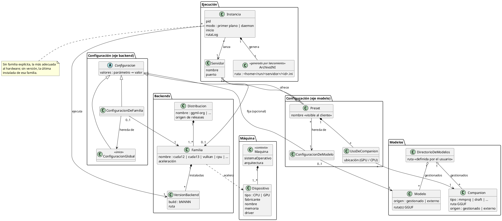

# Modelo de datos

Diagrama de clases del dominio del núcleo. No define persistencia ni tecnología.

Coquena tiene **su propio modelo interno**. Los archivos INI de `llama-server` no son
parte de él: se **generan** en cada lanzamiento, a partir de ese modelo, y duran lo que
dura la instancia — como los archivos que IntelliJ IDEA arma en su propia carpeta al
lanzar una aplicación para depurarla. Se guardan en el home de Coquena, nunca en la
carpeta temporal del sistema operativo.

## Dos ejes de herencia

La configuración se hereda por dos ejes que se encuentran en el INI generado:

- **Eje backend:** una configuración aplicable a cualquier backend, especializada por
  familia. Se vuelca en la sección `[*]`.
- **Eje modelo:** una configuración inicial del modelo, especializada en presets para un
  comportamiento concreto (rápido, contexto largo, con o sin companion). Cada preset se
  vuelca en su propia sección.
- **Precedencia (supuesto):** como `llama-server` hace que una sección de preset pise a
  `[*]`, el eje modelo gana sobre el eje backend cuando ambos definen el mismo parámetro.

## Aclaraciones

- **Servidor** es la composición que Coquena coordina: un puerto, opcionalmente una
  familia, y los
  presets que ofrece. Es lo que antes se escribía a mano en scripts lanzadores. El nombre
  retoma `data/servers/` de `legacy-go`; es provisorio.
- **Clonar** configuraciones y presets hacia otros modelos o familias es la forma de
  reutilizar un ajuste fino.
- **Modelos: nunca se copian.** Coquena descarga (iteración posterior) al directorio de
  modelos, y registra modelos externos por ruta, como SDKMan registra un JDK instalado a
  mano.
- **Distribuciones extensibles.** Además de `ggml-org`, un tercero puede incorporar sus
  familias.

## Arqueología (`legacy-go`)

- Presets en `config/model-presets.json`, renderizados a un INI por runtime. El render es
  una función pura: determinista, sin red, byte a byte idéntico ante las mismas entradas.
  Las claves se emiten con el nombre largo canónico, sin guiones.
- Nombre de preset = sección INI = identificador del modelo servido: minúsculas,
  segmentos separados por `-` o `.`; reservados `global` y `render`.
- Un preset podía declarar qué runtimes lo admiten (familia + rango de releases), y
  Coquena calculaba el rango mínimo según los parámetros usados (un parámetro aparece en
  cierto release). Era consultivo: no bloqueaba nada.
- Sin versión explícita se usa la última (`latest`), como `fnm install --lts`.
  (`openspec/specs/model-preset-persistence`, `llamacpp-runtime-artifact-management`)
