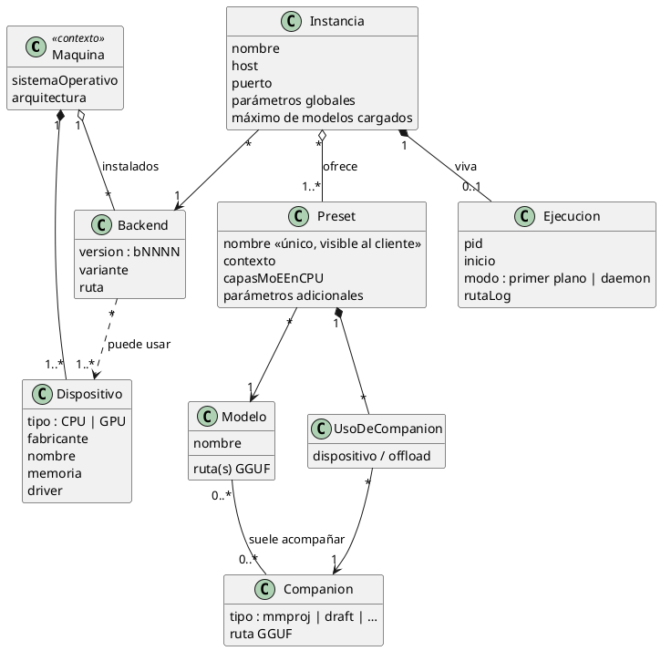

# Modelo de datos

Diagrama de clases del dominio del núcleo. No define persistencia ni tecnología.

## Aclaraciones

- **Varios presets por modelo.** Dos presets pueden apuntar al mismo GGUF: uno rápido
  (sin companion, más capas MoE en CPU, contexto corto) y otro completo (con companion,
  contexto largo). El cliente elige cuál pedir.
- **El companion tiene su propia ubicación.** Un proyector puede alojarse en CPU mientras
  el modelo principal va a la GPU; por eso la relación pasa por `UsoDeCompanion`.
- **Instancia ↔ backend.** Una instancia se ata a un backend concreto (versión + variante).
  Dos instancias con backends distintos pueden convivir si usan puertos y dispositivos
  distintos.
- **Ejecución separada de instancia.** La instancia es configuración durable; la ejecución
  es efímera (PID, logs). Así se distingue "definida pero detenida" de "corriendo".

## Pendiente de confirmar

- ¿Un preset puede pertenecer a varias instancias (reutilizable), o es propio de una?
  El diagrama asume lo primero.
