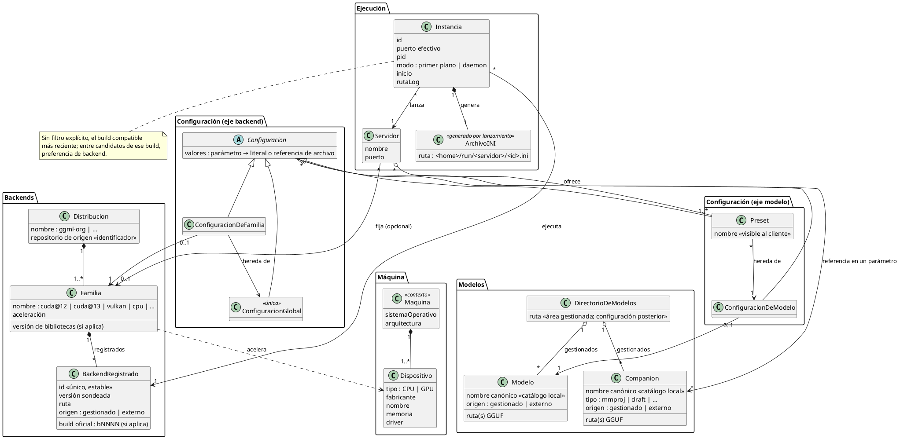
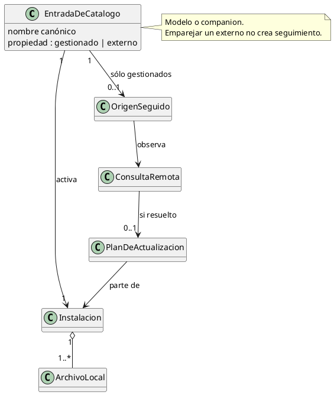
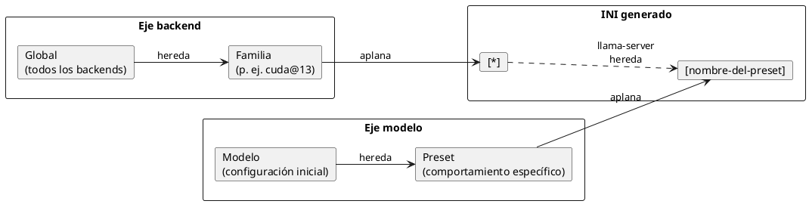

# Modelo de datos

Relaciones del dominio, sin fijar persistencia ni clases C#. Ejecución sigue en borrador.

Coquena tiene **su propio modelo interno**. Los archivos INI de `llama-server` no son
parte de él: se **generan** en cada lanzamiento, a partir de ese modelo, y duran lo que
dura la instancia — como los archivos que IntelliJ IDEA arma en su propia carpeta al
lanzar una aplicación para depurarla. Se guardan en el home de Coquena, nunca en la
carpeta temporal del sistema operativo.

La configuración de un modelo puede estar vacía. Antes de implementar presets debe
definirse cómo se representa o crea su raíz de herencia; la cardinalidad opcional no
autoriza a dejar un preset sin configuración efectiva.

## Catálogo y seguimiento: estructura conceptual propuesta

Los campos y significados se definen una sola vez en
[la guía técnica](implementacion-catalogo-modelos.md#2-datos-mínimos-y-significado).

## Dos ejes de herencia

La configuración se hereda por dos ejes que se encuentran en el INI generado:

- **Eje backend:** una configuración aplicable a cualquier backend, especializada por
  familia. Se vuelca en la sección `[*]`.
- **Eje modelo:** una configuración inicial del modelo, especializada en presets para un
  comportamiento concreto (rápido, contexto largo, con o sin companion). Cada preset se
  vuelca en su propia sección.
- **Precedencia:** el valor específico de un preset sustituye al mismo parámetro de
  `[*]`; la documentación actual da prioridad a los argumentos CLI sobre ambos.
  Coquena evita duplicar en CLI valores configurables por preset y verifica la regla
  para el release elegido. Coquena emite una sola
  clave canónica por parámetro y sección, tras aplanar cada eje. Los parámetros que
  admitan varios valores y los que sólo tengan sentido para el proceso router requieren
  verificación específica por versión antes de fijar su tratamiento.
  **No se presume herencia aditiva:** si un parámetro admite una lista, eso no demuestra
  que repetir su clave en dos ámbitos acumule elementos.
- **Eliminar un valor (`unset`):** quita sólo el par clave-valor propio del ámbito,
  sin modificar el padre ni bloquear su herencia. El valor heredado vuelve a regir;
  si no existe, no se emite la clave en esa sección del INI.
- **Companions:** se registran independientemente y se referencian mediante parámetros
  de configuración. El preset hereda o sobrescribe esas referencias; no existe una lista
  paralela de asociaciones. El render resuelve las referencias efectivas a rutas absolutas.
  La ubicación CPU/GPU se expresa con los parámetros correspondientes del backend.
  `config set <param> --ref <nombre>` guarda una referencia; el valor posicional es
  literal, incluso si coincide con un nombre registrado. Son alternativas excluyentes.
  La compatibilidad funcional del conjunto queda a cargo del backend; Coquena no
  necesita un modo forzado para configurar esas referencias.

## Aclaraciones

- **Servidor** es la composición que Coquena coordina: un puerto, opcionalmente una
  familia, y los
  presets que ofrece. Su diseño y sus comandos siguen pendientes de revisión.
- **Clonar** configuraciones y presets hacia otros modelos o familias es la forma de
  reutilizar un ajuste fino.
  En un preset se copian sólo sus valores propios, incluidas las referencias a companions,
  no los valores heredados ni los archivos. El clon hereda del modelo destino y no queda
  vinculado al preset origen; cambios posteriores de éste no se propagan al clon.
- **Propiedad de archivos.** Coquena descarga modelos al directorio gestionado y borra
  sus archivos al retirarlos; un registro externo sólo guarda rutas y nunca autoriza a
  mover o borrar esos archivos. La regla es la misma para backends. Un modelo puede ser
  un conjunto de shards, no una fila por archivo.
- **Backend externo.** La relación con `Familia` procede de la declaración del usuario;
  también se declara la distribución de origen (repositorio), que permite asociar el
  catálogo por origen y release. Omitirla equivale al origen oficial
  `https://github.com/ggml-org/llama.cpp`; un compilado de terceros debe indicar el suyo.
  La versión sondeada procede de `llama-server --version`; sólo los releases oficiales
  llevan necesariamente un build `bNNNN`. Ese sondeo no verifica la familia ni la
  compatibilidad de aceleración. Cada backend registrado recibe un ID único y estable;
  `familia + build` es sólo un atajo cuando resuelve a uno.
- **Instancias.** Cada lanzamiento tiene ID y puerto efectivos propios; el puerto del
  servidor es sólo el valor predeterminado. Dos instancias no comparten puerto ni INI.
- **Distribuciones de backends.** Sólo `ggml-org` es origen de descubrimiento y
  descarga de binarios. Hugging Face es el origen de modelos, no esta distribución.
  Un tercero puede aportar un binario, pero el usuario lo registra como
  externo y lo selecciona explícitamente. Agregar repositorios de terceros como
  orígenes de confianza queda para después. Identificarlos para asociar parámetros no
  implica consultarlos, descargar de ellos ni verificar la procedencia del binario.

## Render del INI

El render recibe la configuración efectiva y las rutas ya resueltas del catálogo.
No consulta la red. Se propone como función determinista: las mismas entradas producen
el mismo INI, usando claves canónicas sin guiones. Su implementación y pruebas deben
cubrir la herencia y las reglas del backend seleccionado.
