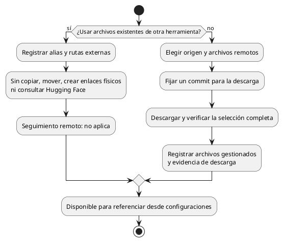

# Catálogo de modelos y companions

Registro, actualización e integridad. Los diagramas de disponibilidad están en [estados.md](estados.md).

La [guía de implementación](implementacion-catalogo-modelos.md) descompone estas reglas
en contratos, algoritmos, pruebas y entregas para agentes. Los mecanismos propuestos
allí no sustituyen las decisiones funcionales de este documento.

## Ejes independientes

| Eje | Pregunta | Comprobación |
|---|---|---|
| **Disponibilidad** | ¿Están presentes y son legibles los archivos necesarios? | Local, sin hash completo |
| **Seguimiento remoto** | ¿La selección instalada coincide con lo publicado en el origen seguido? | Metadatos remotos; no aplica a externos |
| **Integridad** | ¿Los bytes coinciden con la referencia local registrada? | Hash completo, explícito |

La propiedad (**gestionado o externo**) es un atributo del registro. Perder el
seguimiento remoto no vuelve inutilizable un modelo disponible; tampoco estar al día
demuestra integridad ni garantiza que el backend pueda cargarlo.

Un modelo ocupa uno o varios archivos GGUF. Sus shards forman una unidad para
registrar, actualizar, comprobar disponibilidad y eliminar. Un companion es una unidad
independiente y opcional: no se descarga por acompañar al modelo en el repositorio.
Coquena descarga sólo la selección solicitada y sus shards necesarios, no el repositorio
completo.

## Identificación en el catálogo local

Modelos y companions se seleccionan por **alias**, no por sus rutas ni por búsquedas
de nombres de archivos. El registro relaciona el alias con la unidad y sus archivos;
las configuraciones guardan referencias al registro y el INI recibe las rutas absolutas.

El alias puede declararse al incorporar el archivo. Si se omite, su nombre se usa como
alias inicial: sigue siendo un alias del catálogo, no un mecanismo alternativo de búsqueda.
Una colisión de alias se rechaza; no se sustituye otro registro por accidente.

El alias de catálogo no es el nombre del preset visible al cliente. Varios presets pueden
referenciar el mismo modelo o companion. Tampoco identifica una versión en Hugging Face:
el alias permanece estable al actualizar sus archivos.

## Disponibilidad, en el núcleo

- **Disponible:** la ruta existe, es legible, el encabezado GGUF se lee y, si es un
  conjunto de shards, están todos.
- **Incompleto:** faltan shards.
- **Inaccesible:** la ruta no existe o no se puede leer (disco desmontado, archivo
  movido, permisos).
- **Inválido:** el archivo existe pero no es un GGUF legible.

Ninguno de los cuatro exige calcular un hash completo. La integridad se comprueba de forma explícita y separada.

**Cambio detectado (aviso, no estado):** si el tamaño o la fecha de modificación difieren
de lo registrado, Coquena avisa y no bloquea. La consulta no actualiza el registro ni
afirma que los bytes sigan íntegros. El registro se actualiza sólo cuando el usuario
lo pide, con `model refresh`, que relee los metadatos necesarios y anota el tamaño y la
fecha actuales.

Es la misma separación que `git fetch` / `git pull` o `apt update` / `apt upgrade`:
observar y avisar es barato y automático; cambiar lo registrado es explícito. En la
iteración de la biblioteca el par se repite contra el repositorio remoto (`update`
observa, `upgrade` reemplaza bytes).

## Quitar un modelo o companion

`model remove` y `model companion remove` quitan la unidad correspondiente del registro.
Si Coquena descargó sus archivos y los
guarda en su área gestionada, **borra físicamente todos los archivos propios** e informa
cuántos bytes liberó. Si la unidad es externa, **no toca sus archivos** e informa que
permanecen en disco; así no afecta a LM Studio ni a otra herramienta que los gestione.
La misma regla de propiedad rige para backends. Los presets que referencian una unidad
retirada no se borran: pasan a **No servible** por *referencia rota*.

El catálogo usa un **índice central en el área de modelos gestionados**, no sidecars
por archivo o shard. El almacenamiento es propio de Coquena: no replica la estructura
de LM Studio. La ubicación exacta, el formato y la recuperación del índice, la propiedad
de archivos compartidos y las eliminaciones parciales quedan por resolver.

## Companions

Un companion tiene **exactamente los mismos estados** que un modelo. Lo propio del
companion no es su estado sino su relación con los modelos:

- **No depende de un modelo principal para estar disponible.** Un proyector sin su
  modelo instalado sigue disponible.
- **Registro:** `model companion add <ruta.gguf> [<alias>] --type <tipo>` no vincula el
  archivo a un modelo. Sin alias explícito se usa su nombre de archivo.
- **Retiro:** `model companion remove <alias>` resuelve el registro por ese alias.
- **Uso:** un parámetro de configuración referencia al companion registrado. El preset
  puede heredar esa referencia o sobrescribirla; Coquena la resuelve a una ruta absoluta
  en el INI. No hay una segunda lista de asociaciones en el preset.
- **Compatibilidad funcional:** queda a cargo del backend al cargar la combinación.
  Coquena no la certifica ni bloquea la configuración por esa causa. No hay un modo
  forzado: registrar y configurar los archivos basta para intentar utilizarlos.
- **Un companion puede servir a varios modelos**, y un modelo puede tener varios
  companions (proyector, borrador).

## Preset: servible o no

El estado que realmente importa al lanzar no es el del modelo sino el del **preset**, y se
deriva de la disponibilidad de sus archivos:

- **Servible:** su modelo y los companions referenciados por su configuración efectiva
  están disponibles. No garantiza que el backend consiga cargarlos.
- **No servible:** alguno no está disponible, o la referencia está rota porque se quitó
  del registro. Al iniciar, el preset se omite con aviso; el servidor arranca si queda al
  menos uno servible.

## Incorporación: externo o gestionado



Registrar un externo no requiere identificar su revisión remota ni calcular un hash
completo. Basta la referencia del catálogo a sus rutas: no necesita symlinks ni hardlinks.
Si otra herramienta mueve, elimina o reemplaza esos archivos, Coquena informa lo que
observa; no los repara, actualiza ni adopta automáticamente.

La búsqueda de equivalentes es **opcional y asistida**: nombre de archivo y metadatos
GGUF permiten proponer candidatos, no demostrar identidad de contenido ni revisión.
No se recorren exhaustivamente repositorios o historiales para reconstruir procedencia.
El usuario puede conservar el registro externo o elegir una descarga gestionada para
tener seguimiento; esa descarga deja intactos los archivos externos. El comando y la
ergonomía de esta búsqueda quedan pendientes.

## Seguimiento y actualización de gestionados

El registro conserva el repositorio, la referencia seguida (normalmente una rama como
`main`), la selección de archivos, el commit de descarga y, por archivo, rutas, tamaño
e identidad de contenido con su tipo. Conserva por separado el resultado y momento de
la última consulta y la revisión candidata. No confunde revisión instalada con consultada.

Se sigue el repositorio que publica los archivos seleccionados: actualizar el modelo
original no implica que un tercero haya regenerado su GGUF. El alias local no cambia
al actualizar los pesos.

```plantuml
@startuml
start
:model update;
if (¿Registro externo?) then (sí)
  :Informar que el seguimiento no aplica;
  stop
endif
:Resolver referencia a un commit concreto;
:Consultar inventario y metadatos remotos;
no descargar pesos ni clonar el repositorio;
:Comparar con el inventario registrado;
if (¿Correspondencia suficiente?) then (no)
  :Guardar diagnóstico y candidatos;
requiere intervención;
else (sí)
  :Guardar resultado:
sin cambios o actualización disponible;
endif
:Conservar intacta la instalación;
stop
@enduml
```

### Reglas de correspondencia

| Observación | Resultado |
|---|---|
| Misma ruta y contenido | Sin cambios |
| Misma ruta, contenido diferente | Actualización disponible |
| Ruta desaparecida y una única coincidencia exacta de contenido en otra | Reubicación identificada, sin volver a descargar |
| Varias ubicaciones posibles | Pedir cuál seguir |
| Ruta desaparecida y candidatos con contenido diferente | Proponer candidatos, sin afirmar sucesión |

Nombre, tamaño similar o eliminación y alta en el mismo commit son pistas, no pruebas.
No se cambia automáticamente de cuantización. En un modelo dividido se resuelve el
conjunto completo; no basta identificar un shard. La historia remota sólo se consulta
de forma acotada cuando aporte evidencia útil: el flujo normal compara inventarios.

`model update [alias]` consulta y guarda novedades; no cambia pesos ni su revisión de
descarga. Puede registrar una reubicación inequívoca sin alterar las rutas locales.
Un externo explícito informa que no aplica. El alcance sin alias queda por precisar.

Una consulta fallida significa **no se pudo comprobar**; una correspondencia ambigua,
**requiere intervención**. Ninguna equivale a «actualizado» ni necesariamente a
«desactualizado». Se conserva la última observación con su fecha, sin presentarla como
una comprobación actual.

`model upgrade [alias]` aplica la revisión concreta detectada por `update`, no una
revisión nueva elegida silenciosamente. Reutiliza archivos sin cambios, descarga los
nuevos o modificados y verifica el conjunto antes de activarlo. Si falla, conserva la
instalación anterior; nunca publica una mezcla de shards de revisiones distintas.
Los casos que requieren intervención se informan sin sustituir sus archivos.
El alcance sin alias queda por precisar.

La reutilización por archivo es el criterio inicial. La transferencia diferencial por
bloques es una optimización posterior, no un requisito para detectar actualizaciones.
Quedan pendientes las reglas de aplicación con modelos en uso, para la revisión de
servidores e instanciación.

## Integridad local

Al descargar se calcula y registra evidencia de integridad y se contrasta con la
identidad de contenido remoto cuando sea comparable. La comprobación posterior lee los
archivos completos y compara contra esa referencia. Registra el resultado y su fecha:
no certifica indefinidamente que el disco sigue intacto.

Una discrepancia se informa **sin sustituir el hash de referencia por el del archivo
alterado**. `refresh` no restablece esa referencia ni declara integridad.

En externos, establecer una referencia de integridad es opcional y explícito. Sólo
permite afirmar después «no cambió desde aquella lectura», no que la descarga original
fuera correcta o coincidiera con Hugging Face. No es requisito para registrarlos.

Seguimiento remoto e integridad tienen propósitos distintos, pero pueden compartir
algoritmo cuando corresponda. No se inventa un hash corto ni se confunden commit,
identificador Git, ETag y hash de los bytes. La elección técnica y la superficie del
comando de verificación quedan pendientes.

## Límites del catálogo

- No reconstruir obligatoriamente la procedencia de externos ni recorrer historiales exhaustivos.
- No escribir sidecars por archivo o shard.
- No descargar ni reconciliar companions automáticamente.
- No deducir cambios de pesos solamente de un commit distinto.
- No mezclar seguimiento remoto, integridad y disponibilidad en un estado único.

La incorporación externa y la búsqueda asistida son independientes.
El [administrador de descargas](descargas.md) especifica transferencias, seguimiento
por archivo, pausa, reanudación, cancelación y recuperación.
## Referencias técnicas

- [Hugging Face: inventarios y metadatos por revisión](https://huggingface.co/docs/huggingface_hub/package_reference/hf_api#huggingface_hub.HfApi.list_repo_tree).
- [Hugging Face: revisión, ETag y metadatos de descarga](https://huggingface.co/docs/huggingface_hub/package_reference/file_download).
- [GGUF: metadatos y referencias de origen](https://github.com/ggml-org/ggml/blob/master/docs/gguf.md).
