# Secuencias del catálogo y las descargas

Contratos de interacción para implementar en C#. Los participantes representan
responsabilidades, no proyectos, interfaces ni servicios de red obligatorios.
Complementan [modelos y companions](modelos-y-companions.md),
[descargas](descargas.md) y la [guía técnica](implementacion-catalogo-modelos.md).
La estructura JSON acordada está en la guía técnica. Estos diagramas no eligen los
mecanismos de exclusión o recuperación ni cierran la gramática marcada como pendiente.

## Correspondencia entre reglas y secuencias

| Secuencia | Reglas aplicadas |
|---|---|
| 1. Alta externa | Intento de emparejamiento, `--try-match`, persistencia local; no inicia descarga ni seguimiento de externos |
| 2. Descarga inicial | Cuantización opcional, menú único, README a pedido, cancelar sin trabajo; inicio en primer plano, GUID y Ctrl+C conservador |
| 3. Update | Sólo metadatos y plan; sin menú de adquisición, descarga ni GUID de transferencia |
| 4. Upgrade | Plan ya seleccionado; no repite selección de cuantización; transferencia en primer plano, GUID y Ctrl+C conservador |
| 5. Backend | Selección propia de hardware/release; sin menú de cuantizaciones ni README de modelos; transferencia en primer plano y reanudable |
| 6. Pausa y reanudación | Procedimiento común de descarga; conserva GUID, parciales y selección; no repite búsqueda ni menú |
| 7. Integridad | Lectura local y resultado persistido; --set-baseline sólo establece base explícita en externos; sin red |
| Reinicio | Definición actual, latest instalado, servidor activo o detenido; devuelve prompt sin seguir logs |
| Puertos | Asignación al crear/unset por máximo + 1; no reasignación al iniciar |

El menú de adquisición pertenece a la secuencia 2; no se propaga a operaciones que ya
tienen selección fijada. Las cajas de catálogo, operaciones e índice representan
persistencia local en disco, no almacenamiento de Hugging Face ni una base de datos
obligatoria. Operaciones activas/recuperables y catálogo instalado son datos distintos.
Al terminar y limpiar, la operación se elimina; sólo queda su resultado en el log.

## 1. Registrar un externo e intentar emparejarlo

Los archivos GGUF externos y el catálogo son dos almacenamientos locales distintos:
los primeros contienen los pesos; el segundo persiste nombre canónico, rutas y metadatos propios
de Coquena, sin copiar pesos. Sólo Hugging Face está en Internet.

El nombre es obligatorio; el intento remoto es opcional:
`model add <ruta.gguf> --name <usuario/repositorio:cuantización> [--try-match]`.

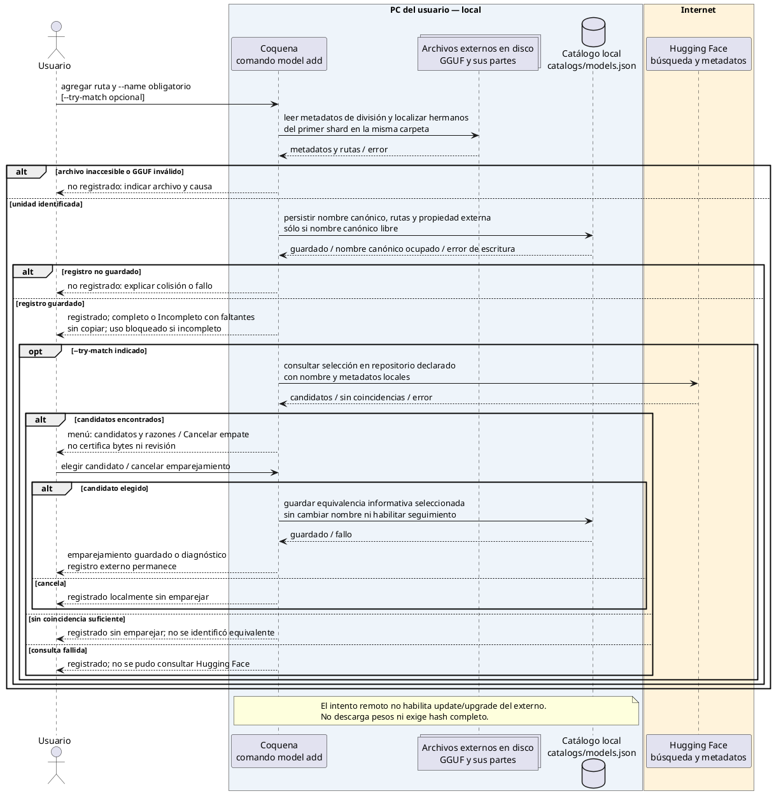

Sin `--try-match`, no se consulta la red. El nombre declarado no prueba procedencia.
Un intento fallido o cancelar el menú no revierte el registro. La elección explícita
guarda equivalencia informativa, no certificación de procedencia ni revisión.
Configurar un preset y generar el INI son operaciones separadas de este diagrama.

Aplicar la agrupación de [shards](modelos-y-companions.md#modelos-divididos-en-shards).
El registro conserva todas las partes esperadas, incluso ausentes; informa Incompleto
y bloquea su uso. No presenta el primer shard como un modelo completo.

## 2. Descargar un modelo desde Hugging Face

Esta secuencia es la adquisición inicial, no `upgrade` ni el alta de un archivo externo.
Entrada: `usuario/repositorio[:cuantización]`, sin alias ni nombre adicional.
El menú determina la cuantización omitida y, con ella, el nombre canónico.

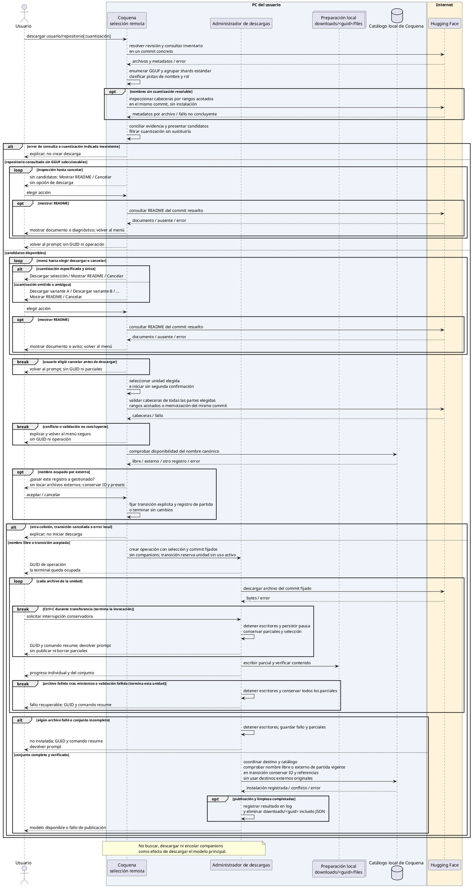

La cuantización identifica candidatos, no necesariamente un archivo único. Las opciones
del menú deben identificar las variantes inequívocamente y declarar que elegirlas inicia
una descarga. Mostrar README no modifica la selección y vuelve al menú. Sin candidatos
no hay opción de descarga: sólo mostrar README o cancelar, sin crear operación.
Aplicar la agrupación de shards documentada; conjuntos remotos incompletos no son descargables
como instalaciones completas.
La publicación usa el protocolo recuperable de la guía técnica: una
colisión tardía no autoriza a sobrescribir otro registro.

### Descarga del companion: otra invocación

El usuario ejecutará `model companion download usuario/repositorio#tipo[:cuantización]`
por separado, cuando lo necesite, usando el mismo flujo de selección y descarga
de la secuencia 2, limitado al tipo auxiliar indicado.
Ese comando creará una unidad registrada independiente, reutilizable mediante referencias
de configuración. No requerirá repetir la descarga del principal ni lo vinculará a un
preset. No promete compatibilidad funcional; las secuencias de update, upgrade e
integridad se aplican igualmente a esta unidad auxiliar.

## 3. Consultar novedades sin descargar pesos

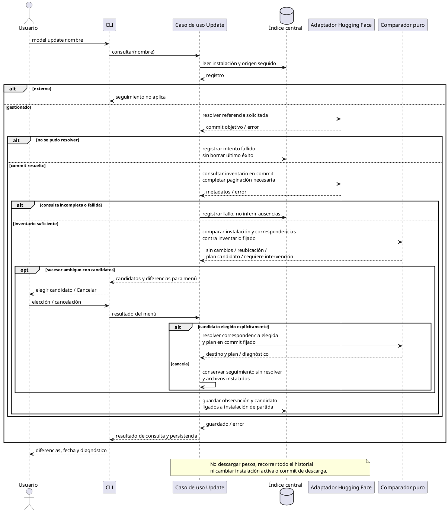

El comparador aplica las reglas de correspondencia documentadas, no heurísticas nuevas.
Una reubicación exacta puede cambiar el seguimiento, no la ruta física instalada.
El movimiento físico y cambio de nombre canónico se aplican en upgrade, no en update.
Esto incluye espacios de nombres elegidos mediante candidatos: upgrade renombra
carpetas y archivos gestionados, conservando IDs y referencias. Sin origen ni candidatos
no hay plan aplicable; no se bloquea por ello la disponibilidad local.
Sin nombre, repetir la consulta por cada gestionado, incluidos companions; su subcomando
limita el conjunto a companions. Un fallo no impide consultar las demás unidades.
Si no se guarda el candidato, no se presenta como un plan durable listo para aplicar.

## 4. Preparar y publicar una actualización de modelo

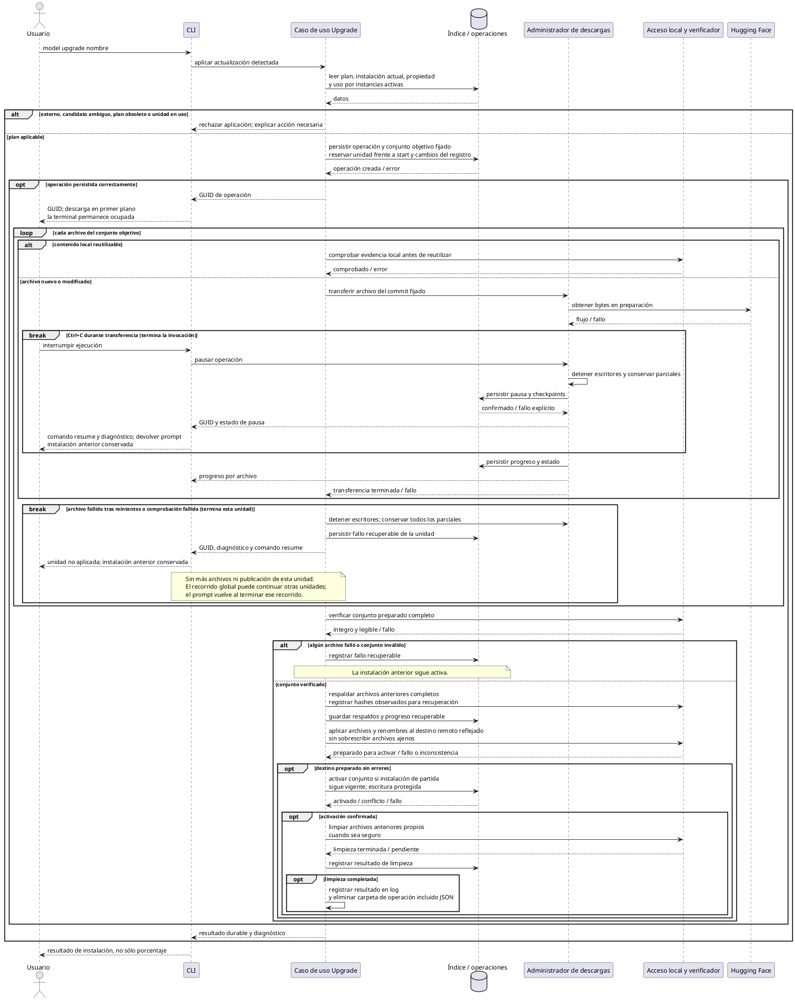

El orden del bucle es ilustrativo, no prescribe paralelismo. Agotados los reintentos
de un archivo, detener la operación de esa unidad y sus escritores, conservar todos
sus parciales y devolver el prompt con GUID y diagnóstico. No continuar transfiriendo
otros archivos de esa unidad ni publicar el conjunto. En un recorrido global pueden
seguir tratándose otras unidades independientes; el prompt vuelve al terminar ese recorrido.
La descarga
inicial usa selección fijada sin instalación anterior; nunca publica una unidad parcial.
El mecanismo de activación y limpieza respeta la propiedad de archivos acordada y
excluye inicios mientras aplica un upgrade; pesos en uso se rechazan antes de descargar.
Si el movimiento físico falla,
no activar el catálogo; diagnosticar cualquier inconsistencia sin reparación destructiva.
Sin nombre, aplicar secuencialmente planes resueltos de las unidades seleccionadas;
no hay transacción global ni cambio silencioso de revisión.

## 5. Instalar un backend desde una selección concreta

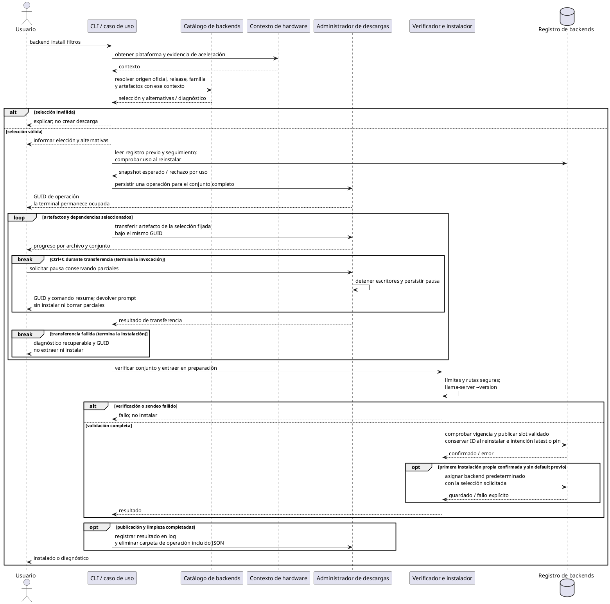

La selección sigue las convenciones de comandos: release y versión de bibliotecas son
independientes; explícito y automático tienen reglas distintas de compatibilidad.
Transferencias fallidas impiden instalar; el sondeo no certifica toda inferencia futura.
La reinstalación forzada sigue la regla canónica de [servidores.md](servidores.md):
no reutiliza los bytes instalados como sustituto de una descarga nueva.
No se calcula ni verifica SHA-256 para backends. Backend upgrade reutiliza la transferencia
y publicación con el build fijado por update; no resuelve latest nuevamente. Tras éxito,
actualiza el seguimiento y aplica retención sin borrar builds protegidos. No actualiza externos.

### Aplicar el candidato guardado de backend

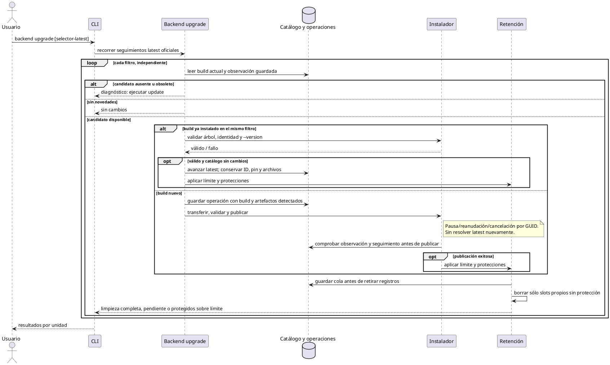

### Consultar novedades de backends

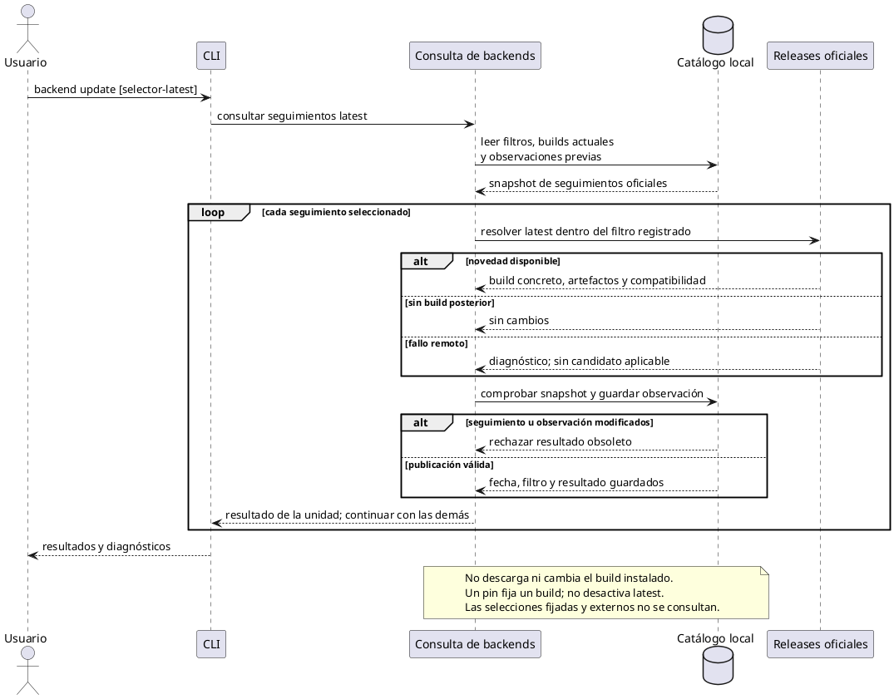

Las condiciones y efectos de la consulta se definen en
[servidores.md](servidores.md#definición-persistida).

## 6. Pausar, recuperar y reanudar una transferencia

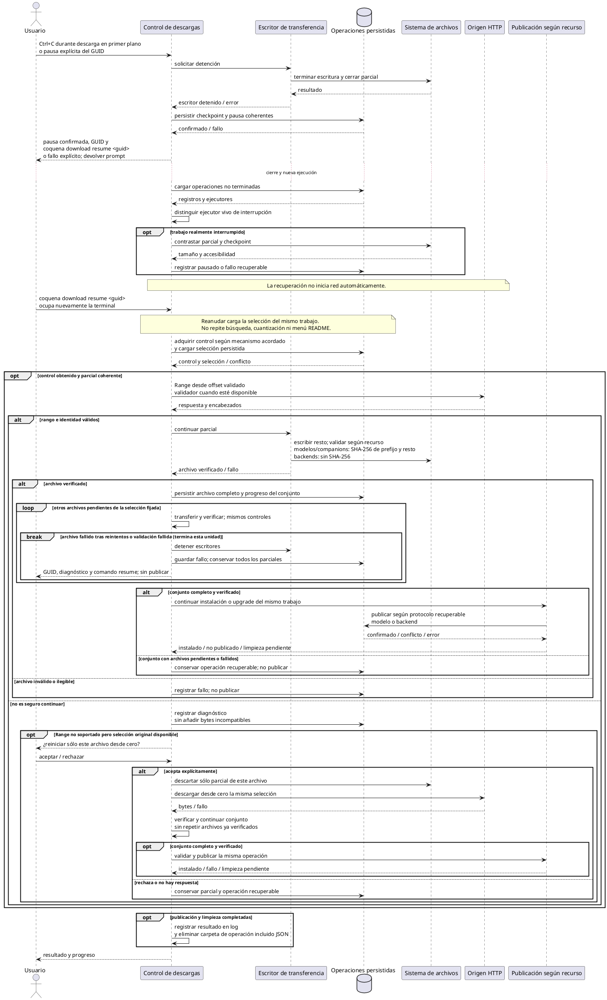

Si Range no permite continuar, conservar el parcial y preguntar antes de reiniciar
ese archivo desde cero, con el mismo GUID y selección. No repetir archivos completos
y verificados. Rechazar o no poder preguntar conserva el trabajo sin reinicio automático.
El GUID identifica la operación tanto de modelos como de backends. Ctrl+C conserva
los parciales: no equivale al comando `cancel`. La descarga activa y su reanudación
permanecen en primer plano; no devuelven el prompt mientras siguen transfiriendo.
Cancelar sigue la misma detención y espera del escritor, pero luego elimina únicamente
sus parciales y registra cualquier limpieza pendiente; no toca instalaciones publicadas.
La continuación ejecuta el protocolo de modelo/upgrade (secuencias 2 y 4) o backend
(secuencia 5), sin una segunda selección. Recuperar los bytes no basta para completar
una operación: resume también debe terminar su validación y publicación.

## 7. Verificación local de integridad

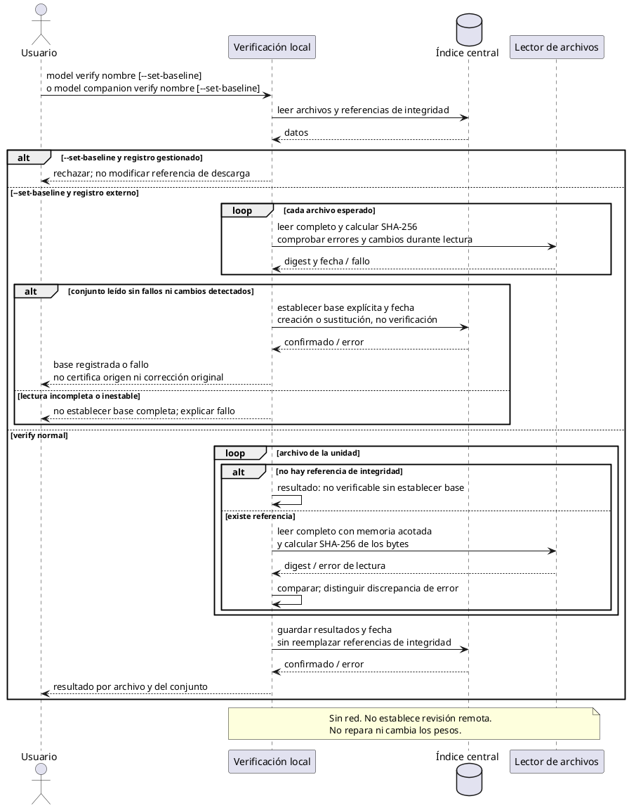

## Validación de las secuencias

Traducir ramas alternativas a pruebas: colisión de nombre, consulta remota incompleta,
plan obsoleto, fallo al persistir, shard fallido, extracción inválida, ejecutor aún vivo,
Range incompatible y discrepancia de integridad. Los diagramas no prueban código ni
resuelven por sí solos la atomicidad del índice y el sistema de archivos.

## Reiniciar un servidor

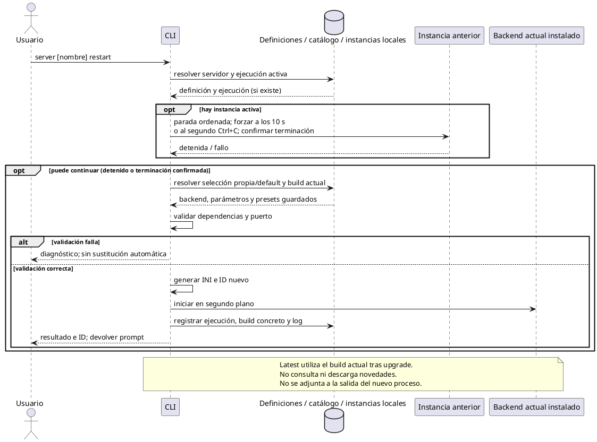

Los mecanismos de detección de salud y exclusión se prueban al implementar;
la política de parada y las reglas de recuperación se mantienen en servidores.md.

## Crear o reasignar el puerto de un servidor

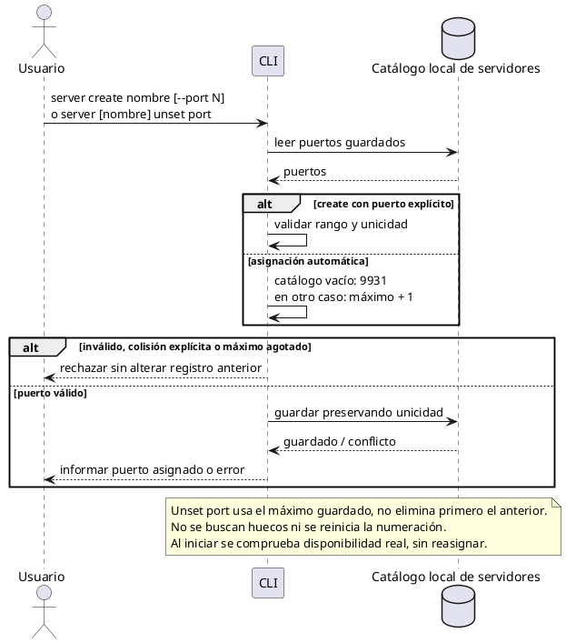
