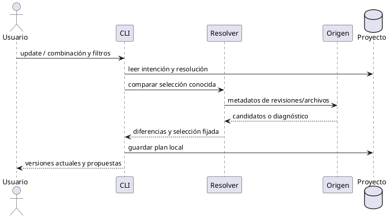
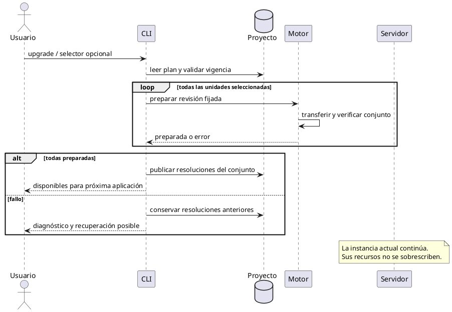
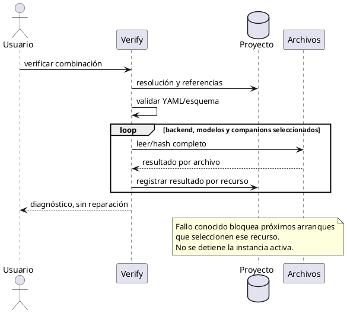
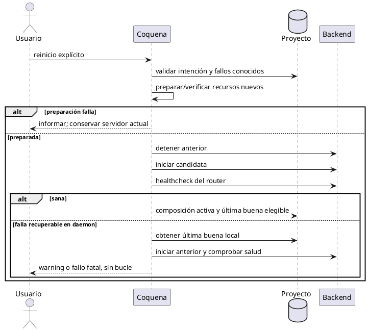
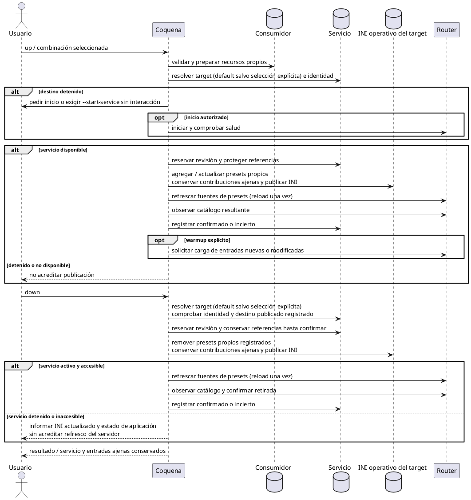

# Secuencias del proyecto y las descargas

## Correspondencia entre reglas y secuencias

Estas secuencias ilustran contratos de [descargas](descargas.md),
[actualización](actualizacion-y-limpieza.md) y [servidores](servidores.md).
No fijan clases ni una API común para todos los forks.

## 1. Registrar un externo e intentar emparejarlo

Seleccionar proyecto y registrar rutas/metadatos locales antes del intento optativo
--try-match. Si el usuario copió archivos al proyecto, registrar esa copia, no la
ubicación de la herramienta de origen. No transferir pesos para completar el alta.
Un fallo o cancelación del matching conserva el alta y la propiedad externa.
Elegir candidato registra una equivalencia informativa, sin certificar bytes.

## 2. Descargar un modelo desde Hugging Face

Resolver commit, consultar inventario y candidatos con lecturas acotadas;
ofrecer README/selección/cancelación antes de crear GUID.
Después transferir selección completa, verificar y publicar inventario.

### Descarga del companion: otra invocación

La descarga explícita del principal no añade companions implícitos.
Cuando se prepara YAML, sus companions declarados sí forman parte de los recursos
necesarios y se coordinan junto al resto del conjunto.

## 3. Consultar novedades sin descargar pesos

## 4. Preparar y publicar una actualización de modelo

## 5. Instalar un backend desde una selección concreta

Preparar artefactos y validar antes de publicar, conservando archivos activos.
No sustituir variante al diagnosticar incompatibilidad de hardware.

### Aplicar el candidato guardado de backend

Consume el plan fijado, como modelos. No modifica intención YAML.
Cambiar el ejecutable activo requiere reinicio explícito.

### Consultar novedades de backends

Update compara el origen/variante de la combinación seleccionada;
no infiere que CUDA y Vulkan sean reemplazos intercambiables.

## 6. Pausar, recuperar y reanudar una transferencia

Persistir selección/checkpoints; interrumpir escritores; conservar parciales.
Al reanudar, verificar ejecutor, tamaño y continuidad HTTP antes de anexar bytes.
No mezclar respuestas 200 con un parcial ni publicar sin integridad completa.

## 7. Verificación local de integridad

## Validación de las secuencias

La evidencia debe cubrir interrupciones entre fases, escrituras concurrentes y
fallos de verificación sin pérdida de la revisión anterior. Los diagramas válidos
no acreditan por sí mismos un protocolo de publicación recuperable.

## Reiniciar un servidor

## Crear o reasignar el puerto de un servidor

Guardar puerto modifica intención. Comprobar colisión al iniciar, sin asignación
automática alternativa ni prohibición de repetirlo en proyectos detenidos.

## Aplicar presets y observar carga

Publicar definición en el router compatible y cargar memoria son dos resultados.
El adaptador debe observar eventos antes de disparar cuando sea posible, confirmar
estado final y reconciliar al reconectar. No mantener polling global desde Coquena
después de terminar el comando.

No asumir transacción nativa de apply ni confundir HTTP exitoso con modelo cargado.
La recuperación ante fallo individual tardío se concreta con evidencia del build.

## Publicar y retirar una receta consumidora

Up y down modifican el mismo INI operativo del servicio target gestionado por
Coquena: up agrega o actualiza los presets del consumidor; down los remueve.
Después ambos solicitan al servidor en funcionamiento refrescar sus fuentes de
presets. Target es default salvo selección explícita. La retirada comprueba además
el destino registrado de la publicación, para no actuar sobre otro servicio si
cambió el alias o se editó la receta.

La reserva de publicación evita superponer escritores pero no retiene un bloqueo
de archivo durante HTTP. Si reload queda incierto, se conserva operación y recursos
hasta reconciliar. El protocolo se concreta en [persistencia](persistencia-proyectos.md).
