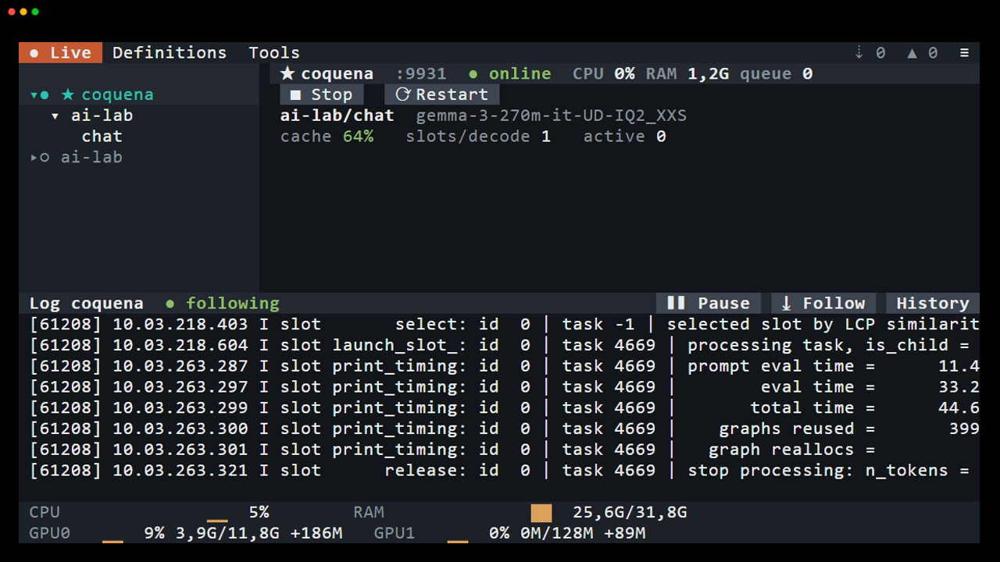
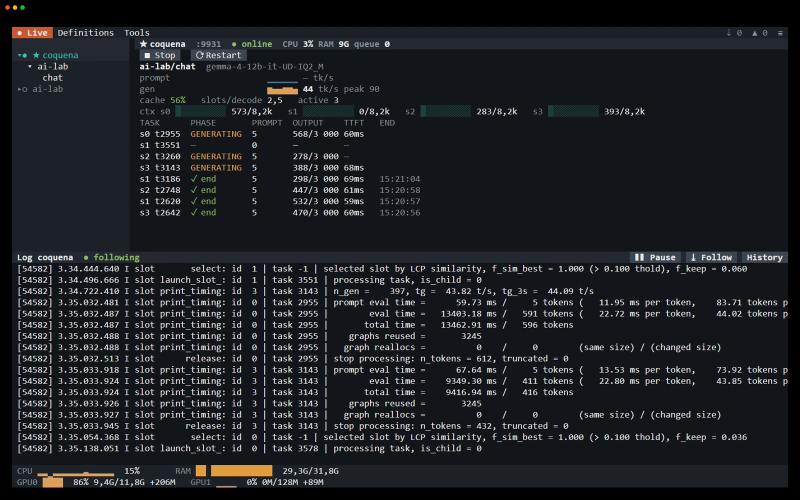
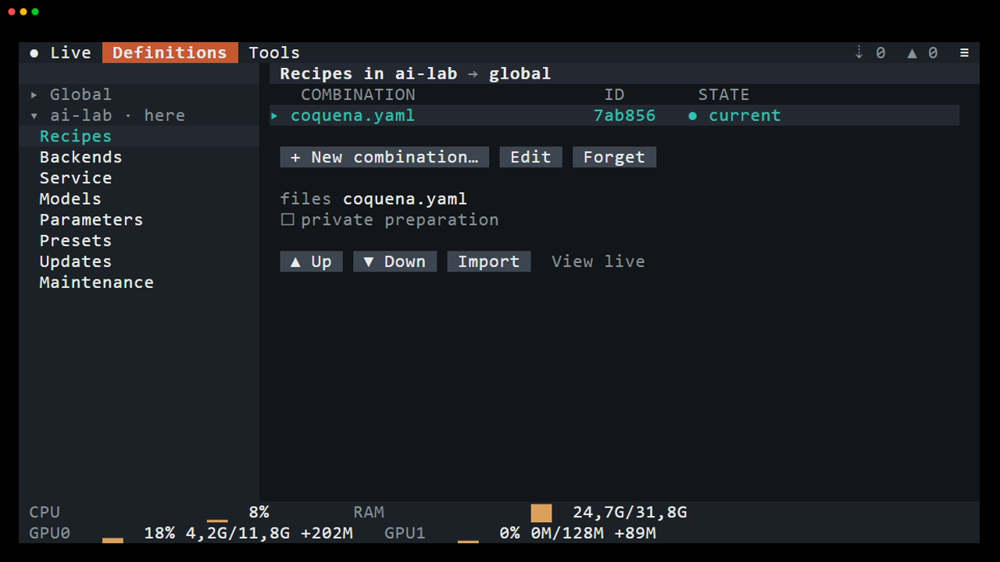

# Terminal interface

`coquena tui` opens a full-screen interface to watch and manage your whole lab in one
place. The [CLI](cli-reference.md) answers one question or runs one operation and
returns, which suits scripts and quick checks. The terminal interface stays open and
keeps everything in view while it changes:

- **All at once:** every service, project, and published preset in one tree, with the
  state of each, instead of one `ps` or `logs` per service.
- **Over time:** request rates, cache, context per slot, and hardware use as charts that
  build up while you watch, so you can see a load or a slowdown as it happens.
- **While you act:** start a service, load a preset, or chat with it, and see the
  effect, the logs, and the GPU memory in the same screen.
- **Without remembering commands:** browse recipes, models, parameters, and presets,
  edit them with validation as you type, and run updates or cleanup from the same place.

It works in any terminal, including over SSH on a remote server, and uses the same
operations as the CLI: what you do in one is visible in the other.

```powershell
coquena tui
```

It opens on the project of the folder you run it in. Closing the interface does not stop services. Press Esc on a tab to
close it; if an operation is still running, Coquena asks first.

## Layout

The top bar holds the tabs. The two bottom rows always show the hardware: CPU, RAM,
and the use, dedicated memory, and shared memory of each GPU. Select them to open the
hardware view.

| Tab | Shows |
| --- | --- |
| ● Live | Services, their projects, and published presets, with activity, tasks, and logs. ● means some service is running; ○ means none is. |
| Definitions | The global scope and every known project, with everything their recipes define. |
| Tools | Chat with a published preset. |
| ⇣ | Downloads, with their progress. |
| ▲ | Notifications, with the number of unread ones. |
| ≡ | Configuration. |

Each tab keeps its place, selection, and scroll when you come back to it. Long
operations, such as Up, downloads, or updates, keep running while you move to another
view; a spinner shows that something is in progress, and the button that started it
stays disabled until it finishes.

The interface is designed for 80×24 and larger. In a bigger terminal, logs, charts,
tables, and the editor take the extra space.

## Live

The tree on the left lists each service, the projects that publish to it, and their
presets. ● marks a running service or a loaded preset; ○ one that is stopped or not
loaded.



**A service** shows its port, state, health, process CPU and RAM, and request queue,
with **Start**, **Stop**, and **Restart**.

**A project** offers **Up** and **Down** for its recipe.

**A preset** shows, with charts over time:

- prompt and generation rates, with their peak;
- cache hits and speculative decoding acceptance;
- context used in each slot;
- the tasks in progress and recently finished, with their phase, prompt, and output.



A preset marked `≠ recipe` is published with values that differ from what its recipe
says now; run Up to publish the recipe again. A focused preset also offers:

| Action | Does |
| --- | --- |
| Chat | Opens Tools › Chat with that preset |
| Load / Unload | Same as [`load` and `unload`](try-presets.md#load-and-unload) |
| Withdraw | Same as `withdraw`, for the project that defines the preset |

Select a task to see its last observed values.

### Service log

The log of the selected service sits below the tree:

- Scrolling up pauses following; scrolling back to the end resumes it.
- ←/→, the horizontal wheel, or Shift+wheel move sideways through long lines.
- **Pause** keeps the view still until **Resume**; **Follow** jumps to the newest lines.
- **History** opens older log files, one at a time with **Previous** and **Next**, and
  filters their lines with a regular expression.

By default the log hides the health requests Coquena itself sends to the service.
You can show them in Configuration › TUI.

The charts read each service every 2 seconds by default. To change that, see
[Observation interval](configuration.md#observation-interval).

## Tools › Chat

Chat sends messages to a published preset and shows, for each response, the prompt and
generation rates, cache use, and speculative acceptance. It is the same chat as
[`coquena chat`](try-presets.md).

- Choose the target with **Service › preset**. It shows whether the model is loaded; if
  the service is stopped, the interface offers to start it.
- Type the message and press **Send**; **Stop** interrupts a response.
- **New session** clears the conversation.
- **Go to the definition** opens the presets of the scope that defines that preset.

Tab and Shift+Tab move out of the message box.

## Definitions

The tree lists the global scope and every project Coquena knows, with only the focused
one expanded. Each view edits what the CLI edits, and opens on its own: there is no
wizard.

| View | In a project | In Global |
| --- | --- | --- |
| Recipes | ✓ | |
| Backends | ✓ | ✓ |
| Service / Services | the project's own service | the global services |
| Models | ✓ | ✓ |
| Parameters | ✓ | ✓ |
| Presets | ✓ | ✓ |
| Updates | ✓ | ✓ |
| Maintenance | ✓ | ✓ |

A project folder without `coquena.yaml` offers **Initialize**, like `coquena init`.

### Recipes and combinations

A combination is a recipe file with the overrides you pass with `-f`, such as
`coquena.yaml + gpu`. Recipes lists the combinations you have used in that project,
with their state: **current** for the one in use, **known** for the others, **private**
for one prepared privately, and **unregistered** for one not used yet.



- **+ New combination…** puts YAML files in order and adds `.env` files.
- **Edit** opens the combination in the editor; **Forget** removes it from the list
  without touching a running service or withdrawing presets.
- **Up** and **Down** run on the selected combination, with progress and the result
  of the last run below. If the target service is busy, Coquena asks first.
- **Import** copies definitions from the combination into the global scope, choosing
  what to keep or replace.
- **+ Backend** picks the backend the project's service uses.

In a project, Service, Presets, Parameters, and Updates show the combination in use in
a selector at the top right. Choosing one there or in Recipes changes both. In Global,
the selector lists the recipes you imported, plus «All intentions».

### Presets, parameters, and service

These views show the value of each argument and which file of the combination it comes
from, numbered as layers (`¹`, `²`). For presets, the table also compares the published
value with what the recipe says now.

- **Presets:** **Clone…** copies a preset under a new name so you can change it and
  compare; **Edit YAML**, **Remove definition**, **Apply**, **Withdraw**, and **View live**.
- **Parameters:** **Filter**, **Define…** a new parameter, and **Remove definition**,
  with its type, scope, default, aliases, and where it is used.
- **Services** (Global): **+ Add** a global service with its name, backend, and process
  arguments, mark one as **★ Default**, start, stop, or remove it.

### Models and backends

- **Models** lists the inventory with its size, source, and which presets use each
  model. **Filter** narrows it down; switch to **Hugging Face** to search GGUF
  repositories, choose a variant, and **Download** it. **+ Add local…** registers a
  GGUF file you already have.
- **Backends** lists the installed llama.cpp variants and their compatibility with
  this machine, and adds new ones.
- **Protect** keeps a resource from being removed by cleanup; **Remove protection**
  undoes it.

### Updates and maintenance

- **Updates:** **Check** queries new versions, as `coquena update` does; **Update**
  applies the plan, as `coquena upgrade` does, and shows its effect on running services.
- **Maintenance:** **Verify** checks references or the whole inventory, as
  `coquena verify` does; **Clean** frees what no project needs, as `coquena prune` does;
  **Forget** removes projects you no longer use from the list.

### Editor

**Edit YAML** opens the files of a combination in tabs, with line numbers and YAML
highlighting. It validates as you type, with the same checks as `coquena verify`, and
lists every problem it can locate; select one to jump to its line.

**Save**, **Validate**, **Up**, **Down**, **Copy**, **Cut**, **Paste**, and **Close**
sit above the text. If a file changed on disk while you edited it, Coquena asks whether
to keep your version or reload it. Actions that copy or change the recipe, such as
Clone, first require a valid combination.

## Downloads

The ⇣ tab lists the downloads of the global scope and of the current project, grouped
by scope and kind, with their progress. A download can be paused, resumed, retried, or
cancelled. Cancelling deletes what was downloaded, so it asks first; **Keep download**
leaves it as it was.

## Notifications

The ▲ tab collects what happened during the session: a service that changed state, an
operation that finished or failed. Select one to see its details or go to the service
it refers to; **Mark as read** clears the counter.

## Hardware

Select the bottom bar to open the hardware view: CPU, RAM, and each GPU with its use,
dedicated memory, and shared memory, as charts with their peak and mean.

## Configuration

| Category | Contains |
| --- | --- |
| Coquena | Language, storage folders, observation, log retention, and a reset of the global parameter catalog, as in `coquena config` |
| TUI | Log filtering and the resources shown in the bottom bar |
| System | Hardware and accelerators, as in `coquena system probe`, and the Coquena version |

The catalog reset can be simulated first to see what it would change. A new language
takes effect the next time you open the interface.
